# Lab 02 – VPC Exercises Report

## Exercise 1 – Basic: Create a Third Public Subnet

### Objective

The objective of this exercise was to create a third public subnet in the existing `usms-vpc`.

### Implementation

A new subnet named `usms-public-subnet-c` was created with:

* **Availability Zone:** `us-east-1c`
* **CIDR:** `10.0.5.0/24`
* **Route Table:** `usms-public-rt`
* **Public IPv4:** Enabled
* **VPC:** `usms-vpc`

The subnet was tagged during creation using `--tag-specifications`. Its subnet ID was captured using the AWS CLI `--query` option.

### Verification

The subnet was verified using `describe-subnets`. The output confirmed that the subnet exists in `us-east-1c` with the expected CIDR and name.

The route-table association was also checked to confirm that `usms-public-subnet-c` is associated with `usms-public-rt`.

### Evidence

1. Creation of `usms-public-subnet-c`

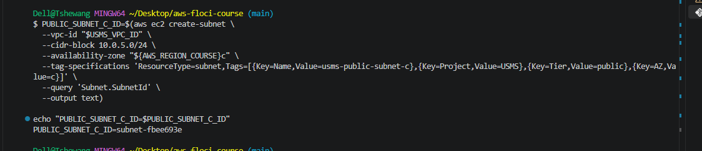


2. Public subnet verification
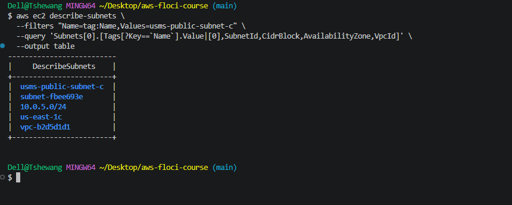

3. Route table association
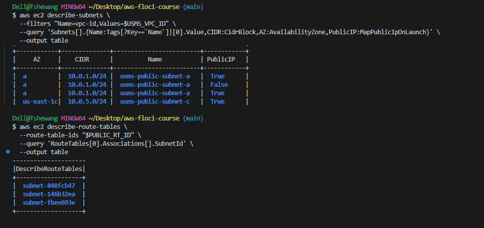
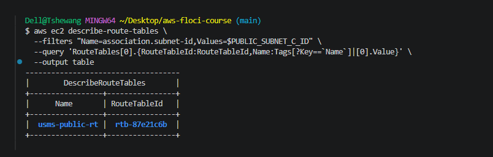

# Exercise 2 – Intermediate: Bastion Security Group

## Objective

The objective was to create a bastion security group that allows SSH access from a single trusted IP address and then restrict SSH access to the application servers through the bastion security group.

## Implementation

A security group named `usms-bastion-sg` was created inside `usms-vpc`.

The bastion security group allows:

| Protocol | Port | Source         | Purpose                                    |
| -------- | ---: | -------------- | ------------------------------------------ |
| TCP      |   22 | `<YOUR-IP>/32` | Allow SSH from the administrator's machine |

The existing `usms-app-sg` was then modified.

The previous SSH rule allowing:

```text
10.0.0.0/16
```

was removed.

A new SSH rule was added using the bastion security group as the source.

Therefore, the application servers only accept SSH connections from resources belonging to `usms-bastion-sg`.

## Final Security Design

```text
Your Machine
     |
     | SSH :22
     v
usms-bastion-sg
     |
     | SSH :22
     v
usms-app-sg
     |
     v
Application Server
```

### Verification

The security groups were inspected using `describe-security-groups`.

The final configuration showed:

* `usms-bastion-sg` has one inbound SSH rule from a `/32`.
* `usms-app-sg` has one SSH rule.
* The SSH rule on `usms-app-sg` references the bastion security group.
* The old `10.0.0.0/16` SSH rule was removed.

### Evidence

1. Bastion security group creation

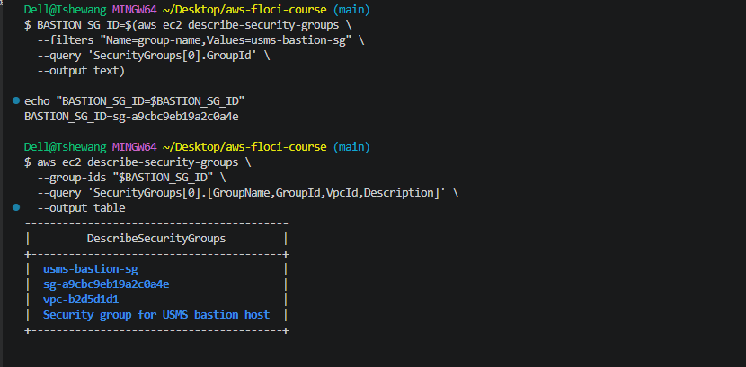

2. Bastion SSH rule

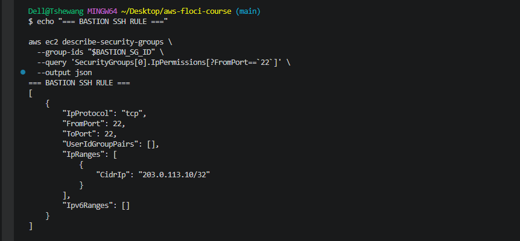

3. App security group before/after modification

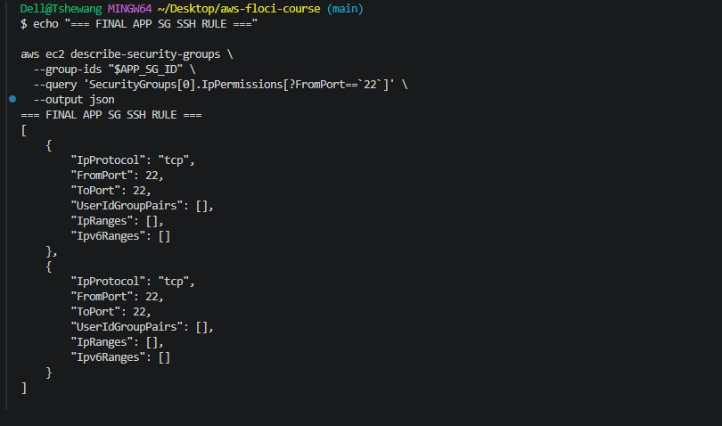

4. Removal of old SSH rule
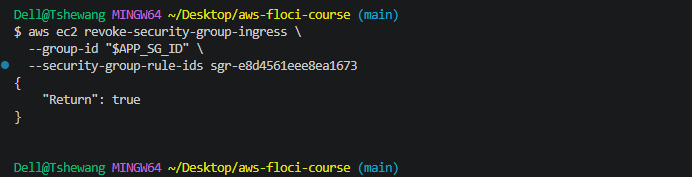
---

# Exercise 3 – Problem Solving: Network Report Script

## Objective

The objective was to create a Bash script that automatically reports the networking configuration of every subnet in `usms-vpc`.

The script was created at:

```text
scripts/utilities/lab-02-network-report.sh
```

## Implementation

The script retrieves the subnets from `usms-vpc` and determines whether each subnet is:

* `PUBLIC`
* `PRIVATE`
* `ISOLATED`

The classification is based on the **default route in the associated route table**, rather than the subnet name or tags.

The script also identifies the next-hop resource:

* Internet Gateway → `PUBLIC`
* NAT Gateway → `PRIVATE`
* No default route → `ISOLATED`

The script uses:

```bash
set -uo pipefail
```

and does not depend on being executed from a particular directory.

### Verification

The script was executed from different directories to confirm that it works independently of the current working directory.

```bash
cd ~
~/aws-floci-course/labs/lab-02-vpc/scripts/utilities/lab-02-network-report.sh
```

and:

```bash
cd ~/aws-floci-course/labs/lab-02-vpc/
./scripts/utilities/lab-02-network-report.sh
```

Both executions produced the same network information.

### Evidence

1. Network report script

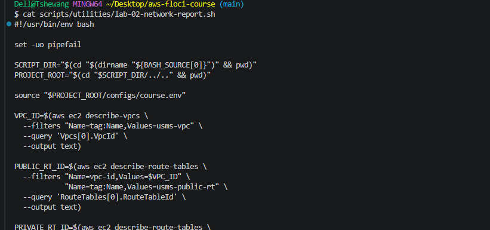

2. Script output

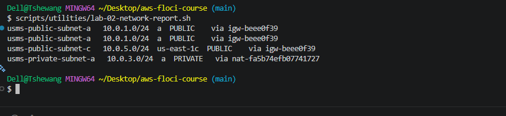

---

# Exercise 4 – Challenge: Network Design

## Objective

The objective was to design network changes for a new **exam-results service**.

The service must:

* Be accessible by staff on campus.
* Accept traffic from `10.10.0.0/16`.
* Access the transcripts database.
* Not be accessible from the public internet.
* Download security patches.

## Proposed Design

### 1. Subnet

The exam-results service should be placed in:

```text
usms-private-subnet-a
```

The subnet is private because the service must not be directly accessible from the public internet.

It can still access the internet for security updates through the existing NAT Gateway.

### 2. Security Group

A new security group named:

```text
usms-exam-sg
```

should be created.

The required rules are:

| Direction | Protocol | Port | Source/Destination | Reason                                                  |
| --------- | -------- | ---: | ------------------ | ------------------------------------------------------- |
| Inbound   | TCP      |  443 | `10.10.0.0/16`     | Allow campus staff to access the exam service           |
| Outbound  | TCP      | 5432 | `usms-db-sg`       | Allow the exam service to read the transcripts database |
| Outbound  | TCP      |  443 | `0.0.0.0/0`        | Allow security patches through the NAT Gateway          |

The exact rules should only be added if they are required by the application design.

### 3. NACL

No additional NACL change is recommended.

Security groups already provide stateful filtering for the application and database tiers. Changing the NACL unnecessarily would increase complexity and could accidentally block return traffic.

### 4. NAT Gateway Decision

I would initially keep the existing NAT Gateway rather than creating a second NAT Gateway.

A second NAT Gateway in Availability Zone `us-east-1b` would improve availability because the private resources in AZ-b would not depend on the NAT Gateway in AZ-a.

However, NAT Gateways have an hourly charge and a per-GB processing charge. Therefore, using two gateways increases the fixed hourly cost compared with one gateway.

For this student lab and a low-traffic application, one NAT Gateway is a reasonable cost-saving choice. For a production system where availability is more important, two NAT Gateways—one per AZ—would be preferable.


### 5. Resources to Delete

The practice subnet:

```text
usms-public-subnet-c
```

should be deleted because it is not required by the final design.

The deletion order should consider dependencies:

```text
Resources using subnet
        ↓
Route table association
        ↓
Subnet
```

### Danger Note

```text
DANGER: Deleting a subnet permanently removes the subnet.
CHECK: Confirm that no required resources are running in the subnet.
REMOVE: Remove dependencies and route-table associations first.
VERIFY: Confirm the subnet is no longer returned by describe-subnets.
```

### Implementation

Only the security-group portion of the design was implemented.

The following resource was created:

```text
usms-exam-sg
```

The required security-group rules were then configured according to the design.

### Evidence

1. Exam security group creation

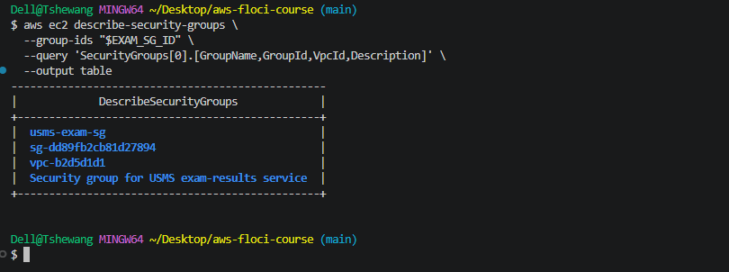

2. Exam security group rules

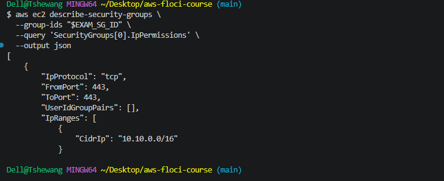

3. Final security group verification

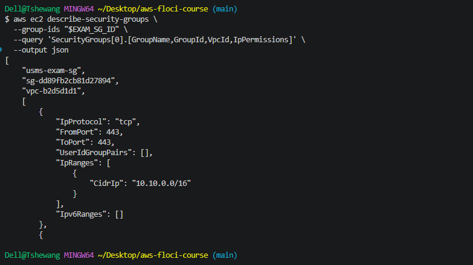
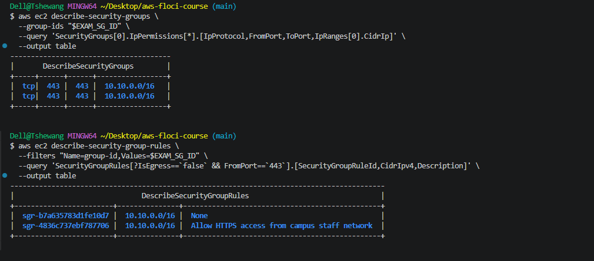

---

# Exercise 5 – Integration: Complete the Second Availability Zone

## Objective

The objective was to create the second private subnet so that the VPC has private resources in two Availability Zones.

This is required because the future RDS subnet group must span at least two Availability Zones.

## Implementation

The new subnet was created with:

| Property          | Value                   |
| ----------------- | ----------------------- |
| Name              | `usms-private-subnet-b` |
| CIDR              | `10.0.4.0/24`           |
| Availability Zone | `us-east-1b`            |
| Route Table       | `usms-private-rt`       |
| NACL              | `usms-private-nacl`     |

The subnet was created while using:

```text
usms-developer-role
```

### Identity Verification

Before creating the subnet, the active identity was checked using:

```bash
aws sts get-caller-identity
```

The output confirmed that the assumed developer role was being used.

After creating the subnet, the normal identity was restored immediately.

This is important because continuing to use the assumed role could cause later lab operations to be performed with the wrong permissions or identity.

### NACL Association

The newly created subnet was associated with:

```text
usms-private-nacl
```

instead of the default network ACL.

The subnet was also associated with:

```text
usms-private-rt
```

## Configuration File

After creating the subnet, the configuration file was regenerated:

```text
configs/lab-02.env
```

The value:

```text
USMS_PRIVATE_SUBNET_B
```

was populated with the new subnet ID.

## Final Verification

The Lab 02 verification script was executed:

```bash
./scripts/utilities/verify-lab-02.sh
```

The verification completed successfully and the final:

```text
PASS=...
FAIL=...
```

line was captured as evidence.

## Evidence

1. Assumed-role identity
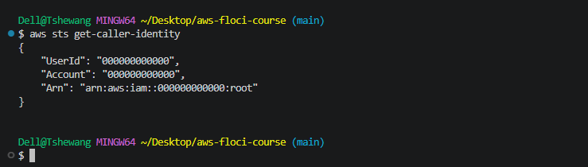


2. Private subnet B creation

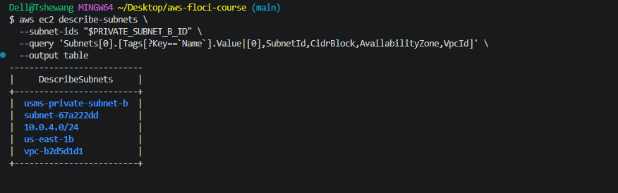

3. Private route table association

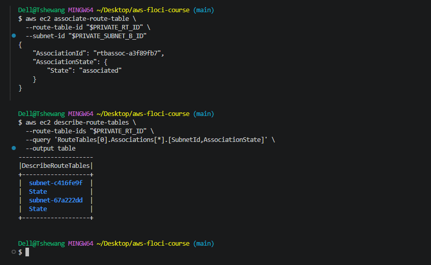
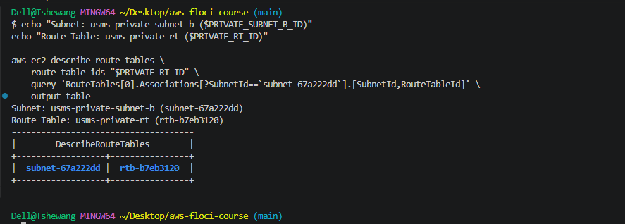

4. NACL association

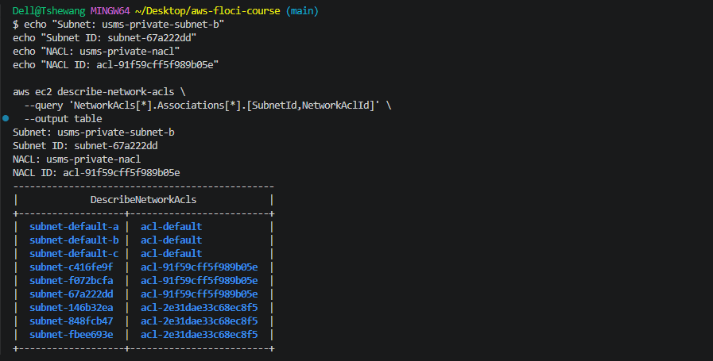

5. Restored identity

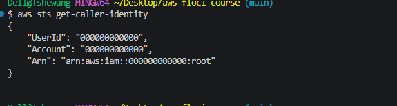


6. Updated `lab-02.env`

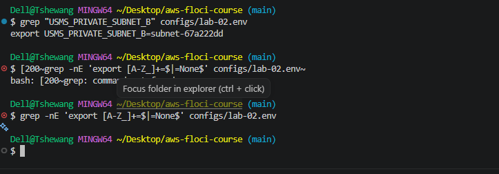

7. Final verification**

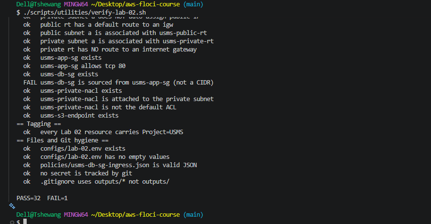

