# Lab 02: Virtual Private Cloud and Networking

## 1. Aim / Objective

The objectives of this practical exercise are:

* To understand the purpose and structure of an Amazon Virtual Private Cloud (VPC).
* To design and configure a VPC using CIDR notation and subnetting.
* To create public and private subnets across two Availability Zones.
* To configure an Internet Gateway, route tables, and NAT Gateway for network connectivity.
* To configure Security Groups and Network ACLs to control network traffic.
* To create a gateway VPC endpoint for Amazon S3.
* To use AWS CLI commands such as `--filters` and `--query` to manage and verify resources.
* To verify that the created network resources persist after restarting the Floci emulator.
* To record the generated AWS resource identifiers for use in subsequent practicals.

The practical specifically aims to demonstrate how a public web tier and private data tier can be securely separated within a VPC while still allowing the private tier to obtain outbound connectivity when required.

---

## 2. Introduction

Amazon Virtual Private Cloud (Amazon VPC) is a networking service that allows cloud resources to be deployed inside an isolated virtual network. A VPC provides control over IP address ranges, subnets, routing, gateways, and network security. In this practical, a VPC named `usms-vpc` is created using the CIDR block `10.0.0.0/16`. The network is divided into public and private subnets across two Availability Zones to support availability and security. An Internet Gateway provides connectivity for the public tier, while a NAT Gateway provides outbound connectivity for resources in the private tier without exposing them directly to the Internet. Security Groups and Network ACLs provide additional traffic control, while an S3 gateway endpoint allows private resources to access S3 through an AWS network path rather than through the Internet or NAT Gateway. These capabilities make VPC an important foundation for deploying secure and scalable cloud applications.

---

## 3. Use Case

Amazon VPC is commonly used in the following situations:

* Hosting secure web applications with separate public and private application tiers.
* Deploying web servers in public subnets while keeping databases in private subnets.
* Isolating cloud resources from other networks and controlling their IP addressing.
* Controlling inbound and outbound traffic using Security Groups and Network ACLs.
* Providing controlled Internet access through Internet Gateways and NAT Gateways.
* Connecting private resources to AWS services such as Amazon S3 using VPC endpoints.
* Designing highly available applications across multiple Availability Zones.
* Supporting enterprise applications that require network segmentation and controlled access.

For this practical, the VPC represents the network of a University Student Management System (USMS). The web tier is accessible from the Internet, while the data tier containing student records is kept in private subnets. The design also allows the private data tier to obtain outbound updates without directly exposing it to the Internet.

---

## 4. System Architecture / Design

The practical uses a two-tier network architecture consisting of a public web tier and a private data tier.

### Architecture Diagram

```text
                              INTERNET
                                  │
                                  ▼
                        ┌──────────────────┐
                        │ Internet Gateway │
                        │    usms-igw       │
                        └────────┬─────────┘
                                 │
                    ┌────────────┴────────────┐
                    │  Public Route Table     │
                    │  0.0.0.0/0 → IGW        │
                    └────────────┬────────────┘
                                 │
                ┌────────────────┴────────────────┐
                │                                 │
                ▼                                 ▼
       ┌─────────────────┐              ┌─────────────────┐
       │ Public Subnet A │              │ Public Subnet B │
       │ 10.0.1.0/24     │              │ 10.0.2.0/24     │
       │ us-east-1a      │              │ us-east-1b      │
       └────────┬────────┘              └─────────────────┘
                │
                ▼
        ┌─────────────────┐
        │    Web Tier     │
        │   usms-app-sg   │
        └────────┬────────┘
                 │
                 │ PostgreSQL
                 ▼
       ┌─────────────────────┐
       │ Private Subnet A    │
       │ 10.0.3.0/24         │
       │ us-east-1a          │
       └──────────┬──────────┘
                  │
                  ▼
          ┌───────────────┐
          │  Data Tier    │
          │  usms-db-sg   │
          └───────────────┘

                  │
                  │ Outbound traffic
                  ▼
          ┌────────────────┐
          │  NAT Gateway   │
          │    usms-nat    │
          └───────┬────────┘
                  │
                  ▼
          ┌────────────────┐
          │ Internet GW    │
          └────────────────┘

Private Subnet
       │
       │ S3 traffic
       ▼
┌─────────────────────┐
│ S3 Gateway Endpoint │
│  usms-s3-endpoint   │
└──────────┬──────────┘
           │
           ▼
      Amazon S3
```

The planned address ranges are:

| Resource                | CIDR          | Availability Zone | Purpose           |
| ----------------------- | ------------- | ----------------- | ----------------- |
| `usms-vpc`              | `10.0.0.0/16` | Regional          | Entire VPC        |
| `usms-public-subnet-a`  | `10.0.1.0/24` | `us-east-1a`      | Public web tier   |
| `usms-public-subnet-b`  | `10.0.2.0/24` | `us-east-1b`      | Public web tier   |
| `usms-private-subnet-a` | `10.0.3.0/24` | `us-east-1a`      | Private data tier |
| `usms-private-subnet-b` | `10.0.4.0/24` | `us-east-1b`      | Private data tier |

Each `/24` subnet contains 256 addresses, of which 251 are usable according to the lab's AWS addressing model.

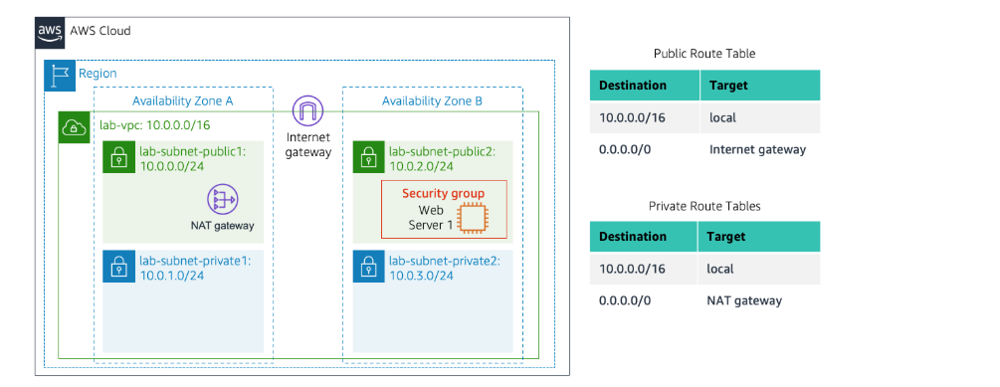

*Figure 1: Architecture of the USMS VPC network.*

---

# 5. Implementation Procedure

## Step 1: Resume the Environment

The Floci environment was first started to ensure that the AWS services required for the practical were available. The storage configuration was also checked because the practical requires the VPC resources to survive a Floci restart.

The following commands were executed:

```bash
cd ~/aws-floci-course
./scripts/setup/floci-up.sh
./scripts/utilities/floci-storage-check.sh
````

The storage verification checks that the Floci container is running, that hybrid storage is being used, and that the persistent host directory is correctly mounted. The expected result is `PASS=6 FAIL=0`. 

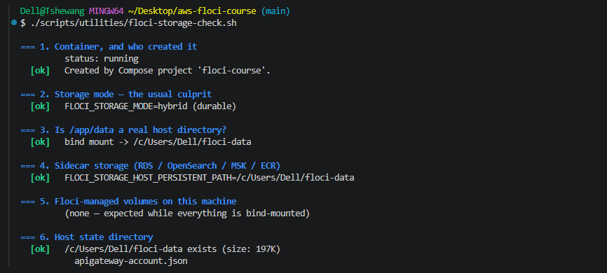

*Figure 1: Floci environment successfully started and persistent storage verified.*

---

## Step 2: Load the Previous Lab's Environment and Confirm Identity

The environment variables created during Lab 01 were loaded. These variables provide the developer role, developer username, and account ID required by the current practical.

```bash
source configs/course.env
source configs/lab-01.env

./scripts/utilities/whoami.sh

echo "developer role : $USMS_ROLE_DEVELOPER"
echo "developer user : $USMS_DEV_USER"
echo "account        : $USMS_ACCOUNT_ID"
```

The identity verification confirmed that the AWS CLI was communicating with the local Floci environment using account `000000000000` and endpoint `http://localhost:4566`. 

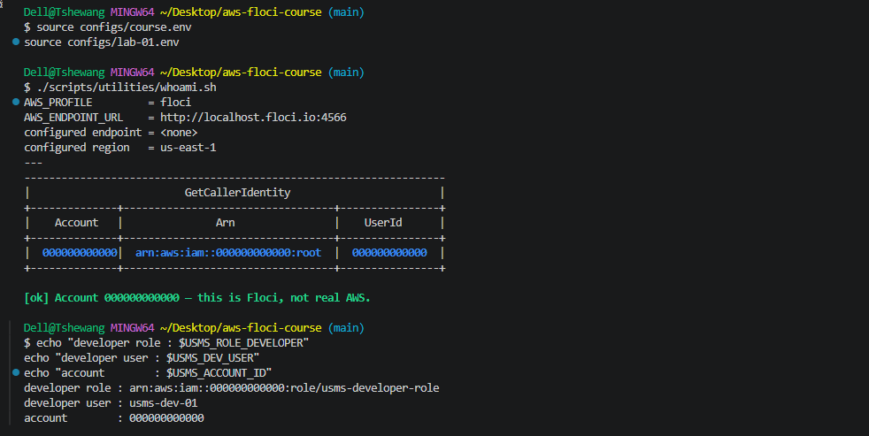

*Figure 2: Previous lab environment variables loaded and Floci identity confirmed.*

---

## CIDR Addressing Preparation

Before creating the VPC, the CIDR addressing scheme was reviewed.

The VPC uses the address range:

```text
10.0.0.0/16
```

The subnet plan uses `/24` networks:

```text
10.0.1.0/24  → Public subnet A
10.0.2.0/24  → Public subnet B
10.0.3.0/24  → Private subnet A
10.0.4.0/24  → Private subnet B
```

The `/16` VPC provides 65,536 addresses, while each `/24` subnet provides 256 addresses, with 251 usable addresses after AWS reservations. The lab also specifies that subnet CIDRs must not overlap. 

---

# Step 3: Assume the Developer Role and Create the VPC

The VPC was created using the `usms-developer-role` created during Lab 01. This demonstrates the principle of using a least-privileged identity when creating cloud resources. 

### 3.1 Verify the Developer Policy

The `USMSDeveloperBase` policy was first inspected to identify its default version and confirm that it contains the required EC2 permissions.

```bash
POLICY_ARN="arn:aws:iam::${USMS_ACCOUNT_ID}:policy/USMSDeveloperBase"

DEFAULT_VERSION=$(aws iam get-policy \
  --policy-arn "$POLICY_ARN" \
  --query 'Policy.DefaultVersionId' \
  --output text)

echo "default version: $DEFAULT_VERSION"

aws iam get-policy-version \
  --policy-arn "$POLICY_ARN" \
  --version-id "$DEFAULT_VERSION" \
  --query 'PolicyVersion.Document' \
  --output json | tee outputs/lab-02-developer-base.json
```

The expected default policy version was `v2`. The policy was checked for the required VPC-related EC2 permissions and its region restriction. 

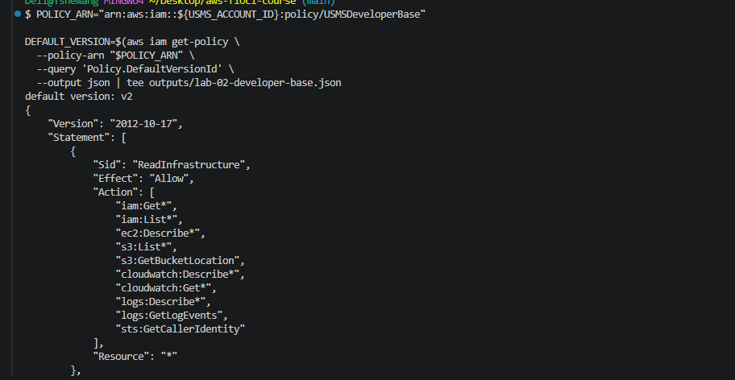

*Figure 3: `USMSDeveloperBase` policy version and permissions verified.*

### 3.2 Assume the Developer Role

The developer role was assumed using the `usms-dev` profile.

```bash
ROLE_ARN="arn:aws:iam::${USMS_ACCOUNT_ID}:role/${USMS_ROLE_DEVELOPER}"

aws sts assume-role \
  --role-arn "$ROLE_ARN" \
  --role-session-name "lab02-vpc-build" \
  --profile usms-dev \
  > outputs/lab-02-assumed-role.json

chmod 600 outputs/lab-02-assumed-role.json

export AWS_ACCESS_KEY_ID=$(jq -r '.Credentials.AccessKeyId' outputs/lab-02-assumed-role.json)
export AWS_SECRET_ACCESS_KEY=$(jq -r '.Credentials.SecretAccessKey' outputs/lab-02-assumed-role.json)
export AWS_SESSION_TOKEN=$(jq -r '.Credentials.SessionToken' outputs/lab-02-assumed-role.json)

aws sts get-caller-identity --no-cli-pager
```

The returned ARN confirmed that the current identity was the assumed `usms-developer-role`. 

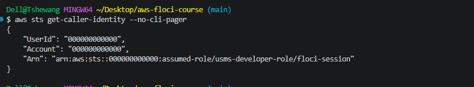

*Figure 4: Successful assumption of the `usms-developer-role`.*

> **Security note:** Do not include the actual temporary access key, secret key, or session token in the screenshot/report.

### 3.3 Create the VPC

The VPC was created with the CIDR block `10.0.0.0/16` and the required tags.

```bash
VPC_ID=$(aws ec2 create-vpc \
  --cidr-block 10.0.0.0/16 \
  --tag-specifications 'ResourceType=vpc,Tags=[{Key=Name,Value=usms-vpc},{Key=Project,Value=USMS},{Key=Tier,Value=network},{Key=ManagedBy,Value=aws-cli}]' \
  --query 'Vpc.VpcId' \
  --output text)

echo "VPC_ID = $VPC_ID"
```

The generated VPC ID was stored in the `VPC_ID` variable. 

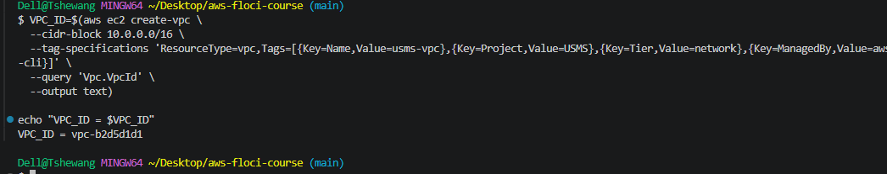

*Figure 5: `usms-vpc` created with the `10.0.0.0/16` CIDR block.*

---

# Step 4: Restore the Normal Identity

The temporary developer credentials were removed after the VPC was created.

```bash
unset AWS_ACCESS_KEY_ID AWS_SECRET_ACCESS_KEY AWS_SESSION_TOKEN

./scripts/utilities/whoami.sh

aws ec2 describe-vpcs \
  --vpc-ids "$VPC_ID" \
  --query 'Vpcs[0].{Id:VpcId,CIDR:CidrBlock,State:State,Default:IsDefault,Tenancy:InstanceTenancy}' \
  --output table
```

The VPC was successfully verified using the normal identity. The expected state was `available`, with `10.0.0.0/16` as its CIDR and `Default=False`. 

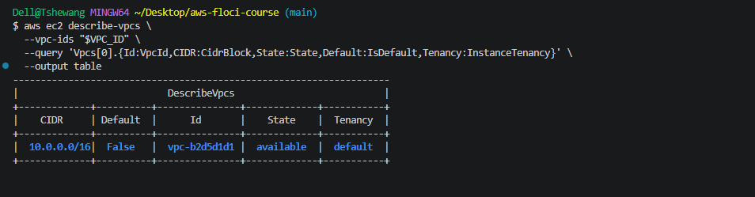

*Figure 6: VPC successfully verified after restoring the normal identity.*

---

# Step 5: Enable DNS Support and DNS Hostnames

DNS support and DNS hostnames were enabled for the VPC.

```bash
aws ec2 modify-vpc-attribute \
  --vpc-id "$VPC_ID" \
  --enable-dns-support '{"Value":true}'

aws ec2 modify-vpc-attribute \
  --vpc-id "$VPC_ID" \
  --enable-dns-hostnames '{"Value":true}'
```

The configuration was verified using:

```bash
aws ec2 describe-vpc-attribute \
  --vpc-id "$VPC_ID" \
  --attribute enableDnsSupport \
  --query 'EnableDnsSupport.Value' \
  --output text

aws ec2 describe-vpc-attribute \
  --vpc-id "$VPC_ID" \
  --attribute enableDnsHostnames \
  --query 'EnableDnsHostnames.Value' \
  --output text
```

Both attributes were expected to return `True`. 

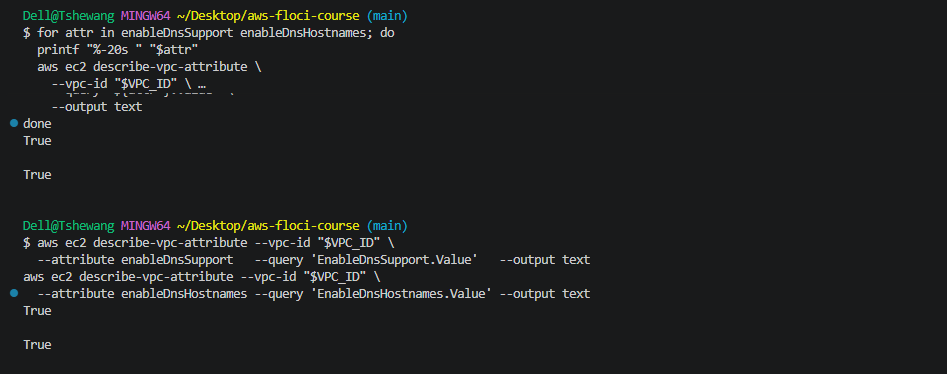

*Figure 7: DNS support and DNS hostnames successfully enabled.*

---

# Step 6: Create and Attach the Internet Gateway

An Internet Gateway named `usms-igw` was created and attached to the VPC.

```bash
IGW_ID=$(aws ec2 create-internet-gateway \
  --tag-specifications 'ResourceType=internet-gateway,Tags=[{Key=Name,Value=usms-igw},{Key=Project,Value=USMS}]' \
  --query 'InternetGateway.InternetGatewayId' \
  --output text)

echo "IGW_ID = $IGW_ID"

aws ec2 attach-internet-gateway \
  --internet-gateway-id "$IGW_ID" \
  --vpc-id "$VPC_ID"
```

The attachment was then verified using `describe-internet-gateways`. 

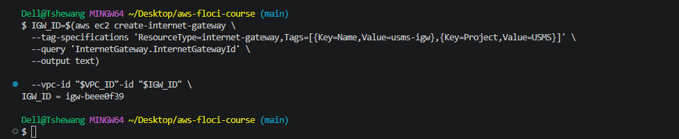
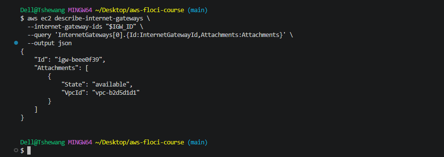

*Figure 8: `usms-igw` created and attached to `usms-vpc`.*

---

# Step 7: Create the Public Subnet in `us-east-1a`

The first public subnet was created using CIDR `10.0.1.0/24`.

```bash
PUBLIC_SUBNET_A_ID=$(aws ec2 create-subnet \
  --vpc-id "$VPC_ID" \
  --cidr-block 10.0.1.0/24 \
  --availability-zone "${AWS_REGION_COURSE}a" \
  --tag-specifications 'ResourceType=subnet,Tags=[{Key=Name,Value=usms-public-subnet-a},{Key=Project,Value=USMS},{Key=Tier,Value=public},{Key=AZ,Value=a}]' \
  --query 'Subnet.SubnetId' \
  --output text)

echo "PUBLIC_SUBNET_A_ID = $PUBLIC_SUBNET_A_ID"
```

The subnet was verified to ensure that it was available and had the expected CIDR and Availability Zone. At this stage, automatic public IP assignment was still `False`. 

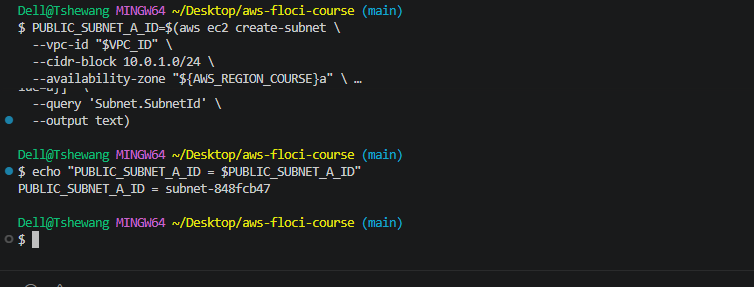

*Figure 9: Public subnet A created in `us-east-1a`.*

---

# Step 8: Turn On Auto-Assign Public IPv4

Automatic public IPv4 assignment was enabled for the public subnet.

```bash
aws ec2 modify-subnet-attribute \
  --subnet-id "$PUBLIC_SUBNET_A_ID" \
  --map-public-ip-on-launch

aws ec2 describe-subnets \
  --subnet-ids "$PUBLIC_SUBNET_A_ID" \
  --query 'Subnets[0].MapPublicIpOnLaunch' \
  --output text
```

The expected result was:

```text
True
```

This allows instances launched in the subnet to automatically receive public IPv4 addresses. 

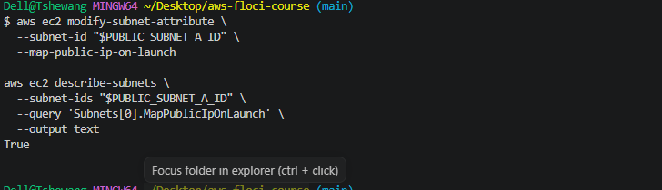

*Figure 10: Automatic public IPv4 assignment enabled for the public subnet.*

---

# Step 9: Create the Private Subnet in `us-east-1a`

The private subnet for the data tier was created using `10.0.3.0/24`.

```bash
PRIVATE_SUBNET_A_ID=$(aws ec2 create-subnet \
  --vpc-id "$VPC_ID" \
  --cidr-block 10.0.3.0/24 \
  --availability-zone "${AWS_REGION_COURSE}a" \
  --tag-specifications 'ResourceType=subnet,Tags=[{Key=Name,Value=usms-private-subnet-a},{Key=Project,Value=USMS},{Key=Tier,Value=private},{Key=AZ,Value=a}]' \
  --query 'Subnet.SubnetId' \
  --output text)

echo "PRIVATE_SUBNET_A_ID = $PRIVATE_SUBNET_A_ID"
```

Automatic public IP assignment was deliberately not enabled for this subnet. 

The subnets were then listed using `--filters` and `--query` to confirm their configuration. 

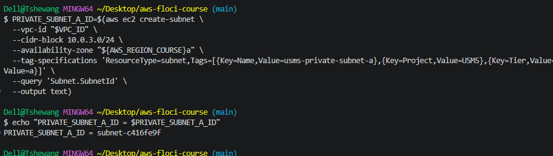

*Figure 11: Private subnet A created and subnet configuration verified.*

---

# Step 10: Create the Public Route Table and Default Route

A public route table named `usms-public-rt` was created.

```bash
PUBLIC_RT_ID=$(aws ec2 create-route-table \
  --vpc-id "$VPC_ID" \
  --tag-specifications 'ResourceType=route-table,Tags=[{Key=Name,Value=usms-public-rt},{Key=Project,Value=USMS},{Key=Tier,Value=public}]' \
  --query 'RouteTable.RouteTableId' \
  --output text)

echo "PUBLIC_RT_ID = $PUBLIC_RT_ID"

aws ec2 create-route \
  --route-table-id "$PUBLIC_RT_ID" \
  --destination-cidr-block 0.0.0.0/0 \
  --gateway-id "$IGW_ID"
```

The default route `0.0.0.0/0` was configured to point to the Internet Gateway. 

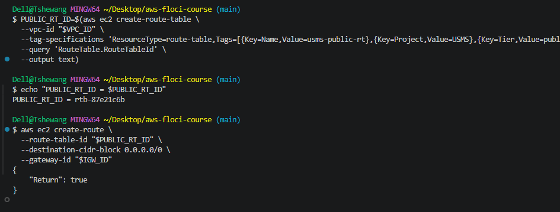

*Figure 12: Public route table with the default route pointing to the Internet Gateway.*

---

# Step 11: Associate the Public Subnet with the Public Route Table

The public subnet was associated with `usms-public-rt`.

```bash
PUBLIC_ASSOC_A_ID=$(aws ec2 associate-route-table \
  --route-table-id "$PUBLIC_RT_ID" \
  --subnet-id "$PUBLIC_SUBNET_A_ID" \
  --query 'AssociationId' \
  --output text)

echo "PUBLIC_ASSOC_A_ID = $PUBLIC_ASSOC_A_ID"
```

The lab also requires a second public subnet as a **Your turn** exercise. The second subnet should be:

```text
Name: usms-public-subnet-b
CIDR: 10.0.2.0/24
AZ:   us-east-1b
```

It should have automatic public IPv4 assignment enabled and be associated with `usms-public-rt`. 

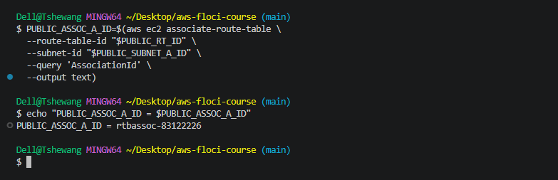

*Figure 13: Public subnets associated with the public route table across two Availability Zones.*

---

# Step 12: Create the Private Route Table and Associate the Private Subnet

A separate private route table named `usms-private-rt` was created.

```bash
PRIVATE_RT_ID=$(aws ec2 create-route-table \
  --vpc-id "$VPC_ID" \
  --tag-specifications 'ResourceType=route-table,Tags=[{Key=Name,Value=usms-private-rt},{Key=Project,Value=USMS},{Key=Tier,Value=private}]' \
  --query 'RouteTable.RouteTableId' \
  --output text)

echo "PRIVATE_RT_ID = $PRIVATE_RT_ID"

PRIVATE_ASSOC_A_ID=$(aws ec2 associate-route-table \
  --route-table-id "$PRIVATE_RT_ID" \
  --subnet-id "$PRIVATE_SUBNET_A_ID" \
  --query 'AssociationId' \
  --output text)

echo "PRIVATE_ASSOC_A_ID = $PRIVATE_ASSOC_A_ID"
```

At this point, the private route table intentionally had no Internet Gateway default route. 

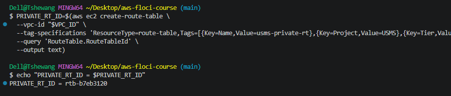
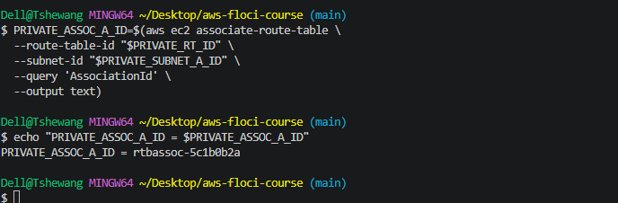

*Figure 14: Private subnet associated with the private route table.*

---

# Step 13: Prove the Two Subnets Are Actually Different

The effective route table associated with each subnet was inspected.

```bash
for s in "$PUBLIC_SUBNET_A_ID" "$PRIVATE_SUBNET_A_ID"; do
  name=$(aws ec2 describe-subnets --subnet-ids "$s" \
          --query 'Subnets[0].Tags[?Key==`Name`]|[0].Value' --output text)

  rt=$(aws ec2 describe-route-tables \
        --filters "Name=association.subnet-id,Values=$s" \
        --query 'RouteTables[0].RouteTableId' --output text)

  igw=$(aws ec2 describe-route-tables --route-table-ids "$rt" \
        --query 'RouteTables[0].Routes[?DestinationCidrBlock==`0.0.0.0/0`].GatewayId | [0]' \
        --output text)

  printf '%-24s subnet=%-26s rt=%-24s default-route-target=%s\n' \
         "$name" "$s" "$rt" "$igw"
done
```

The public subnet was expected to have an Internet Gateway as its default route target, while the private subnet had no default route at this stage. 

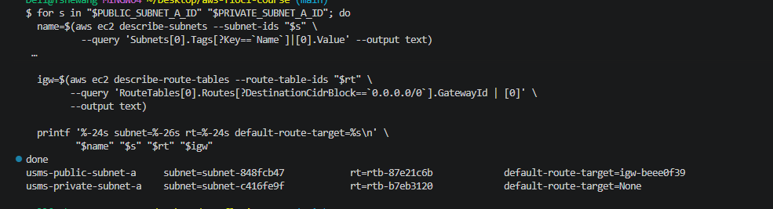

*Figure 15: Effective route tables demonstrating the difference between public and private subnets.*

---

# Step 14: Create the Application Security Group

A security group named `usms-app-sg` was created for the application/web tier.

```bash
APP_SG_ID=$(aws ec2 create-security-group \
  --group-name usms-app-sg \
  --description "USMS application tier: HTTP/HTTPS from the internet, SSH from inside the VPC" \
  --vpc-id "$VPC_ID" \
  --tag-specifications 'ResourceType=security-group,Tags=[{Key=Name,Value=usms-app-sg},{Key=Project,Value=USMS},{Key=Tier,Value=app}]' \
  --query 'GroupId' \
  --output text)

echo "APP_SG_ID = $APP_SG_ID"
```

HTTP and SSH rules were configured:

```bash
aws ec2 authorize-security-group-ingress \
  --group-id "$APP_SG_ID" \
  --protocol tcp --port 80 --cidr 0.0.0.0/0

aws ec2 authorize-security-group-ingress \
  --group-id "$APP_SG_ID" \
  --protocol tcp --port 22 --cidr 10.0.0.0/16
```

The lab's **Your turn** exercise also requires HTTPS on TCP port 443 from `0.0.0.0/0`. 

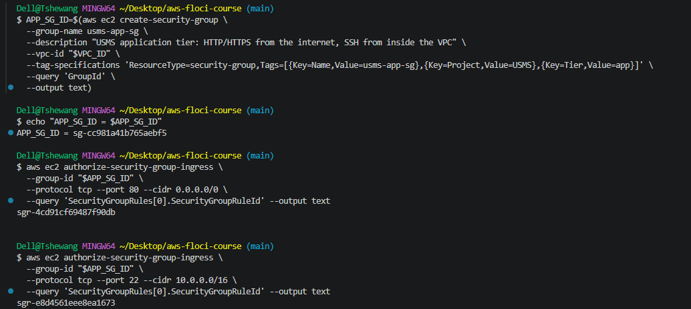

*Figure 16: `usms-app-sg` configured for HTTP, HTTPS and internal SSH access.*

---

# Step 15: Create the Database Security Group

A separate security group named `usms-db-sg` was created for the database tier.

```bash
DB_SG_ID=$(aws ec2 create-security-group \
  --group-name usms-db-sg \
  --description "USMS data tier: PostgreSQL from the application tier only" \
  --vpc-id "$VPC_ID" \
  --tag-specifications 'ResourceType=security-group,Tags=[{Key=Name,Value=usms-db-sg},{Key=Project,Value=USMS},{Key=Tier,Value=data}]' \
  --query 'GroupId' \
  --output text)

echo "DB_SG_ID = $DB_SG_ID"
```

A JSON policy file was created to allow PostgreSQL traffic on port 5432 from the application security group:

```text
policies/usms-db-sg-ingress.json
```

The rule was then applied:

```bash
aws ec2 authorize-security-group-ingress \
  --group-id "$DB_SG_ID" \
  --ip-permissions file://policies/usms-db-sg-ingress.json
```

The database security group was verified to ensure that the source was `usms-app-sg` rather than a CIDR address. 

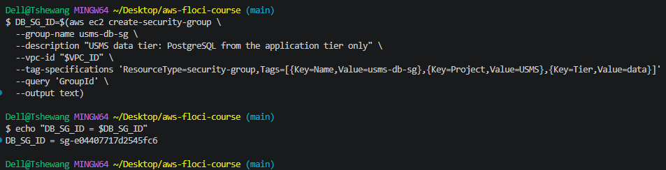
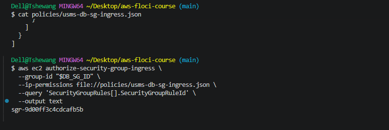

*Figure 17: Database security group allowing PostgreSQL traffic from the application security group.*

---

# Step 16: Read the Security Groups Back and Understand Stateful Behaviour

Both security groups were inspected using:

```bash
aws ec2 describe-security-groups \
  --filters "Name=vpc-id,Values=$VPC_ID" \
  --query 'SecurityGroups[].{Name:GroupName,Id:GroupId,Inbound:length(IpPermissions),Outbound:length(IpPermissionsEgress)}' \
  --output table
```

The output confirmed the application and database security groups and the automatically created default security group.

Security Groups are **stateful**, meaning return traffic for an established connection is automatically allowed. The application server can therefore receive HTTP traffic and send the response without requiring a separate outbound rule for that response. 

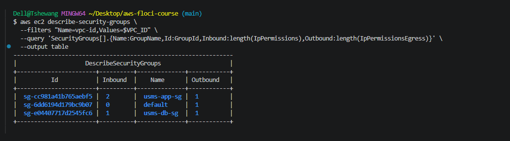

*Figure 18: Security groups and their inbound/outbound rule counts verified.*

---

# Step 17: Explore the Default Network ACL and Create a Private NACL

The default Network ACL was first inspected:

```bash
aws ec2 describe-network-acls \
  --filters "Name=vpc-id,Values=$VPC_ID" "Name=default,Values=true" \
  --query 'NetworkAcls[0].Entries[].{Rule:RuleNumber,Egress:Egress,Proto:Protocol,Action:RuleAction,CIDR:CidrBlock}' \
  --output table
```

A custom NACL named `usms-private-nacl` was then created.

```bash
PRIVATE_NACL_ID=$(aws ec2 create-network-acl \
  --vpc-id "$VPC_ID" \
  --tag-specifications 'ResourceType=network-acl,Tags=[{Key=Name,Value=usms-private-nacl},{Key=Project,Value=USMS},{Key=Tier,Value=private}]' \
  --query 'NetworkAcl.NetworkAclId' \
  --output text)

echo "PRIVATE_NACL_ID = $PRIVATE_NACL_ID"
```

Rules were configured for PostgreSQL, return traffic, application replies, and HTTPS outbound access.

The NACL is **stateless**, unlike a Security Group, so return traffic must be explicitly permitted. 

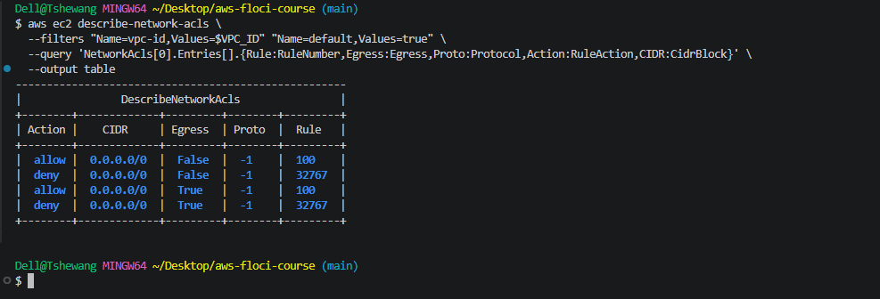
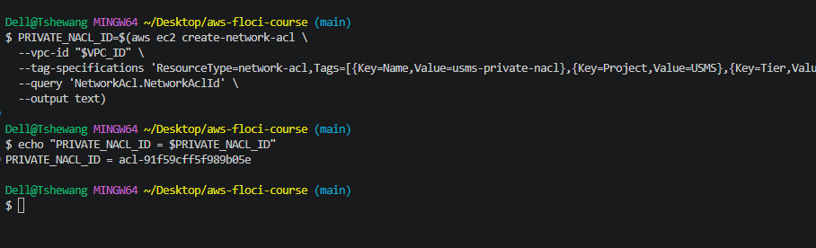

*Figure 19: Custom private NACL and its inbound/outbound rules.*

---

# Step 18: Associate the Private NACL with the Private Subnet

The existing NACL association for the private subnet was identified and replaced with the custom `usms-private-nacl`.

```bash
NACL_ASSOC_ID=$(aws ec2 describe-network-acls \
  --filters "Name=association.subnet-id,Values=$PRIVATE_SUBNET_A_ID" \
  --query 'NetworkAcls[0].Associations[0].NetworkAclAssociationId' \
  --output text)

echo "current association: $NACL_ASSOC_ID"

aws ec2 replace-network-acl-association \
  --association-id "$NACL_ASSOC_ID" \
  --network-acl-id "$PRIVATE_NACL_ID" \
  --query 'NewAssociationId' \
  --output text
```

The association was verified using `describe-network-acls`. The expected result was `Default=False` and the name `usms-private-nacl`. 

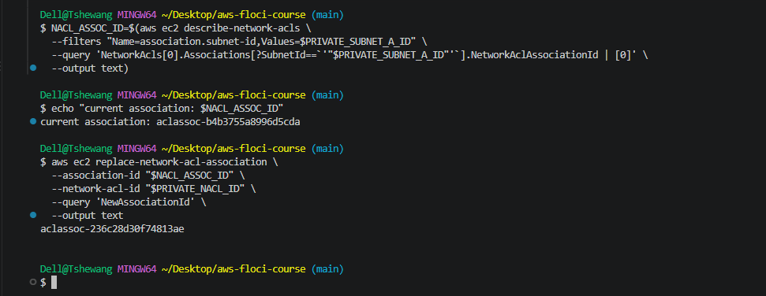


*Figure 20: Custom private NACL associated with the private subnet.*

---

# Step 19: Give the Private Subnet Outbound Internet Access with a NAT Gateway

An Elastic IP was first allocated for the NAT Gateway.

```bash
NAT_EIP_ALLOC_ID=$(aws ec2 allocate-address \
  --domain vpc \
  --tag-specifications 'ResourceType=elastic-ip,Tags=[{Key=Name,Value=usms-nat-eip},{Key=Project,Value=USMS}]' \
  --query 'AllocationId' \
  --output text)

echo "NAT_EIP_ALLOC_ID = $NAT_EIP_ALLOC_ID"
```

The NAT Gateway was then created in the **public subnet**:

```bash
NAT_GW_ID=$(aws ec2 create-nat-gateway \
  --subnet-id "$PUBLIC_SUBNET_A_ID" \
  --allocation-id "$NAT_EIP_ALLOC_ID" \
  --tag-specifications 'ResourceType=natgateway,Tags=[{Key=Name,Value=usms-nat},{Key=Project,Value=USMS}]' \
  --query 'NatGateway.NatGatewayId' \
  --output text)

echo "NAT_GW_ID = $NAT_GW_ID"
```

The NAT Gateway was then waited on until it became available. 

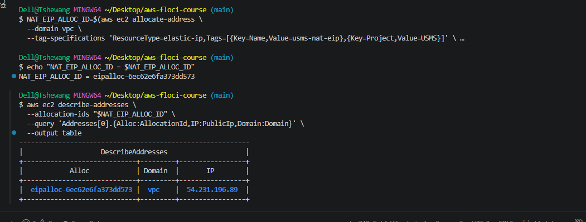
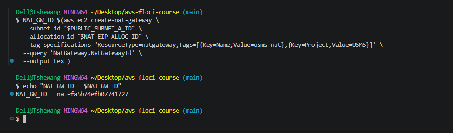
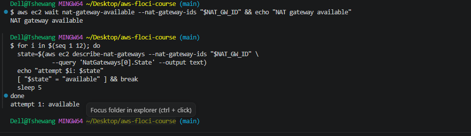

*Figure 21: NAT Gateway created in the public subnet with an Elastic IP.*

---

# Step 20: Point the Private Route Table at the NAT Gateway

The private route table was configured with a default route pointing to the NAT Gateway.

```bash
aws ec2 create-route \
  --route-table-id "$PRIVATE_RT_ID" \
  --destination-cidr-block 0.0.0.0/0 \
  --nat-gateway-id "$NAT_GW_ID"

aws ec2 describe-route-tables \
  --route-table-ids "$PRIVATE_RT_ID" \
  --query 'RouteTables[0].Routes[].{Destination:DestinationCidrBlock,Gateway:GatewayId,NAT:NatGatewayId,State:State}' \
  --output table
```

The private route table was expected to contain:

```text
10.0.0.0/16 → local
0.0.0.0/0   → NAT Gateway
```

The private route table must **not** point its default route to the Internet Gateway. 

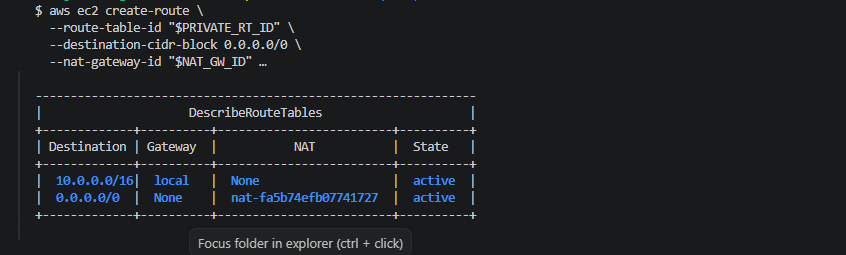

*Figure 22: Private route table configured to use the NAT Gateway.*

---

# Step 21: Create the S3 Gateway Endpoint

A gateway VPC endpoint for Amazon S3 was created and associated with the private route table.

```bash
S3_ENDPOINT_ID=$(aws ec2 create-vpc-endpoint \
  --vpc-id "$VPC_ID" \
  --service-name "com.amazonaws.${AWS_REGION_COURSE}.s3" \
  --vpc-endpoint-type Gateway \
  --route-table-ids "$PRIVATE_RT_ID" \
  --tag-specifications 'ResourceType=vpc-endpoint,Tags=[{Key=Name,Value=usms-s3-endpoint},{Key=Project,Value=USMS}]' \
  --query 'VpcEndpoint.VpcEndpointId' \
  --output text)

echo "S3_ENDPOINT_ID = $S3_ENDPOINT_ID"
```

The endpoint was verified using `describe-vpc-endpoints` and the private route table was inspected to confirm the S3 endpoint route where supported by Floci. 

The lab notes that some Floci builds may create the endpoint successfully without displaying the prefix-list route in the route table, even though real AWS adds the route. 

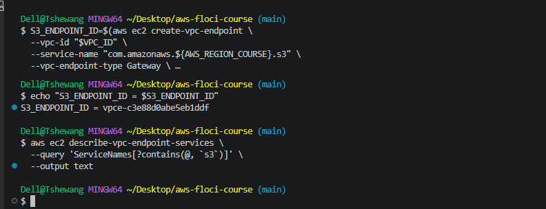

*Figure 23: S3 gateway endpoint created and associated with the private route table.*

---

# Step 22: Audit the Resource Tags

The resources were checked to ensure that they carried the required `Project=USMS` tag.

```bash
echo "== Resources tagged Project=USMS in this VPC =="

aws ec2 describe-tags \
  --filters "Name=tag:Project,Values=USMS" \
  --query 'sort_by(Tags[?Key==`Name`], &Value)[].{Type:ResourceType,Name:Value,Id:ResourceId}' \
  --output table
```

The output was expected to include the VPC, Internet Gateway, subnets, route tables, Security Groups, NACL, NAT Gateway, Elastic IP, and S3 endpoint. 

The lab also includes a **Your turn** activity to create a subnet inventory showing the subnet name, CIDR, Availability Zone and tier, with private subnets listed first and the result saved to:

```text
outputs/lab-02-subnet-inventory.txt
```


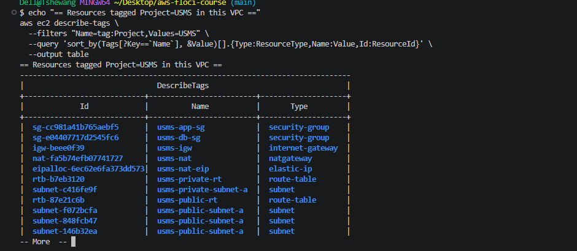

*Figure 24: USMS resources verified using the `Project=USMS` tag.*

---

# Step 23: Prove the Network Survives a Restart

The VPC ID, subnet count and Security Group count were recorded before restarting Floci.

```bash
aws ec2 describe-vpcs --vpc-ids "$VPC_ID" \
  --query 'Vpcs[0].VpcId' --output text > outputs/lab-02-pre-restart.txt

aws ec2 describe-subnets --filters "Name=vpc-id,Values=$VPC_ID" \
  --query 'length(Subnets)' --output text >> outputs/lab-02-pre-restart.txt

aws ec2 describe-security-groups --filters "Name=vpc-id,Values=$VPC_ID" \
  --query 'length(SecurityGroups)' --output text >> outputs/lab-02-pre-restart.txt
```

Floci was then stopped and restarted:

```bash
./scripts/setup/floci-down.sh
sleep 3
./scripts/setup/floci-up.sh
sleep 5
```

After restarting, the VPC was rediscovered using its tag rather than simply reusing the old shell variable.

```bash
source configs/course.env

VPC_ID=$(aws ec2 describe-vpcs \
  --filters "Name=tag:Name,Values=usms-vpc" \
  --query 'Vpcs[0].VpcId' --output text)
```

The post-restart values were compared with the pre-restart values.

```bash
diff outputs/lab-02-pre-restart.txt outputs/lab-02-post-restart.txt \
  && echo "PERSISTENCE PROVEN: VPC id, subnet count and security group count all unchanged" \
  || echo "PERSISTENCE FAILED: run ./scripts/utilities/floci-storage-check.sh"
```

The expected result was:

```text
PERSISTENCE PROVEN: VPC id, subnet count and security group count all unchanged
```
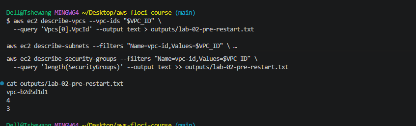
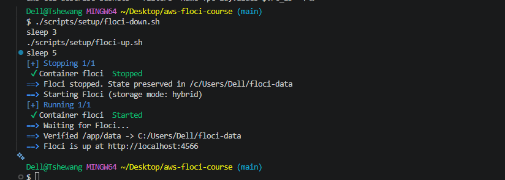
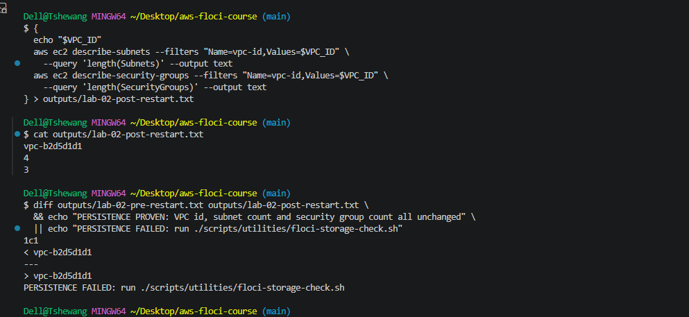

*Figure 25: VPC network successfully preserved after restarting Floci.*

---

# Step 24: Write `configs/lab-02.env`

All important resource identifiers were stored in `configs/lab-02.env` so that future practicals could reuse the resources without manually entering their IDs.

The file contains identifiers for:

* VPC
* Internet Gateway
* Public and private subnets
* Public and private route tables
* Application and database Security Groups
* Private NACL
* NAT Gateway
* NAT Elastic IP
* S3 VPC endpoint
* Availability Zones

The file was generated using tag-based lookups rather than simply copying shell variables. 

The file was then checked:

```bash
grep -n 'export .*=$\|None' configs/lab-02.env || echo "all values populated"
```

Finally, it was sourced to confirm that the values could be loaded successfully:

```bash
source configs/lab-02.env

echo "vpc=$USMS_VPC_ID  public-a=$USMS_PUBLIC_SUBNET_A  app-sg=$USMS_APP_SG"
```


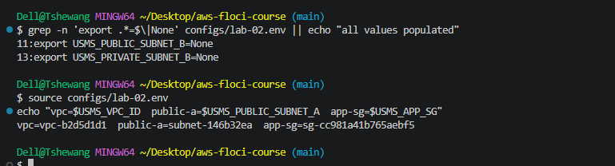

*Figure 26: Resource identifiers stored in `configs/lab-02.env` and successfully loaded.*

---

# Step 25: Commit the Work

The Git working tree was checked before adding files.

```bash
git status --short
```

The lab specifically requires that sensitive files under `outputs/` are not committed, while `configs/lab-02.env` can be committed because it contains resource IDs rather than secrets. 

The required files were staged explicitly:

```bash
git add labs/lab-02-vpc/ configs/lab-02.env policies/usms-db-sg-ingress.json \
        scripts/utilities/verify-lab-02.sh scripts/cleanup/lab-02-cleanup.sh
```

The commit was then created:

```bash
git status --short

git commit -m "Lab 02: USMS VPC, subnets, routing, security groups, NACL, NAT and S3 endpoint"

git log --oneline -3
```

Explicitly specifying the files prevents accidentally committing files containing credentials or other sensitive data. 

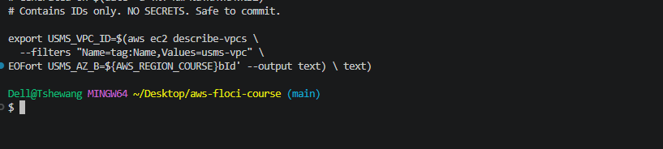

*Figure 27: Lab 02 files successfully committed to the Git repository.*

---

## Final Verification

After completing the 25 steps, the Lab 02 verification script was executed:

```bash
./scripts/utilities/verify-lab-02.sh
```

The verification checks the Floci environment, Lab 01 dependencies, VPC configuration, Internet Gateway, subnets, routing, Security Groups, NACL, S3 endpoint, tags, configuration files, and Git hygiene. 

The expected final result is:

```text
PASS=33 FAIL=0
```
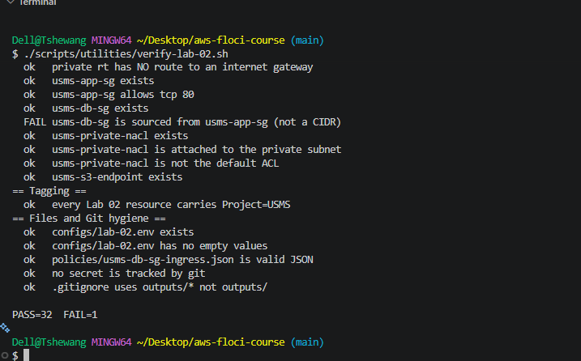

*Figure 28: Final Lab 02 verification showing `PASS=33 FAIL=0`.*

---

## 6. Results and Evidence

### 6.1 CLI / SDK Output

The practical was successfully implemented using the AWS CLI through the Floci environment.

The following CLI operations were performed:

* Floci environment verification.
* AWS identity verification.
* VPC creation.
* Subnet creation.
* Internet Gateway creation and attachment.
* Route table creation.
* Route configuration and association.
* Security Group creation and configuration.
* Network ACL configuration.
* NAT Gateway configuration.
* S3 VPC endpoint creation.
* Resource filtering and querying.
* Persistence verification.
* Final automated verification.

### 6.1 AWS Management Console Verification

Where the AWS Management Console is available, screenshots should be included to visually verify the resources created through the CLI.

### Console/Evidence – VPC

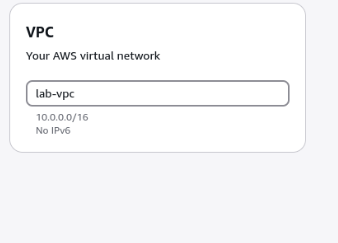

**Explanation:** This images shows that the USMS VPC was created with the required CIDR block.

---

### Console/Evidence – Subnets

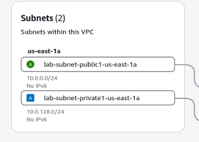
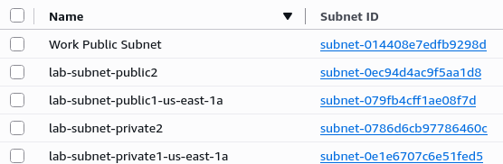

**Explanation:** This image shows that the network has been divided into public and private subnets across two Availability Zones.

---

### Console/Evidence – Route Tables

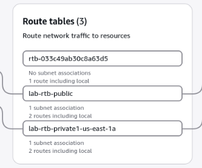
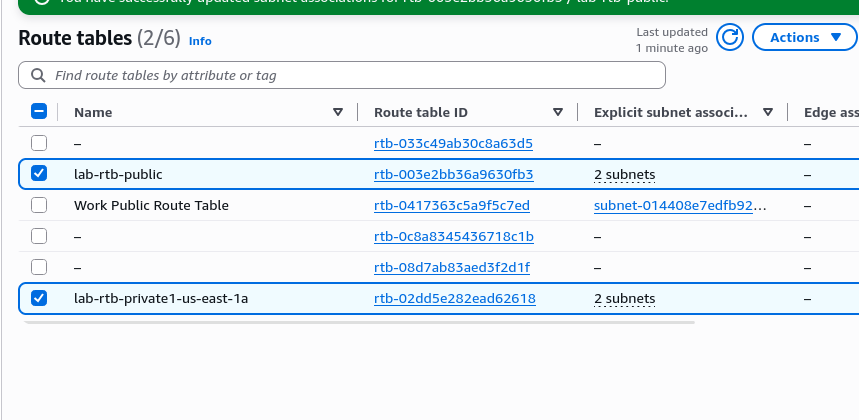

**Explanation:** This image shows the routing difference between the public and private network tiers.

---

### Console/Evidence – Security Groups


**Explanation:** This image shows that application and database traffic is controlled using separate Security Groups.

---

## Console/Evidence – Private EC2 Instance


**Explanation:** The iamge shows the running EC2 instance with private IPv4 address 10.0.2.246 and VPC ID vpc-0b7446b00ed75437a. This confirms that the application instance is deployed within the configured VPC.

## Console/Evidence – Application Access from EC2


**Explanation:** The image shows the web application running successfully on the EC2 instance. The displayed instance ID and Availability Zone provide evidence that the deployed application is operational within the AWS environment.

## 7. Analysis and Discussion

The practical successfully demonstrated the construction of a structured cloud network using Amazon VPC concepts and the AWS CLI through Floci. The network was divided into public and private subnets using the `10.0.0.0/16` VPC CIDR block. The public tier was configured with a route to the Internet Gateway, while the private tier was separated from direct Internet access and configured to use a NAT Gateway for outbound connectivity. The design therefore follows the main requirements of the USMS system: the web tier can be publicly accessible while the data tier remains protected from direct Internet access.

The practical also demonstrated the difference between Security Groups and Network ACLs. Security Groups were used for instance-level access control, including HTTP, HTTPS, SSH, and database traffic. The database Security Group used the application Security Group as its source rather than depending on a fixed CIDR range. This makes the security design more flexible if application servers are moved or scaled.

One important observation was that a subnet does not become public simply because it is named a "public subnet." Its routing configuration determines whether it is public. The effective route table showed that the public subnet had a default route to the Internet Gateway, while the private subnet did not.

Another important outcome was the use of the S3 gateway endpoint. Instead of requiring S3 traffic from the private subnet to travel through the NAT Gateway, the endpoint provides an AWS-managed route for S3 traffic.

Finally, the persistence test confirmed whether the network survived a Floci restart. The lab specifically compares the VPC identifier and resource counts before and after the restart rather than assuming persistence.

### Errors/Challenges Encountered

During implementation, possible challenges included:

* Understanding CIDR notation and subnet sizing.
* Managing AWS CLI variables and resource identifiers.
* Correctly associating subnets with route tables.
* Understanding the difference between a public route to an Internet Gateway and a private route to a NAT Gateway.
* Configuring Security Group rules using another Security Group as the source.
* Ensuring that private subnets did not accidentally receive an Internet Gateway route.
* Maintaining persistent Floci storage.
* Using `--filters` and `--query` correctly.

These issues were resolved by verifying each resource immediately after creation and using the provided verification scripts. The final verification script was expected to report `PASS=33 FAIL=0`.

---

## 8. Reflection

### 1. What did you learn?

I learned that Amazon VPC provides a private network for AWS resources. I learned how CIDR blocks, subnets, route tables, Internet Gateways, NAT Gateways, Security Groups, Network ACLs and VPC endpoints work together to create a secure network.

### 2. What challenges did you encounter?

The main challenges were understanding CIDR notation, configuring route tables and understanding the difference between Security Groups and Network ACLs. Managing CLI variables and resource IDs was also challenging.

### 3. How would you apply this in a real-world environment?

I would use VPC to create a secure network for an application. Public subnets could be used for web servers, while private subnets could be used for application servers and databases. Security Groups and Network ACLs could control access, while NAT Gateways could provide Internet access to private resources.

### 4. What additional concepts would you like to explore?

I would like to learn more about VPC peering, Transit Gateway, VPN, VPC Flow Logs, Network Firewall, and VPC endpoints. I would also like to learn how to create VPC networks automatically using Terraform or CloudFormation.

---

## 9. Conclusion

This practical successfully demonstrated the fundamental concepts of Virtual Private Cloud networking. A VPC using the `10.0.0.0/16` address range was designed and divided into public and private subnets across two Availability Zones. Internet and NAT connectivity were configured through appropriate route tables, while Security Groups and Network ACLs were used to provide network-level protection. An S3 gateway endpoint was also configured to provide private access to S3 services.

The practical helped develop practical skills in cloud network design, CIDR addressing, AWS CLI resource management, routing, security configuration, and network verification. The final verification process also demonstrated the importance of testing the actual state of cloud resources rather than assuming that successful commands automatically mean the desired architecture has been achieved. The completed VPC provides the networking foundation required for the subsequent USMS practicals, including the web server, database, S3, Lambda, and RDS-related labs.
