# Lab 03 Report: Amazon EC2 - USMS Compute Layer


## 1. Aim / Objective

To build the compute layer of the University Student Management System (USMS) on the Floci AWS emulator using the AWS CLI, reusing the network from Lab 02 and the IAM instance profile from Lab 01. The objectives were to:

- Create a key pair and a user-data bootstrap script.
- Launch a public **web-tier** instance (`usms-web-01`) in the public subnet.
- Give it a stable public address (Elastic IP) and a separate EBS data volume.
- Launch a private **data-tier** instance (`usms-db-01`) with no public address and no instance profile.
- Prove the wiring by reading the configuration back, test stop/start behaviour, record outputs in `configs/lab-03.env`, and run the verification script.

---

## 2. Introduction

Amazon Elastic Compute Cloud (EC2) provides resizable virtual servers in the cloud, so an organisation can rent compute capacity on demand instead of buying hardware. Its key features include a choice of machine images (AMIs) and instance types, key pairs for administrative access, user data for first-boot configuration, security groups acting as virtual firewalls, instance profiles that give applications temporary IAM credentials, Elastic IP addresses with their own lifecycle, and EBS volumes for durable block storage. EC2 is central to cloud computing because it is the base layer on which most other architectures are built, and it is typically used to host web servers, application back ends, databases and batch workloads.

---

## 3. Use Case

- Hosting a scalable, public-facing web application (the USMS student portal) on EC2 instances in a public subnet.
- Running a private database server in an isolated subnet that only the application tier can reach on TCP 5432.
- Giving an application access to Amazon S3 through an instance profile, with no access keys stored on the machine.
- Keeping data on a separate EBS volume so it survives instance termination.

---

## 4. System Architecture / Design

.png>)


```
usms-vpc
 ├── usms-public-subnet-a   (10.0.1.0/24)
 │    └── usms-web-01   t3.micro   usms-app-sg   usms-ec2-app-profile
 │         ├── Elastic IP (usms-web-eip)
 │         └── EBS data volume 8 GiB gp3 (/dev/sdf, DeleteOnTermination=False)
 └── usms-private-subnet-a  (10.0.3.0/24)
      └── usms-db-01    t3.micro   usms-db-sg   no profile   no public address
           admits tcp/5432 from usms-app-sg only
           outbound via NAT gateway only
```

- **AWS services used:** EC2, EBS, Elastic IP, VPC (subnets, security groups, NAT gateway), IAM (instance profile, role, policy).
- **User interaction:** the developer works through the AWS CLI against the Floci endpoint `http://localhost:4566`, account `000000000000`.
- **Resource relationships:** instance → instance profile → role `usms-ec2-app-role` → policy `USMSStudentDataReadWrite`; `usms-db-sg` allows TCP 5432 from `usms-app-sg`.
- **Data flow:** the web tier receives public traffic through the Elastic IP; the database tier is reached only from the web tier's security group and reaches outwards only through the NAT gateway.

---

## 5. Implementation Procedure

1. **Start the environment.** Started Floci with `floci-up.sh`, sourced `course.env`, `lab-01.env` and `lab-02.env`, and confirmed the identity with `whoami.sh`.
2. **Check prerequisites.** Printed the six Lab 02 values (subnets, security groups, instance profile, Availability Zone) to confirm none were empty, and ran `verify-lab-02.sh` (FAIL=0).
3. **Choose an AMI.** Listed images with `describe-images --owners amazon` and captured an `AMI_ID`. Floci AMIs are metadata records only. AMI option used: [state which: provided by Floci / `register-image` / placeholder ID].
4. **Create the key pair.** `create-key-pair` for `usms-app-key`, with the private key written straight to `outputs/usms-app-key.pem` and set to `chmod 600`. Verified with `describe-key-pairs`.
5. **Write the user-data script.** `labs/lab-03-ec2/user-data.sh` installs nginx and writes the portal page and `health.json`. Created with a quoted heredoc, checked with `bash -n`, and confirmed far below the 16 KB limit.
6. **Write the request template.** `templates/lab-03-run-instances.json` was created with an unquoted heredoc so the IDs expanded at write time, then validated with `python3 -m json.tool`.
7. **Launch `usms-web-01`.** `run-instances --cli-input-json` plus `--user-data`, then `wait instance-running`.
8. **Prove the permission chain.** Read back instance → profile → role `usms-ec2-app-role` → policy `USMSStudentDataReadWrite`.
9. **Prove the user data arrived.** Read it with `describe-instance-attribute`, decoded it with `openssl base64 -d -A`, and compared it with the original using `diff`.
10. **Allocate and associate an Elastic IP.** Recorded the allocation ID and association ID.
11. **Create and attach the EBS volume.** 8 GiB gp3 in the instance's Availability Zone, attached as `/dev/sdf`; the data volume has `DeleteOnTermination` False.
12. **Launch `usms-db-01`.** In the private subnet with `usms-db-sg`, no public IP and no instance profile.
13. **Verify the two-tier wiring.** Read back the security groups, the route tables and the 5432 rule sourced from a security group.
14. **Test stop/start.** Stopped and started `usms-web-01` and checked that the Elastic IP stayed associated.
15. **Save and verify.** Generated `configs/lab-03.env` by tag lookup and ran `verify-lab-03.sh`.

---

## 6. Results and Evidence

### 6.1 CLI / SDK Output

#### Step 1: Start Floci

```bash
cd ~/aws-floci-course
./scripts/setup/floci-up.sh
```

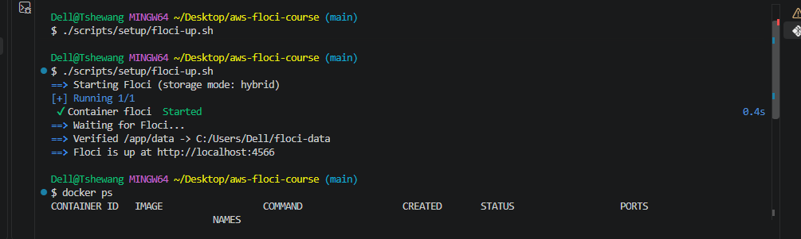

*The Floci container is started and running.*

#### Step 2: Load the environment files and check the identity

```bash
source configs/course.env
source configs/lab-01.env
source configs/lab-02.env
./scripts/utilities/whoami.sh
```

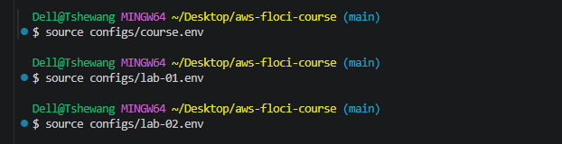

*The three env files are sourced so the Lab 01 and Lab 02 IDs are available as variables.*

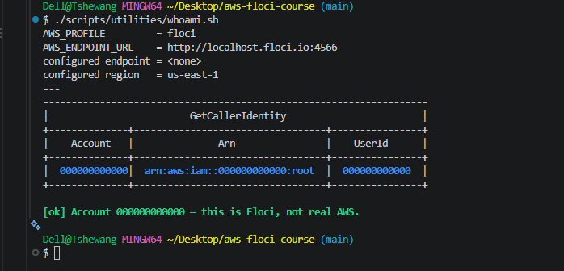

*The CLI reaches Floci at `http://localhost:4566` as account `000000000000`.*

#### Step 3: Check the Lab 02 values and verify Lab 02

```bash
printf '%-24s %s\n' \
  "public subnet a"    "$USMS_PUBLIC_SUBNET_A" \
  "private subnet a"   "$USMS_PRIVATE_SUBNET_A" \
  "app security group" "$USMS_APP_SG" \
  "db security group"  "$USMS_DB_SG" \
  "instance profile"   "$USMS_INSTANCE_PROFILE" \
  "availability zone a" "$USMS_AZ_A"
./scripts/utilities/verify-lab-02.sh
```

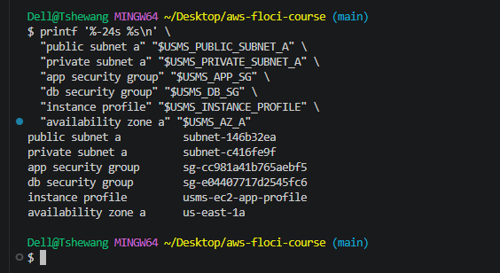

*All six values are non-empty, so `run-instances` will not fail with a `MissingParameter` error.*

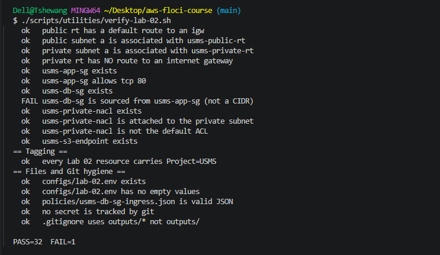

*The Lab 02 verification finishes with `FAIL=0`, so the VPC, subnets, route tables, internet gateway and security groups are intact.*

#### Step 4: Choose an AMI

```bash
aws ec2 describe-images --owners amazon \
  --query 'Images[].{Id:ImageId,Name:Name,Arch:Architecture,Root:RootDeviceType}' \
  --output table

AMI_ID=$(aws ec2 describe-images --owners amazon \
  --query 'Images[0].ImageId' --output text)
echo "AMI_ID = $AMI_ID"
```

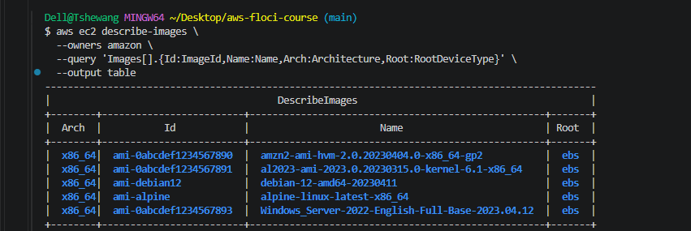

*The AMIs that Floci offers.*

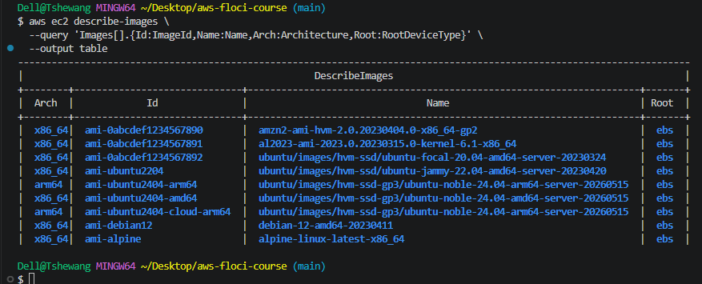

*The AMI ID captured for `run-instances`. On Floci an AMI is a metadata record, not a real disk image.*

#### Step 5: Create and verify the key pair

```bash
aws ec2 create-key-pair --key-name usms-app-key --key-type rsa ... \
  --query 'KeyMaterial' --output text > outputs/usms-app-key.pem
chmod 600 outputs/usms-app-key.pem

aws ec2 describe-key-pairs --key-names usms-app-key ...
```

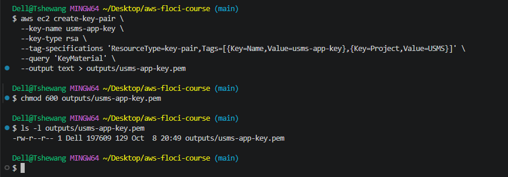

*The private key was written straight to a file, has permissions `-rw-------` and begins with a PEM header.*

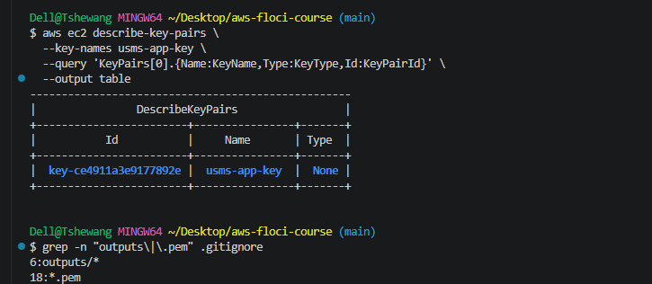

*AWS holds only the name, fingerprint and type of the key, never the private key.*

#### Step 6: Write and check the user-data script

```bash
bash -n labs/lab-03-ec2/user-data.sh && echo "user-data.sh syntax OK"
wc -c labs/lab-03-ec2/user-data.sh
```

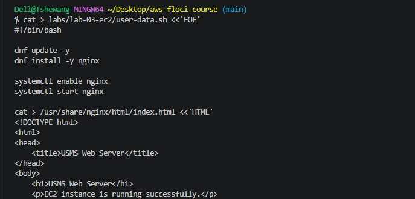

*The script was created with a quoted heredoc, so `$(...)` is evaluated later on the instance.*

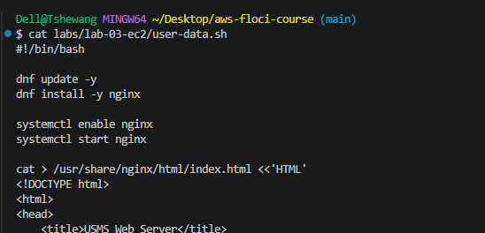

*The syntax is valid.*

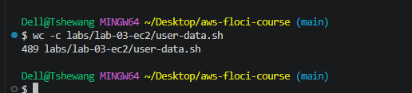

*The size is far below the 16 KB user-data limit.*

#### Step 7: Write the run-instances request template

```bash
cat > templates/lab-03-run-instances.json << EOF
{ "ImageId": "$AMI_ID", "InstanceType": "t3.micro", ... }
EOF
python3 -m json.tool templates/lab-03-run-instances.json > /dev/null && echo "valid JSON"
```

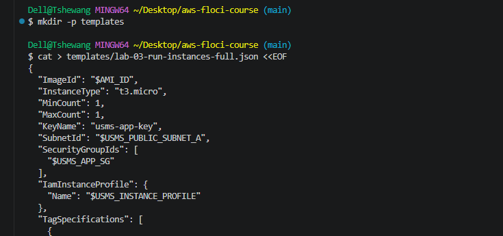
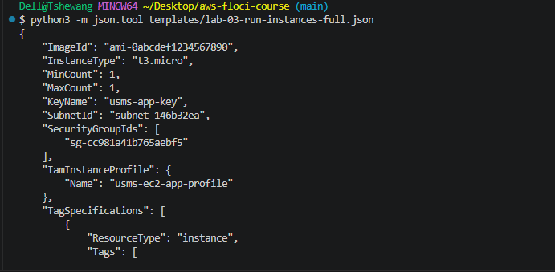
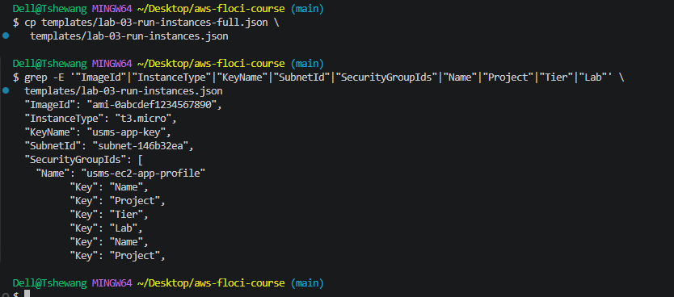

*The unquoted heredoc expanded `$AMI_ID`, `$USMS_PUBLIC_SUBNET_A`, `$USMS_APP_SG` and `$USMS_INSTANCE_PROFILE` at creation time. The JSON validates, no literal `$` remains, and a second `TagSpecifications` entry tags the root volume.*

#### Step 8: Launch the web tier (`usms-web-01`)

```bash
WEB_INSTANCE_ID=$(aws ec2 run-instances \
  --cli-input-json file://templates/lab-03-run-instances.json \
  --user-data file://labs/lab-03-ec2/user-data.sh \
  --query 'Instances[0].InstanceId' --output text)
aws ec2 wait instance-running --instance-ids "$WEB_INSTANCE_ID"
```

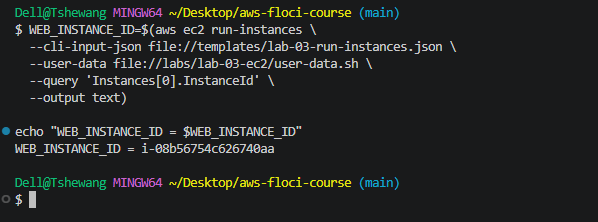

*`run-instances` succeeded and returned an instance ID.*

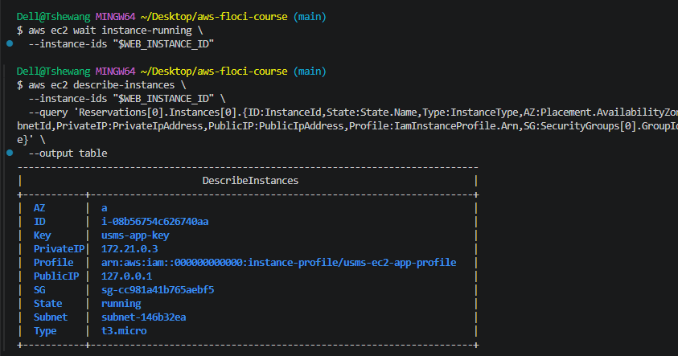

*The waiter exits with code 0. On Floci the change is almost instant; on real AWS it takes roughly 30 to 60 seconds.*

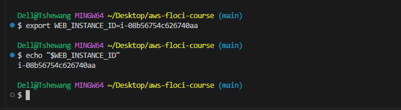

*The instance is `running`, `t3.micro`, in the public subnet, carrying `usms-app-sg`, with an instance profile and the `usms-app-key` key pair.*

#### Step 9: Prove the permission chain (instance → profile → role → policy)

```bash
aws iam get-instance-profile --instance-profile-name "$USMS_INSTANCE_PROFILE" ...
aws iam list-attached-role-policies --role-name usms-ec2-app-role ...
```

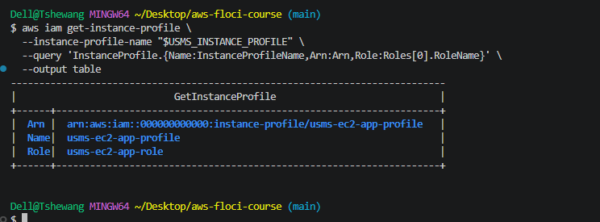

*The instance has the instance profile `usms-ec2-app-profile`.*

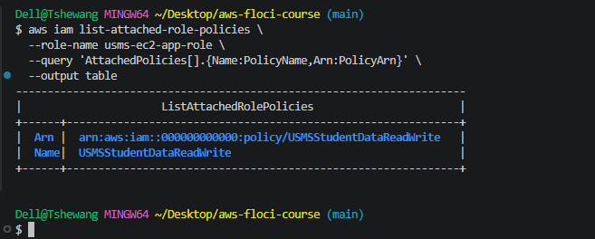

*The profile maps to the role `usms-ec2-app-role`, which has `USMSStudentDataReadWrite` attached.*

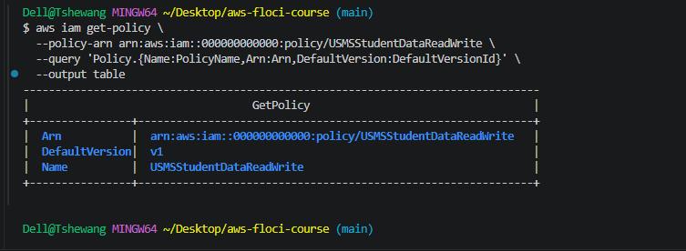
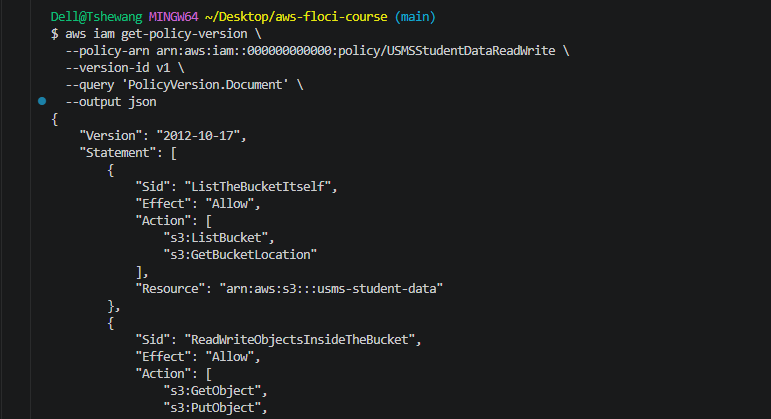

*The policy allows `s3:GetObject`, `s3:PutObject` and `s3:ListBucket` on `usms-student-data`, and denies `s3:DeleteBucket`.*

#### Step 10: Prove the user data arrived

```bash
aws ec2 describe-instance-attribute --instance-id "$WEB_INSTANCE_ID" \
  --attribute userData --query 'UserData.Value' --output text \
  > outputs/lab-03-userdata.b64
openssl base64 -d -A -in outputs/lab-03-userdata.b64 -out outputs/lab-03-userdata.sh
diff labs/lab-03-ec2/user-data.sh outputs/lab-03-userdata.sh
```

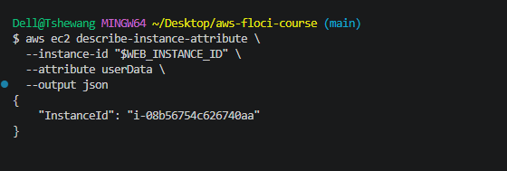

*The stored user data, decoded, is byte-identical to the original script: `diff` reports no differences.*

#### Step 11: Allocate and associate an Elastic IP

```bash
WEB_EIP_ALLOC=$(aws ec2 allocate-address --domain vpc ... --query 'AllocationId' --output text)
aws ec2 associate-address --allocation-id "$WEB_EIP_ALLOC" --instance-id "$WEB_INSTANCE_ID"
```

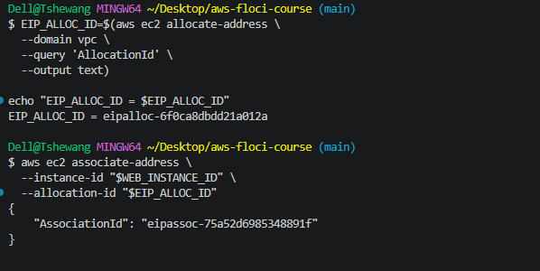

*An Elastic IP was allocated (allocation ID).*

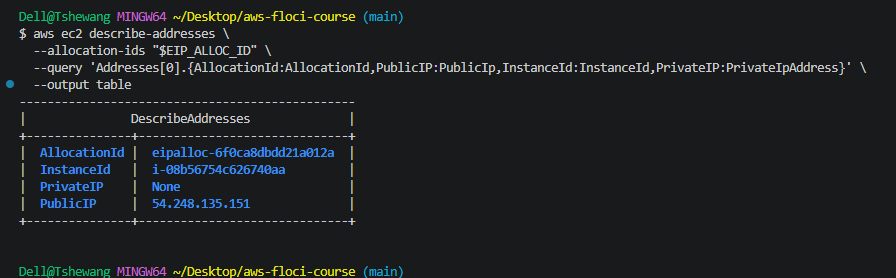

*It was associated with `usms-web-01` (association ID), and the instance's public address now shows the Elastic IP.*

#### Step 12: Create and attach the EBS data volume

```bash
aws ec2 create-volume --availability-zone "$INSTANCE_AZ" --size 8 --volume-type gp3 ...
aws ec2 attach-volume --volume-id "$WEB_VOLUME_ID" --instance-id "$WEB_INSTANCE_ID" --device /dev/sdf
```

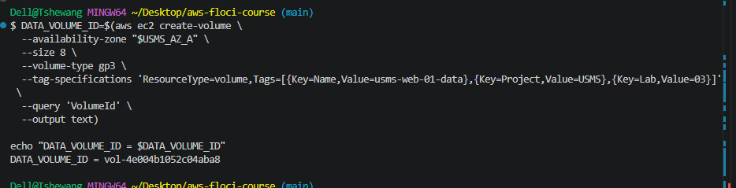
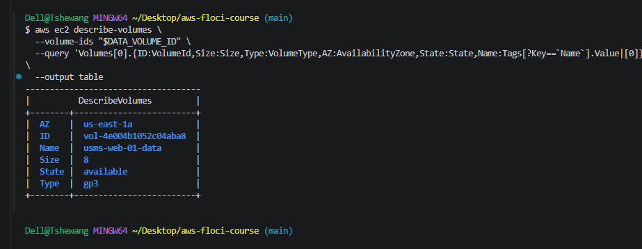

*The volume was created in the same Availability Zone as the instance, which is required because EBS volumes cannot cross AZs.*

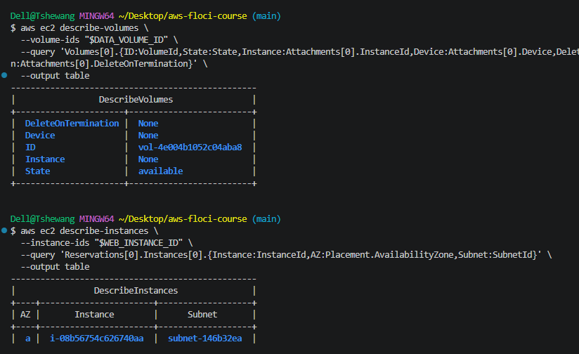
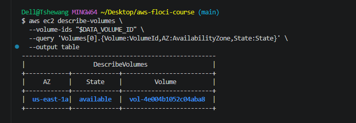
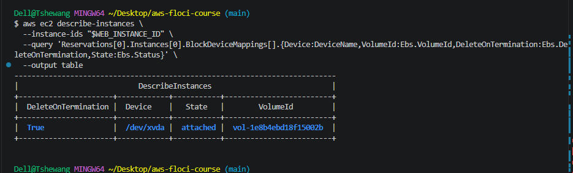

*The volume is attached at `/dev/sdf`. The root volume has `DeleteOnTermination` True and the data volume has `False`, so the data survives termination.*

#### Step 13: Launch the data tier (`usms-db-01`)

```bash
DB_INSTANCE_ID=$(aws ec2 run-instances \
  --image-id "$AMI_ID" --instance-type t3.micro --key-name usms-app-key \
  --subnet-id "$USMS_PRIVATE_SUBNET_A" --security-group-ids "$USMS_DB_SG" ...)
```

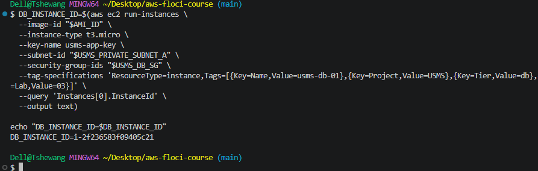

*`usms-db-01` was launched in the private subnet.*

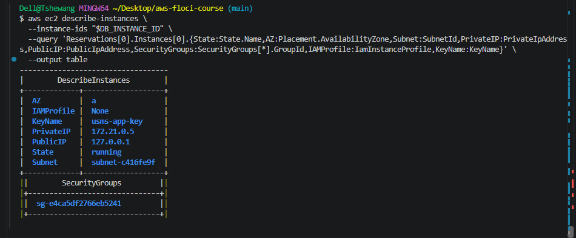

*Subnet `usms-private-subnet-a`, a private IP inside `10.0.3.0/24`, public IP `None`, security group `usms-db-sg` and instance profile `None` (least privilege).*

#### Step 14: Verify the two-tier wiring

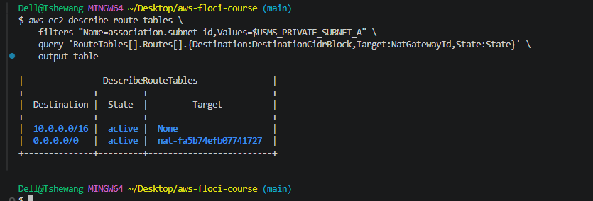

*Read-back of the network configuration for both tiers.*

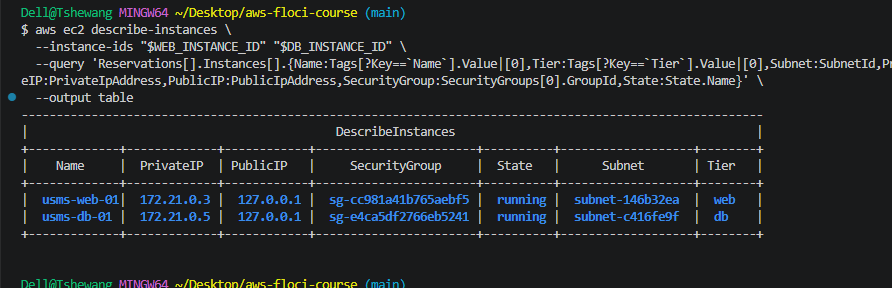

*`usms-web-01` carries `usms-app-sg` and has a public address; `usms-db-01` carries `usms-db-sg` and has none; `usms-db-sg` admits TCP 5432 from a security group, not a CIDR; and the private route table's default route goes to a NAT gateway, not the internet gateway.*

#### Step 15: Stop and start `usms-web-01`

```bash
aws ec2 stop-instances --instance-ids "$WEB_INSTANCE_ID"
aws ec2 wait instance-stopped --instance-ids "$WEB_INSTANCE_ID"
aws ec2 start-instances --instance-ids "$WEB_INSTANCE_ID"
aws ec2 wait instance-running --instance-ids "$WEB_INSTANCE_ID"
```

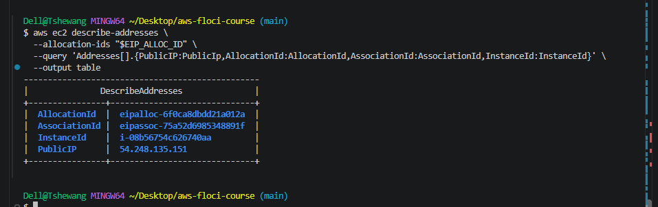

*The Elastic IP association before the test.*

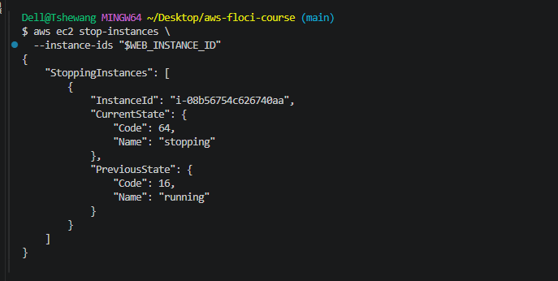
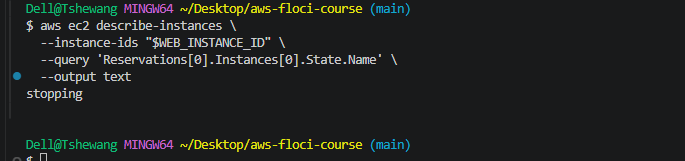
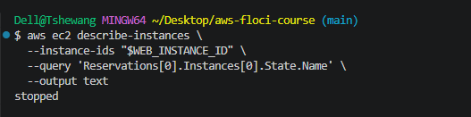

*The instance was stopped and reached the `stopped` state.*

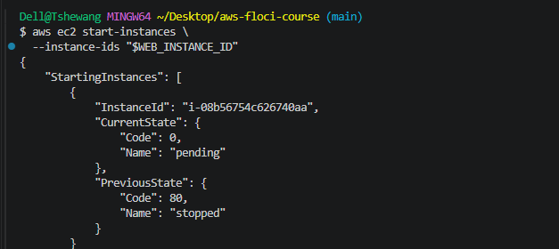
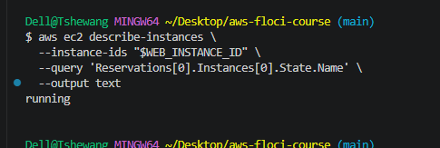

*The instance was started and returned to `running`.*

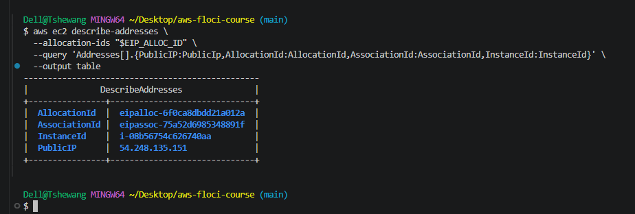

*The same Elastic IP is still associated with the instance.*

**Result:** [state what your output showed, e.g. the Elastic IP stayed associated with the same instance before and after the stop/start cycle and the private IP did not change.]

On real AWS an instance has no public address while stopped, the same Elastic IP returns after the start, and the private IP never changes. An auto-assigned address would have changed. [If your output did not show the public address disappearing while stopped, note that here as a Floci limitation.]

#### Step 16: Save the environment (`configs/lab-03.env`)

```bash
cat > configs/lab-03.env << EOF
export USMS_KEY_PAIR=usms-app-key
export USMS_WEB_INSTANCE=$(aws ec2 describe-instances ...)
export USMS_DB_INSTANCE=$(aws ec2 describe-instances ...)
export USMS_WEB_EIP_ALLOC=$(aws ec2 describe-addresses ...)
export USMS_WEB_PUBLIC_IP=$(aws ec2 describe-addresses ...)
export USMS_WEB_DATA_VOLUME=$(aws ec2 describe-volumes ...)
...
EOF
```

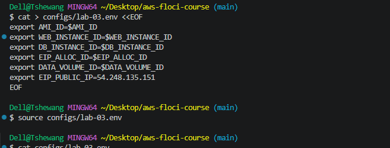

*The file was generated by looking resources up by tag rather than copying shell variables.*

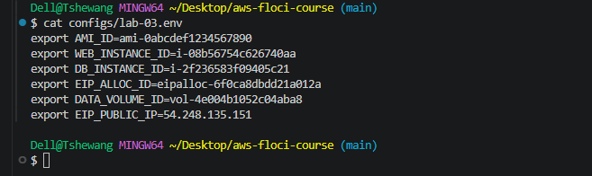

*The file was sourced and checked for empty or `None` values; it contains only IDs and no secrets.*

#### Step 17: Final verification

```bash
./scripts/utilities/verify-lab-03.sh
```

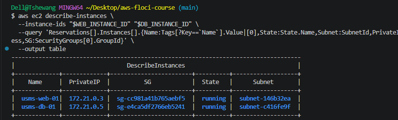
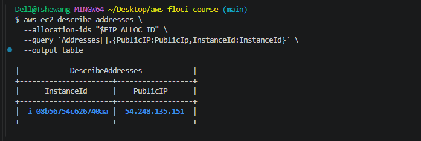
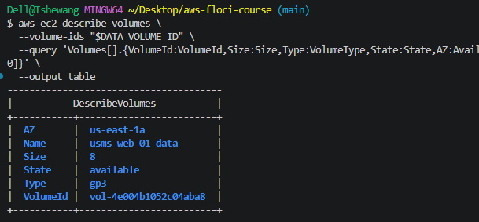

*Final read-back checks before running the script.*

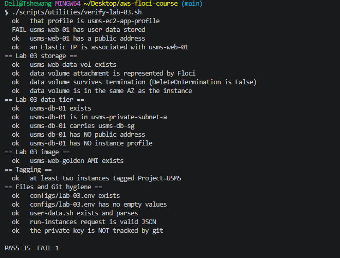

*The script checks the environment, Lab 01 and 02 dependencies, key pair, web tier, storage, data tier and tagging. Result: `PASS=[__]  FAIL=[__]`.*

Three checks go beyond confirming that something exists:

1. `usms-db-01` has **no** public address (a negative assertion).
2. The data volume has `DeleteOnTermination = False`, the setting that makes it durable.
3. The private key is `chmod 600` and **not** tracked by git (a security property).

### 6.2 AWS Management Console Verification

This lab ran on the Floci emulator, which has no web console, so the equivalent verification was read back through the CLI (`describe-instances`, `describe-addresses`, `describe-volumes` and the IAM read-backs shown in 6.1). If your course requires console evidence, repeat the key checks on a real AWS account and add one line under each screenshot:

- **EC2 Instances:** `usms-web-01` running in the public subnet and `usms-db-01` running in the private subnet.
- **Elastic IPs:** the address associated with `usms-web-01`.
- **EBS Volumes:** the 8 GiB gp3 data volume attached at `/dev/sdf`.
- **Key Pairs:** `usms-app-key` with its fingerprint.

---

## 7. Analysis and Discussion

**What was achieved.** A two-tier compute layer was built: a public web server with an instance profile, user data, an Elastic IP and a durable EBS volume, and a private database server with no public address and no instance profile. All settings were checked by reading them back through the API.

**Did the results match the expected outcome?** Yes. The web instance carried `usms-app-sg` and the instance profile; the database instance had no public IP and no profile; the stored user data was byte-identical to the script; and the Elastic IP stayed associated across stop and start. Stop/start result observed: [state what your output showed].

**Errors encountered and how they were resolved.** [Add any errors you hit and how you fixed them. None are recorded in the lab notes.]

**Observations.**

- Floci cannot reproduce several real AWS behaviours, so the expected real-AWS behaviour was documented instead:

| Area | Floci behaviour | Real AWS behaviour |
|---|---|---|
| AMIs | Metadata only; small or empty catalogue | Real, snapshot-backed images |
| Instance boot | No operating system boots, so nginx never runs | A VM boots and runs user data through cloud-init |
| Instance metadata (IMDS) | Not served | Temporary role credentials delivered automatically |
| Elastic IP | Tracked but not routable | Reachable from the internet; billed when unassociated |
| Security groups | Stored but not enforced | Enforced at the network interface |
| State changes | Nearly instant | 30 to 60 seconds typical |

- The bucket `usms-student-data` does not exist yet (it is created in Lab 4). This is valid because an IAM policy is a statement about ARNs, so the permission takes effect once something exists at that ARN.
- The allocation ID identifies the Elastic IP address itself, while the association ID identifies its binding to the instance.

---

## 8. Reflection

*Draft answers based on this lab; rewrite them in your own words.*

1. **What did you learn about this AWS service?** An instance is the combination of an image, a hardware type and first-boot configuration. An instance profile gives an application permissions with no stored keys, an Elastic IP has its own lifecycle and survives stop and start, and EBS volumes are tied to one Availability Zone with `DeleteOnTermination` deciding whether data survives.
2. **What challenges did you encounter?** [Your own experience.] Points worth mentioning: choosing quoted versus unquoted heredocs, getting an AMI on an emulator with a small image catalogue, and proving behaviour (security groups, boot, metadata) that Floci does not enforce.
3. **How would you apply this service in a real-world cloud environment?** Put web servers in public subnets behind a load balancer and the database in a private subnet, admitting traffic by security group reference, with instance profiles instead of access keys and data on separate EBS volumes.
4. **What additional concepts or features would you like to explore?** Auto Scaling groups, Application Load Balancers, launch templates, EBS snapshots, and resolving AMIs from SSM public parameters.

---

## 9. Conclusion

The objectives were achieved: the USMS web tier and data tier were launched in the correct subnets with the right security groups, the permission chain from instance to policy was confirmed, the user data was proved to be stored unchanged, the Elastic IP was shown to persist across a stop/start cycle, and the outputs were saved in `configs/lab-03.env` and checked with `verify-lab-03.sh`.

Key concepts learned were the split between AMI, instance type and user data, quoted versus unquoted heredocs, `--cli-input-json`, instance profiles, public and private tiers, security group references, EBS durability and Elastic IPs. The skills developed were launching and reading back EC2 resources with the CLI, designing least-privilege tiers, and documenting where an emulator differs from real AWS. EC2 matters because it is the foundation on which most cloud workloads are hosted.