# Lab 03 – EC2

## 1. Objective

Build the compute layer of the University Student Management System (USMS) on the Floci AWS emulator, using the network (Lab 02) and IAM instance profile (Lab 01) created earlier:

- Create a key pair and a user-data bootstrap script
- Launch a public **web-tier** instance (`usms-web-01`) in the public subnet
- Give it a stable public address (Elastic IP) and a separate EBS data volume
- Launch a private **data-tier** instance (`usms-db-01`) with no public address and no instance profile
- Prove the wiring by reading configuration back, test stop/start behaviour, record outputs in `configs/lab-03.env`, and run the verification script

---

## 2. Environment and prerequisites

### 2.1 Start Floci

```bash
cd ~/aws-floci-course
./scripts/setup/floci-up.sh
```

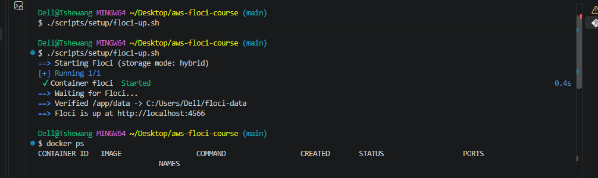

*Evidence: the Floci container is started and running.*

### 2.2 Load the environment files

```bash
source configs/course.env
source configs/lab-01.env
source configs/lab-02.env
```

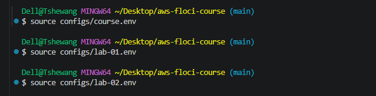

*Evidence: the three env files are sourced so the Lab 01 and Lab 02 IDs are available as variables.*

### 2.3 Check the AWS identity

```bash
./scripts/utilities/whoami.sh
```

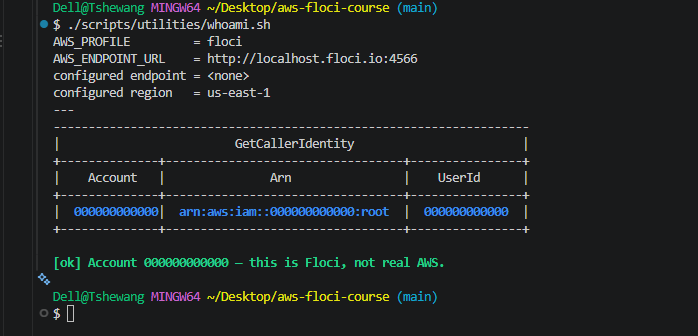

*Evidence: the CLI reaches Floci at `http://localhost:4566` as account `000000000000`.*

### 2.4 Check the important Lab 02 values

```bash
printf '%-24s %s\n' \
  "public subnet a"    "$USMS_PUBLIC_SUBNET_A" \
  "private subnet a"   "$USMS_PRIVATE_SUBNET_A" \
  "app security group" "$USMS_APP_SG" \
  "db security group"  "$USMS_DB_SG" \
  "instance profile"   "$USMS_INSTANCE_PROFILE" \
  "availability zone a" "$USMS_AZ_A"
```

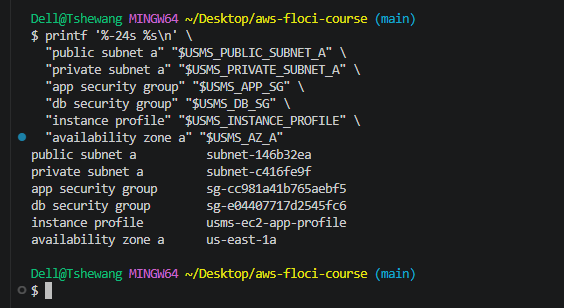

*Evidence: all six values are non-empty, so `run-instances` will not fail with a `MissingParameter` error.*

### 2.5 Verify Lab 02

```bash
./scripts/utilities/verify-lab-02.sh
```

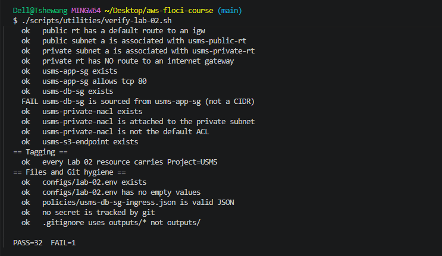

*Evidence: the Lab 02 verification script finishes with `FAIL=0`, confirming the VPC, subnets, route tables, internet gateway and security groups are intact before building on them.*

---

## 3. Choosing an AMI

### 3.1 List available images

```bash
aws ec2 describe-images --owners amazon \
  --query 'Images[].{Id:ImageId,Name:Name,Arch:Architecture,Root:RootDeviceType}' \
  --output table
```

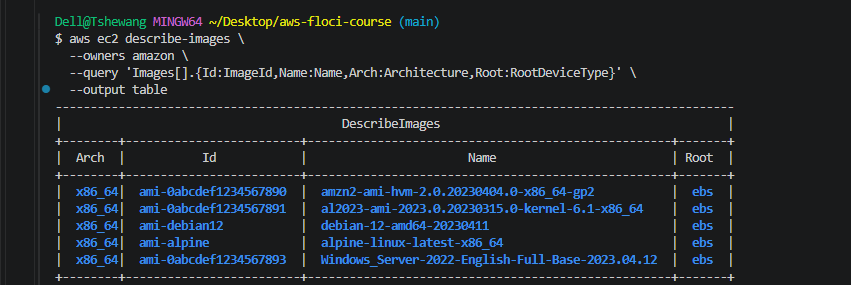

### 3.2 Check whether Floci has any AMIs

```bash
AMI_ID=$(aws ec2 describe-images --owners amazon \
  --query 'Images[0].ImageId' --output text)
echo "AMI_ID = $AMI_ID"
```

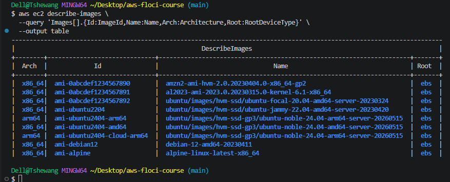

*Evidence: shows which AMI ID was captured for `run-instances`.*

**AMI option used:** [state which: image already provided by Floci / Option A `register-image` / Option B placeholder `ami-00000000000000000`]

**Observation:** On Floci, AMIs are metadata records, not real disk images. On real AWS, the current ID should be resolved at launch time from the SSM public parameter `/aws/service/ami-amazon-linux-latest/...` instead of being hard-coded.

---

## 4. Key pair

### 4.1 Create the key pair

```bash
aws ec2 create-key-pair \
  --key-name usms-app-key \
  --key-type rsa \
  --tag-specifications 'ResourceType=key-pair,Tags=[{Key=Name,Value=usms-app-key},{Key=Project,Value=USMS}]' \
  --query 'KeyMaterial' --output text > outputs/usms-app-key.pem

chmod 600 outputs/usms-app-key.pem
ls -l outputs/usms-app-key.pem
head -1 outputs/usms-app-key.pem
```

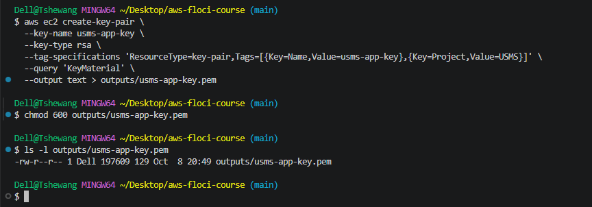

*Evidence: the private key is written straight to a file (never printed to the screen), has permissions `-rw-------`, and begins with a PEM header.*

### 4.2 Verify the key pair

```bash
aws ec2 describe-key-pairs --key-names usms-app-key \
  --query 'KeyPairs[0].{Name:KeyName,Fingerprint:KeyFingerprint,Type:KeyType}' \
  --output table
```

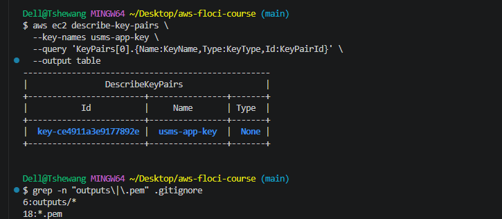

*Evidence: AWS holds the name, fingerprint and type of the key. It never stores the private key.*

---

## 5. User-data bootstrap script

### 5.1 Create the script

`labs/lab-03-ec2/user-data.sh` installs nginx, reads instance metadata using IMDSv2, writes the USMS portal page and a `health.json` endpoint, then enables nginx.

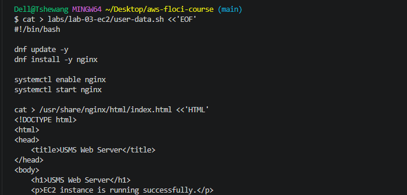

*Evidence: the script was created using a quoted heredoc (`<< 'EOF'`), so `$(...)` and `${...}` are evaluated later on the instance and not by the local shell.*

### 5.2 Check the syntax

```bash
bash -n labs/lab-03-ec2/user-data.sh && echo "user-data.sh syntax OK"
```

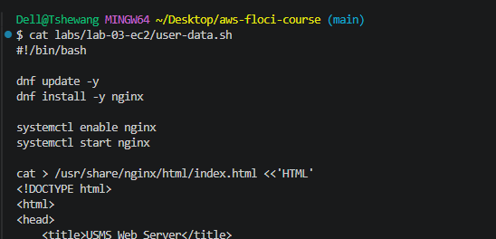

### 5.3 Check the size

```bash
wc -c labs/lab-03-ec2/user-data.sh
```

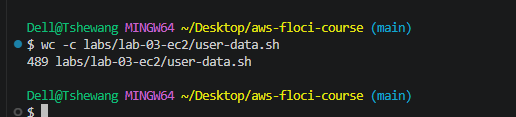

*Evidence: the syntax is valid and the size is far below the 16 KB user-data limit.*

---

## 6. The run-instances request template

```bash
cat > templates/lab-03-run-instances.json << EOF
{ "ImageId": "$AMI_ID", "InstanceType": "t3.micro", ... }
EOF

python3 -m json.tool templates/lab-03-run-instances.json > /dev/null && echo "valid JSON"
```

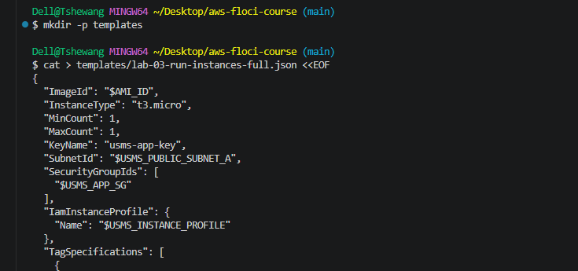
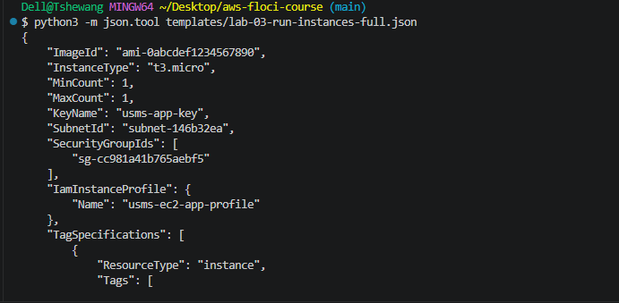
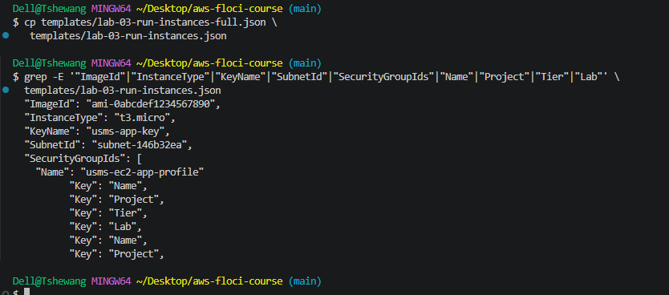

*Evidence: the template uses an unquoted heredoc so the variables (`$AMI_ID`, `$USMS_PUBLIC_SUBNET_A`, `$USMS_APP_SG`, `$USMS_INSTANCE_PROFILE`) are expanded at creation time. The JSON validates and no literal `$` remains. It also contains a second `TagSpecifications` entry for the root volume so that volume is not left untagged.*

---

## 7. Web-tier instance (`usms-web-01`)

### 7.1 Launch

```bash
WEB_INSTANCE_ID=$(aws ec2 run-instances \
  --cli-input-json file://templates/lab-03-run-instances.json \
  --user-data file://labs/lab-03-ec2/user-data.sh \
  --query 'Instances[0].InstanceId' --output text)
```

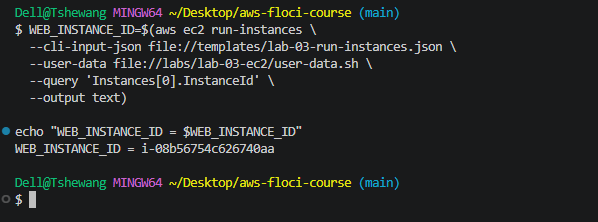

*Evidence: `run-instances` succeeded and returned an instance ID. The command-line `--user-data` is merged over the JSON, and the CLI base64-encodes the script automatically.*

### 7.2 Wait for running

```bash
aws ec2 wait instance-running --instance-ids "$WEB_INSTANCE_ID"
```

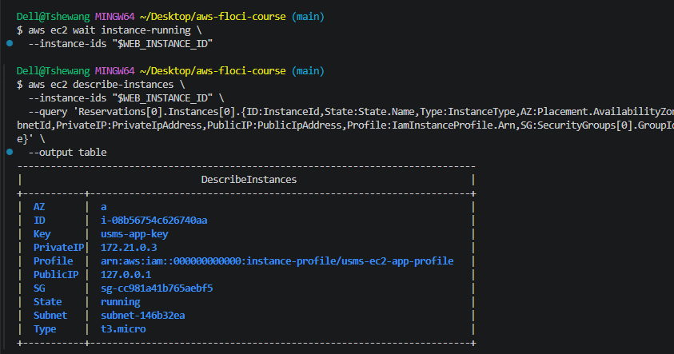

*Evidence: the waiter exits with code 0. On Floci the transition is almost instant, whereas on real AWS it takes roughly 30–60 seconds.*

### 7.3 Save the instance ID and inspect it

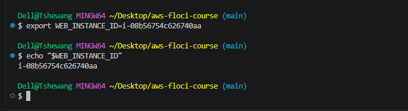

*Evidence: the instance is `running`, `t3.micro`, in the public subnet, carrying `usms-app-sg`, with an instance profile and the `usms-app-key` key pair.*

---

## 8. Permission chain: instance → profile → role → policy

### 8.1 Instance profile

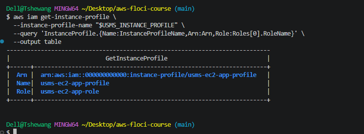

*Evidence: the instance has an instance profile ARN (`usms-ec2-app-profile`).*

### 8.2 Role and attached policies

```bash
aws iam get-instance-profile --instance-profile-name "$USMS_INSTANCE_PROFILE" ...
aws iam list-attached-role-policies --role-name usms-ec2-app-role ...
```

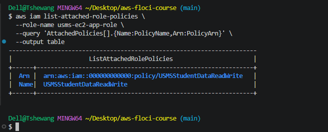

*Evidence: the profile maps to the role `usms-ec2-app-role`, which has `USMSStudentDataReadWrite` attached.*

### 8.3 Policy document

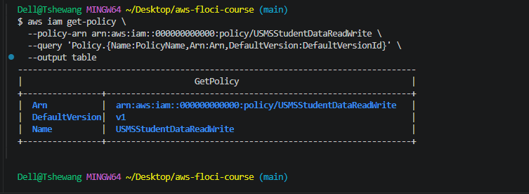
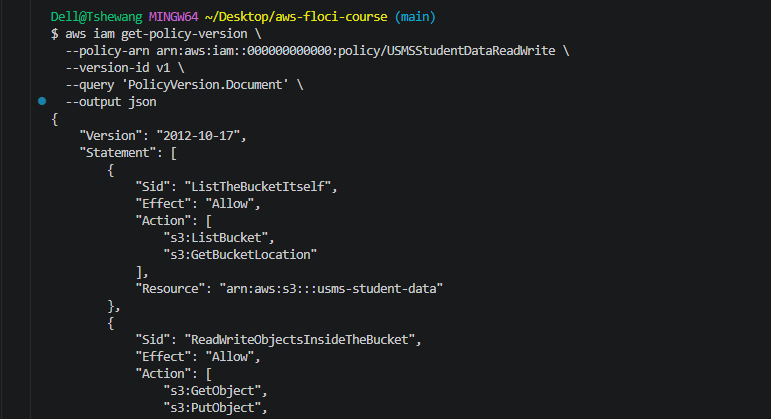

*Evidence: the policy allows `s3:GetObject`, `s3:PutObject` and `s3:ListBucket` on `usms-student-data`, and denies `s3:DeleteBucket`.*

**Key idea for notes:** the bucket `usms-student-data` does not exist yet (it is created in Lab 4). An IAM policy is a statement about ARNs, not a reference to existing objects, so it is valid to grant access to a resource that does not exist. The permission takes effect as soon as something is created at that ARN, and the instance can then write to it with no access key stored on the machine.

**Floci limitation:** Floci does not serve the Instance Metadata Service (169.254.169.254), so the instance cannot actually fetch temporary credentials. The stored association chain is what is being assessed.

---

## 9. Proving the user data arrived

```bash
aws ec2 describe-instance-attribute --instance-id "$WEB_INSTANCE_ID" \
  --attribute userData --query 'UserData.Value' --output text \
  > outputs/lab-03-userdata.b64

openssl base64 -d -A -in outputs/lab-03-userdata.b64 -out outputs/lab-03-userdata.sh
diff labs/lab-03-ec2/user-data.sh outputs/lab-03-userdata.sh
```

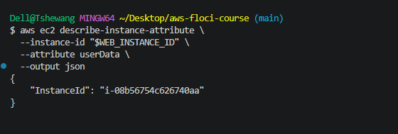

*Evidence: the user data stored by EC2 was read back, base64-decoded with `openssl` (portable across GNU and BSD), and compared with the original script. No differences means the stored payload is byte-identical to what was written.*

---

## 10. Elastic IP

```bash
WEB_EIP_ALLOC=$(aws ec2 allocate-address --domain vpc ... --query 'AllocationId' --output text)
aws ec2 associate-address --allocation-id "$WEB_EIP_ALLOC" --instance-id "$WEB_INSTANCE_ID"
```

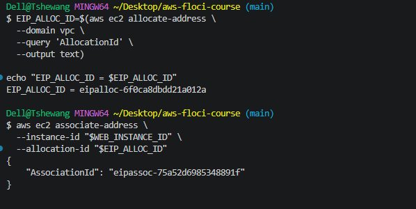
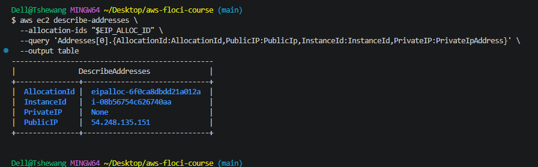

*Evidence: an Elastic IP was allocated (allocation ID) and associated with `usms-web-01` (association ID). The instance's public address now shows the Elastic IP.*

**Concept:** the allocation ID identifies the address itself, while the association ID identifies the binding between the address and the instance. When an Elastic IP is associated, the auto-assigned public address is released.

**Floci limitation:** the address looks like a public IPv4 address but is not routable from the internet. On real AWS, an unassociated Elastic IP is charged.

---

## 11. EBS data volume

### 11.1 Create the 8 GiB gp3 volume

```bash
aws ec2 create-volume --availability-zone "$INSTANCE_AZ" --size 8 --volume-type gp3 ...
```

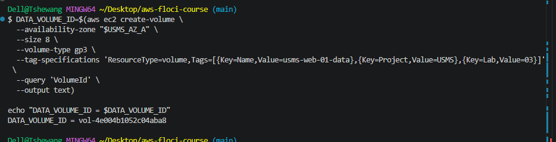
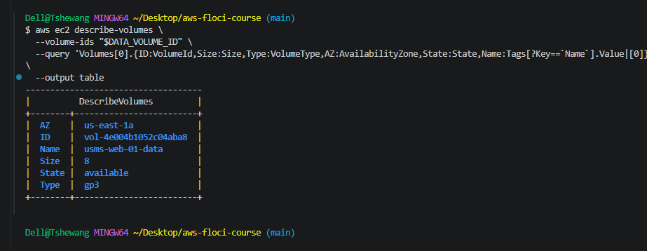

*Evidence: the volume was created in the same Availability Zone as the instance, which is required because EBS volumes cannot cross AZs.*

### 11.2 Attach as `/dev/sdf`

```bash
aws ec2 attach-volume --volume-id "$WEB_VOLUME_ID" --instance-id "$WEB_INSTANCE_ID" --device /dev/sdf
```

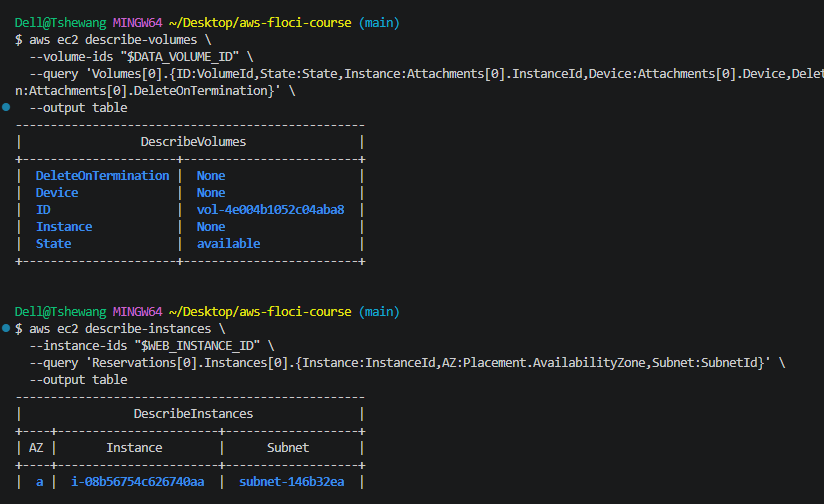
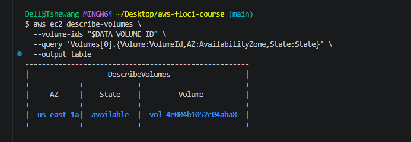
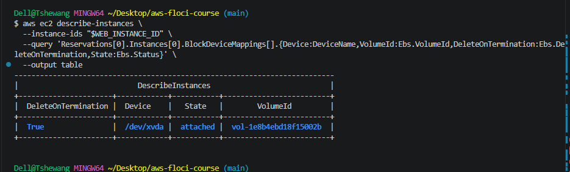

*Evidence: the volume is attached to `usms-web-01`. The instance now has two volumes: the root volume (DeleteOnTermination `True`) and the data volume (DeleteOnTermination `False`), which means the data volume survives termination.*

---

## 12. Data-tier instance (`usms-db-01`)

### 12.1 Launch in the private subnet

```bash
DB_INSTANCE_ID=$(aws ec2 run-instances \
  --image-id "$AMI_ID" --instance-type t3.micro --key-name usms-app-key \
  --subnet-id "$USMS_PRIVATE_SUBNET_A" --security-group-ids "$USMS_DB_SG" ...)
```

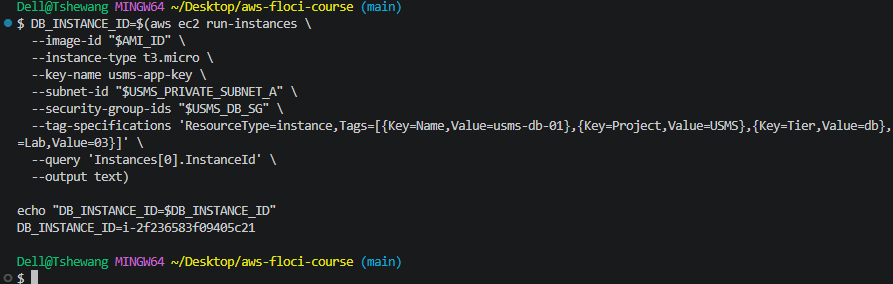

### 12.2 Verify

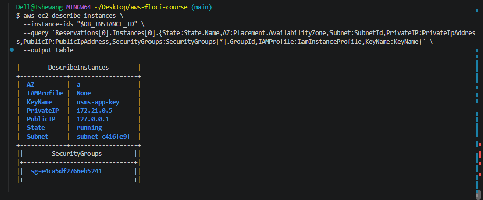

*Evidence:*

| Property | Expected | Why |
|---|---|---|
| Subnet | `usms-private-subnet-a` | Data tier is isolated from the internet gateway |
| Private IP | inside `10.0.3.0/24` | CIDR chosen in Lab 02 |
| Public IP | `None` | Private subnet has `MapPublicIpOnLaunch=False` |
| Security group | `usms-db-sg` | Only admits the app tier |
| Instance profile | `None` | The database tier has no reason to call the S3 API (least privilege) |

---

## 13. Verifying the two-tier wiring

### 13.1 Network wiring

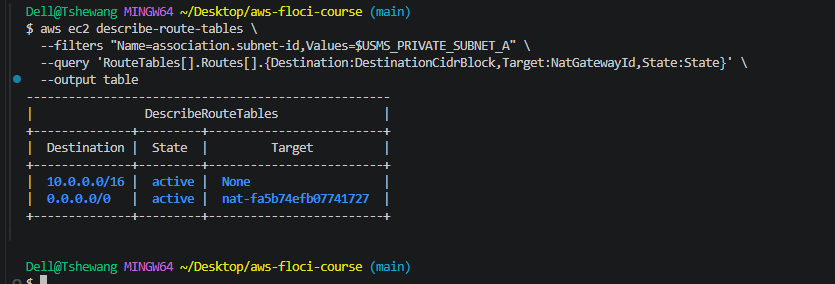

### 13.2 Both tiers together

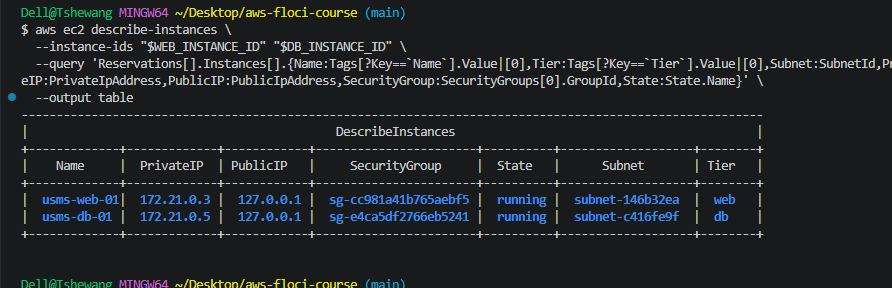

*Evidence:*

- `usms-web-01` carries `usms-app-sg` and has a public address
- `usms-db-01` carries `usms-db-sg` and has no public address
- `usms-db-sg` admits TCP 5432 **from a security group** (the group `usms-web-01` carries), not from a CIDR range
- The private route table's default route goes to a **NAT gateway**, not the internet gateway: outbound is possible, inbound is not

**Note:** Floci does not enforce security groups, so a refused connection cannot be demonstrated. The configuration that would produce that behaviour is read back and shown to be correct instead.

---

## 14. Stop/start behaviour and Elastic IP persistence

### 14.1 Elastic IP before the test

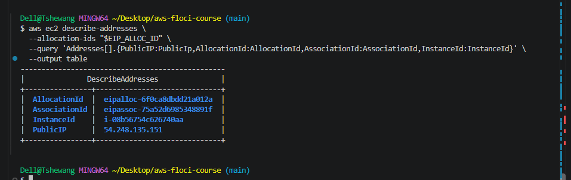

### 14.2 Stop `usms-web-01`

```bash
aws ec2 stop-instances --instance-ids "$WEB_INSTANCE_ID"
aws ec2 wait instance-stopped --instance-ids "$WEB_INSTANCE_ID"
```

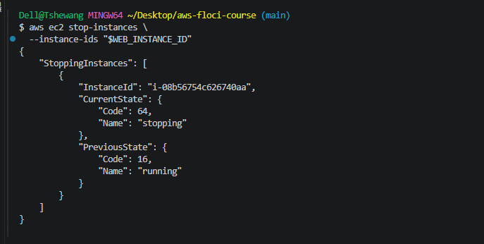
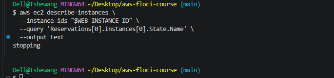
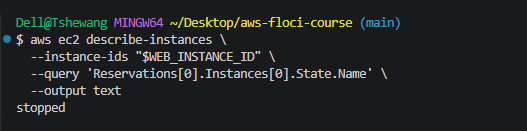

### 14.3 Start `usms-web-01`

```bash
aws ec2 start-instances --instance-ids "$WEB_INSTANCE_ID"
aws ec2 wait instance-running --instance-ids "$WEB_INSTANCE_ID"
```

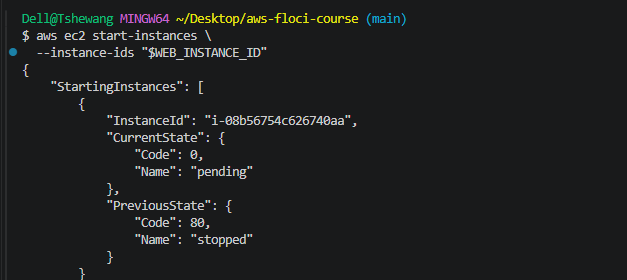
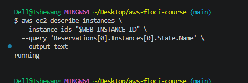

### 14.4 Verify the same Elastic IP is still associated

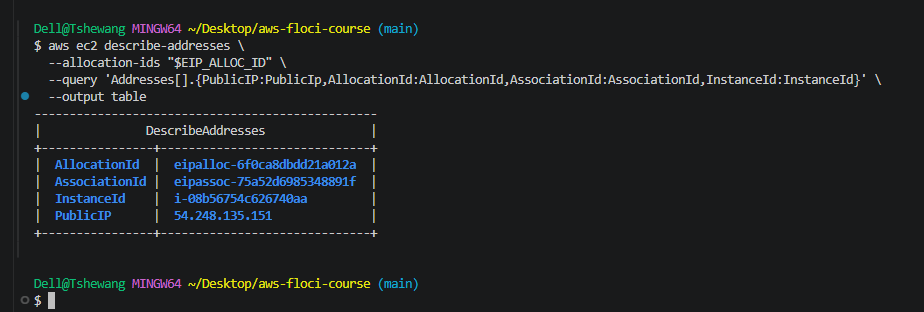

**Result:** [state what your output showed: e.g. the Elastic IP stayed associated with the same instance before and after the stop/start cycle, and the private IP did not change.]

**Expected behaviour on real AWS:** while stopped, an instance has no public address; after starting, the Elastic IP is back and is the same address; the private IP never changes. An auto-assigned address would have changed. This matters for DNS: a record pointing at an auto-assigned address would break after a stop/start, but a record pointing at an Elastic IP keeps working.

**Floci note:** [if your output did not show the public address disappearing while stopped, record it here as a Floci limitation.]

---

## 15. Saving the Lab 03 environment

```bash
cat > configs/lab-03.env << EOF
export USMS_KEY_PAIR=usms-app-key
export USMS_WEB_INSTANCE=$(aws ec2 describe-instances ...)
export USMS_DB_INSTANCE=$(aws ec2 describe-instances ...)
export USMS_WEB_EIP_ALLOC=$(aws ec2 describe-addresses ...)
export USMS_WEB_PUBLIC_IP=$(aws ec2 describe-addresses ...)
export USMS_WEB_DATA_VOLUME=$(aws ec2 describe-volumes ...)
...
EOF
```

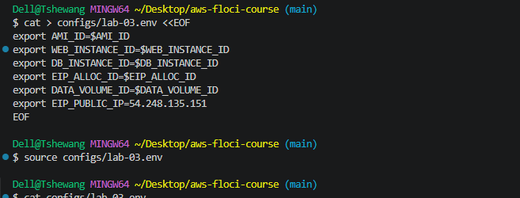
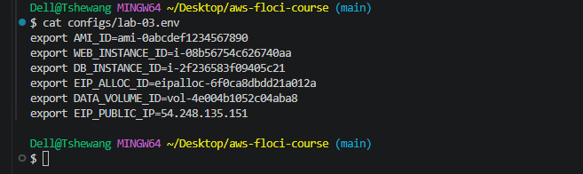

*Evidence: `configs/lab-03.env` was generated by looking resources up by tag rather than copying shell variables, and contains only IDs (no secrets). The file was sourced and checked for empty or `None` values.*

---

## 16. Final verification

### 16.1 Final checks

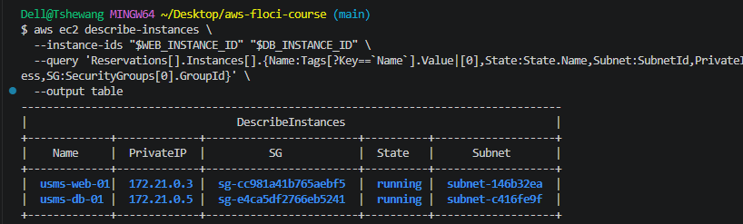
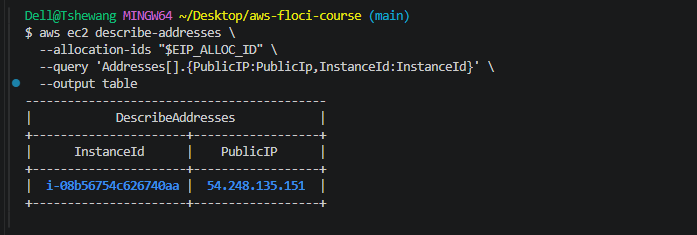
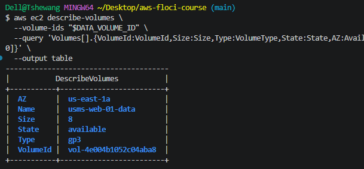

### 16.2 Lab 03 verification script

```bash
./scripts/utilities/verify-lab-03.sh
```

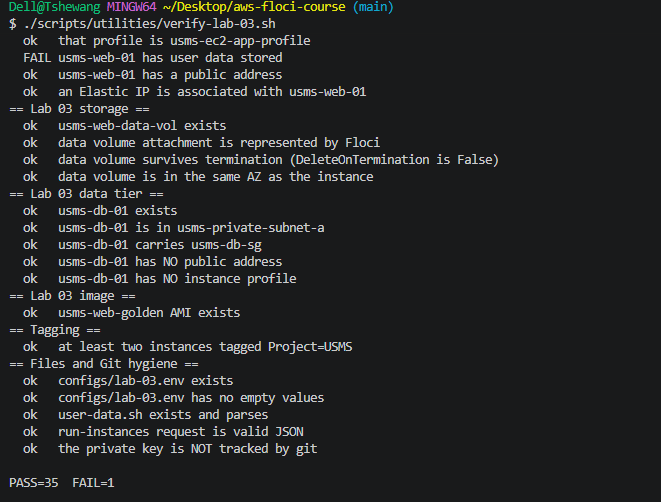

*Evidence: the script checks the environment, Lab 01/02 dependencies, key pair (including `chmod 600`), web tier, storage, data tier and tagging. Result: `PASS=[__]  FAIL=[__]`.*

Three checks go beyond simply confirming that something exists:

1. `usms-db-01` has **no** public address (a negative assertion)
2. The data volume has `DeleteOnTermination = False` (the configuration that makes it durable)
3. The private key is `chmod 600` and **not** tracked by git (a security property)

---

## 17. Architecture built

```
usms-vpc
 ├── usms-public-subnet-a   (10.0.1.0/24)
 │    └── usms-web-01   t3.micro   usms-app-sg   usms-ec2-app-profile
 │         ├── Elastic IP (usms-web-eip)
 │         └── EBS data volume 8 GiB gp3 (/dev/sdf, DeleteOnTermination=False)
 └── usms-private-subnet-a  (10.0.3.0/24)
      └── usms-db-01    t3.micro   usms-db-sg   no profile   no public address
           admits tcp/5432 from usms-app-sg only
           outbound via NAT gateway only
```

---

## 18. Floci limitations observed

| Area | Floci behaviour | Real AWS behaviour |
|---|---|---|
| AMIs | Metadata only; small or empty catalogue | Thousands of real, snapshot-backed images |
| Instance boot | No operating system is booted, so nginx never runs and HTTP tests would time out | Real VM boots and runs user data via cloud-init |
| Instance metadata (IMDS) | Not served | Temporary role credentials delivered automatically |
| Elastic IP | Allocated and tracked but not routable | Reachable from the internet; billed when unassociated |
| Security groups | Stored but not enforced | Enforced at the network interface |
| Instance state changes | Nearly instant | 30–60 seconds typical |

---

## 19. Key concepts learned

- **AMI vs instance type vs user data:** the image, the hardware, and the first-boot configuration. User data runs once, as root, and is limited to 16 KB before encoding.
- **Quoted vs unquoted heredocs:** decide whether text is expanded *now* (unquoted) or *later* (quoted).
- **`--cli-input-json`:** turns a long API call into a reviewable, version-controlled file; command-line flags override the JSON.
- **Instance profile chain:** instance → profile → role → policy, giving access with no stored credentials.
- **Public/private tiers:** a public subnet reaches the internet gateway; a private subnet uses a NAT gateway for outbound only.
- **Security group references:** allowing traffic from a group is more robust than allowing a CIDR range.
- **EBS:** volumes are AZ-bound and independent of the instance; `DeleteOnTermination` determines whether data survives.
- **Elastic IP:** an address with its own lifecycle, decoupled from the instance, so it survives stop/start.
- **Debugging reachability:** instance running → route table/IGW → IGW attached → NACL → security group → public address → process listening on the port.

---

## 20. Conclusion

The USMS compute layer was built on Floci: a public web server with an instance profile, user data, Elastic IP and a durable EBS data volume, and a private database server with no public address and no instance profile. The configuration was verified by reading it back through the API, the Elastic IP was shown to persist across a stop/start cycle, the outputs were saved in `configs/lab-03.env`, and the verification script was run. Where Floci cannot emulate real AWS behaviour (booting an OS, IMDS, routable addresses, security group enforcement), the expected real-AWS behaviour has been documented instead.

