# Lab 04 Report: ECS 

## 1. Objective

The aim of this lab was to deploy the USMS enrolment API as a containerised service on **Amazon ECS with Fargate**, built on top of the networking from Lab 2 and the IAM work from Lab 1. The work covered:

- Creating an ECS cluster while holding the least-privileged `usms-developer-role`
- Creating a CloudWatch log group with a retention policy
- Creating **two separate IAM roles**: the task execution role and the task role
- Reusing Lab 1's `USMSStudentDataReadWrite` policy on the task role
- Creating a security group sourced from the web tier's security group rather than a CIDR
- Writing and registering a Fargate task definition
- Creating a service across two private subnets (two Availability Zones)
- Proving that `desiredCount` is the only value auto scaling will change, by changing it by hand
- Recording outputs in `configs/lab-04.env` and building an automated verification script

## 2. Architecture Built

```
usms-ecs-cluster
 └── usms-enrolment-svc          ACTIVE   FARGATE
      ├── task definition        usms-enrolment:1  (256 CPU / 512 MiB, awsvpc)
      ├── desired 2 tasks        one per private subnet / Availability Zone
      ├── subnets                usms-private-subnet-a, usms-private-subnet-b
      ├── security group         usms-enrolment-sg (in: TCP 80 from usms-app-sg only)
      ├── assignPublicIp         DISABLED
      ├── executionRoleArn       usms-ecs-exec-role  -> USMSECSTaskExecution
      ├── taskRoleArn            usms-ecs-task-role  -> USMSStudentDataReadWrite
      └── logs                   /usms/ecs/enrolment (7-day retention)
```

Image pull path from the private subnets: `usms-private-rt` → `usms-nat` → `usms-igw` → registry (with the S3 gateway endpoint carrying some layer data).

---

## 3. Implementation and Evidence

### Step 1: Resume the environment and load the env files

Floci was started with `./scripts/setup/floci-up.sh`, then `course.env`, `lab-01.env`, `lab-02.env` and `lab-03.env` were sourced. The identity guard `whoami.sh` confirmed the session was pointing at the Floci account and not a real AWS account.

**Start Floci**

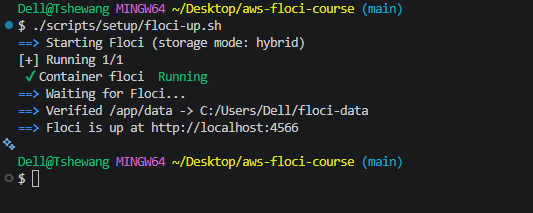

**Load the environment files**

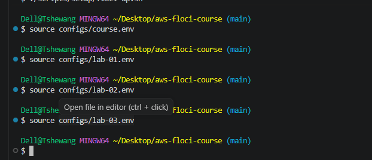

**Check the Floci identity**

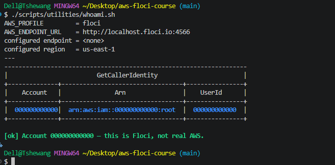

**Check the important variables** (private subnets, app security group, VPC, NAT gateway, web instance, region, account)

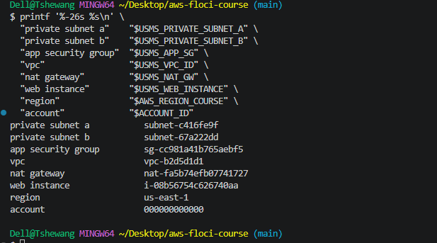

### Step 2: Confirm Labs 2 and 3 are still intact

`verify-lab-02.sh` and `verify-lab-03.sh` were run to confirm the resources this lab depends on still exist and are correctly configured (in particular that the private route table has no route to an internet gateway, and that `usms-web-01` carries `usms-app-sg`).

**Verify Lab 2**

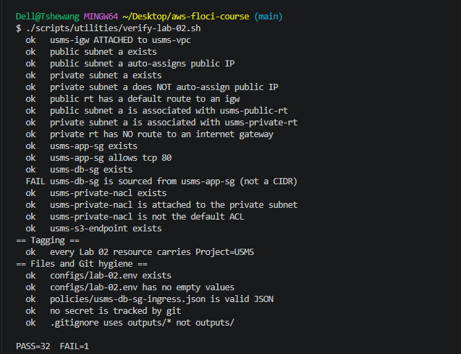

**Verify Lab 3**

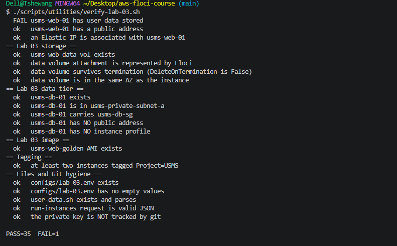

### Step 3: Probe what this Floci build supports

The probe function tested ECS, Application Auto Scaling, CloudWatch and CloudWatch Logs.

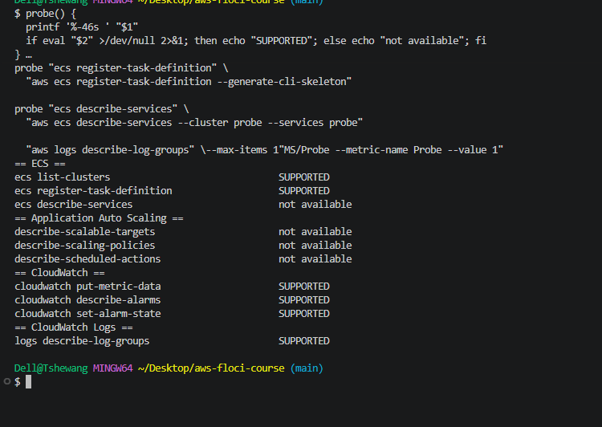

**Support path recorded: Path A (full).** The probe showed ECS, Application Auto Scaling, CloudWatch and CloudWatch Logs all answering, so every step in this lab was completed as written, and Lab 06 can use the full set of scaling-policy calls. This was written at the top of `notes/lab-04-notes.md`.

### Step 4: Create the ECS cluster as the developer role

I assumed `usms-developer-role` through STS, exported the temporary credentials, confirmed the caller identity showed `assumed-role/usms-developer-role/lab04-ecs-build`, and then created the cluster `usms-ecs-cluster` with `containerInsights` enabled.

**Assume the developer role**

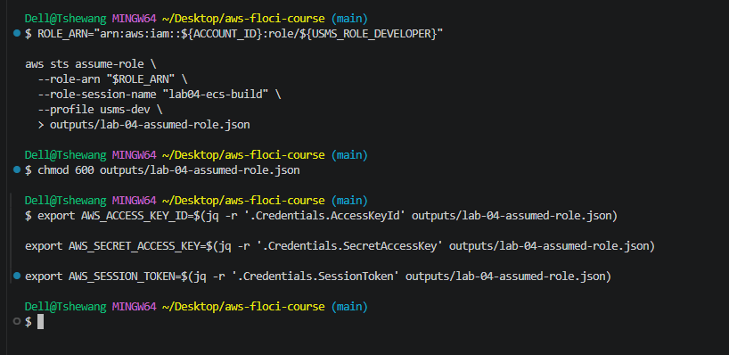
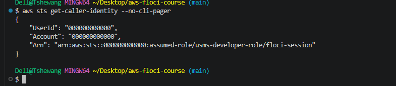

**Create the ECS cluster**

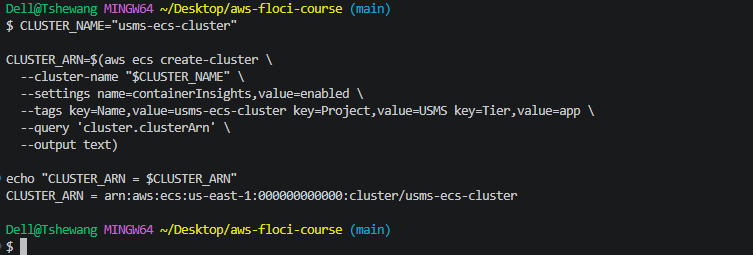

**Restore the normal identity** (unset the three temporary credential variables so the session credentials no longer override the profile)

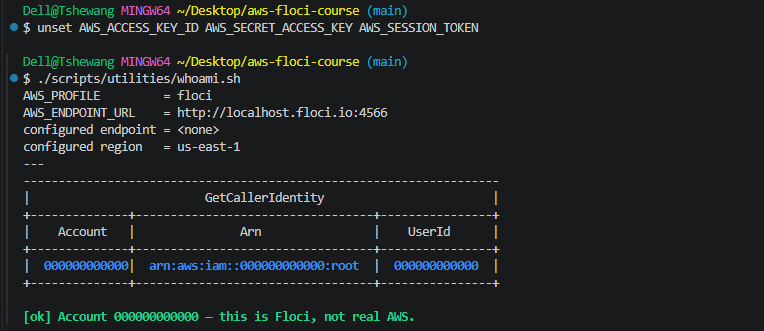

**Verify the cluster** (expected: `ACTIVE`, 0 services, 0 tasks)

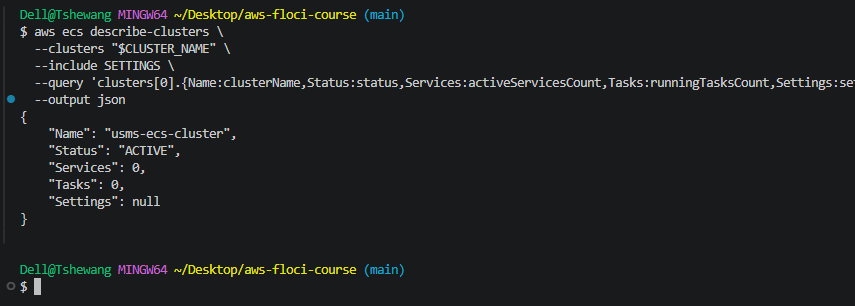

**Check whether Floci returns the `containerInsights` setting**
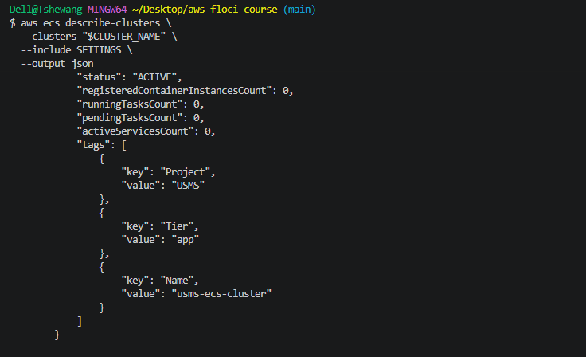

### Step 5: Create the CloudWatch log group

`/usms/ecs/enrolment` was created and a 7-day retention policy applied as a separate call, because `create-log-group` has no retention parameter. Without it the group would keep data (and cost) indefinitely.

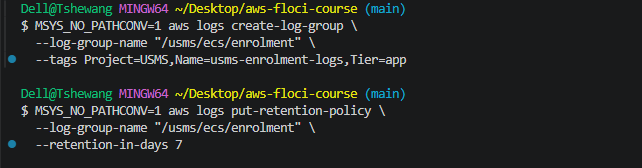

**Verify** (one row, retention exactly 7)

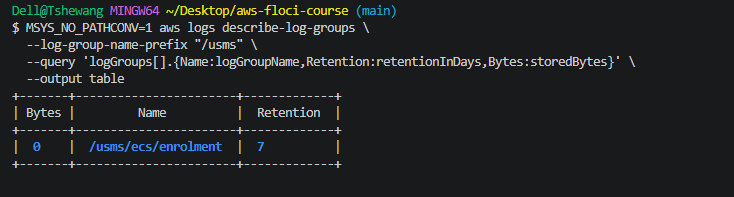

### Step 6: Create the task execution role

The execution role is assumed by the ECS agent / Fargate infrastructure before the container starts. It needs to pull the image and write the log stream.

**Create the trust policy** (`ecs-tasks.amazonaws.com`, written with a quoted heredoc so nothing was expanded)

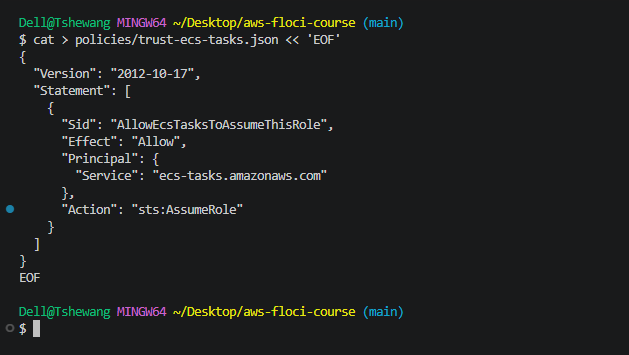

**Validate the JSON**

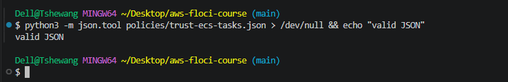

**Create the execution role `usms-ecs-exec-role`**

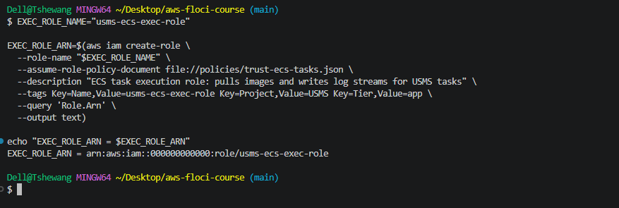

**Create the execution policy** (ECR pull actions plus `logs:CreateLogStream` / `logs:PutLogEvents` scoped to the single enrolment log group)

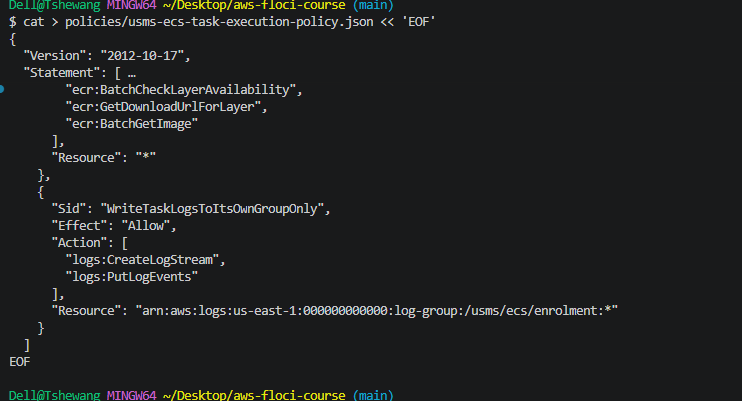

**Validate the JSON**

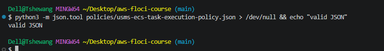

**Create and attach the policy `USMSECSTaskExecution`**

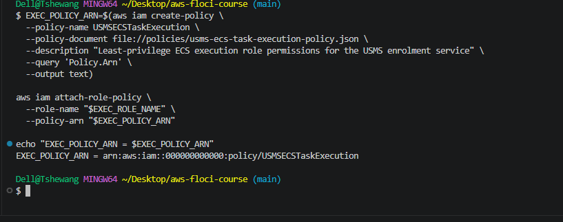

**Verify the role** (principal is `ecs-tasks.amazonaws.com`, not `ecs.amazonaws.com`, and `USMSECSTaskExecution` is attached)

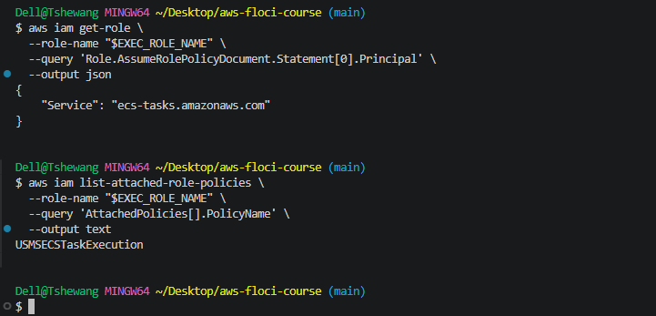

### Step 7: Create the task role and reuse Lab 1's policy

The task role is the identity used by the application code inside the container. The same trust policy file was reused, and `USMSStudentDataReadWrite` from Lab 1 was attached unchanged.

**Create the ECS task role `usms-ecs-task-role`**

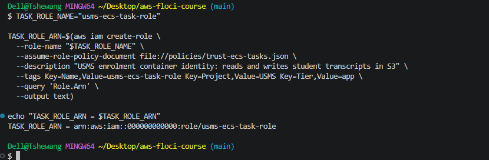

**Attach the existing Lab 1 policy `USMSStudentDataReadWrite`**

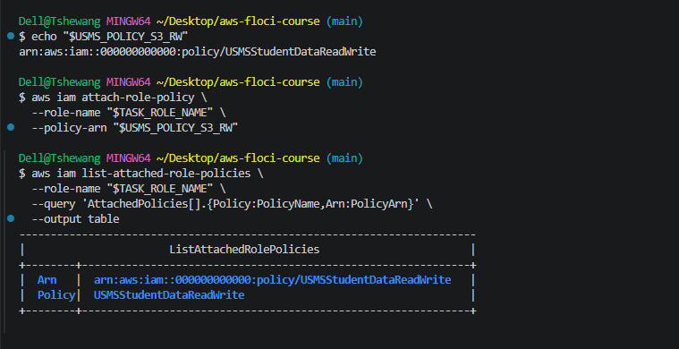

**Verify the policy** (the policy document read back and compared with what Lab 3 printed for the EC2 role)

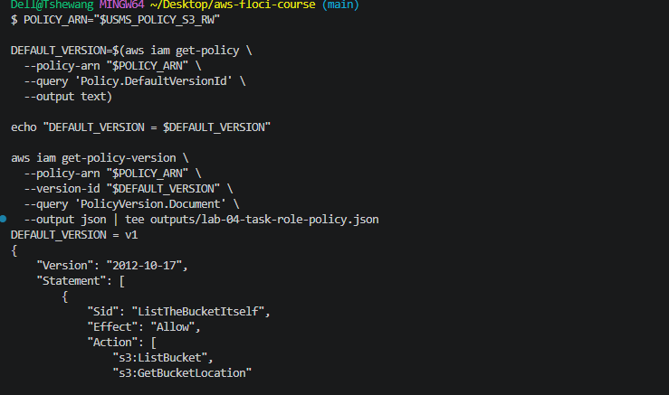
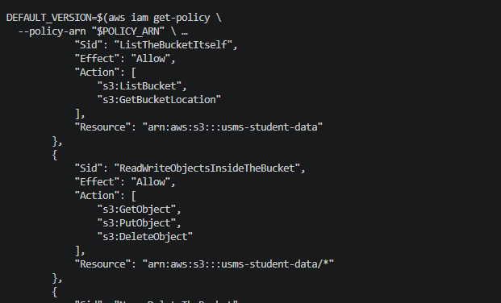

### Step 8: Create the enrolment security group

`usms-enrolment-sg` was created in the USMS VPC. The inbound rule allows TCP port 80 **only from the web tier's security group** (`usms-app-sg`), not from a CIDR range. A group reference is close to mandatory in an auto-scaling system because task network interfaces and addresses constantly change.

**Create the security group**

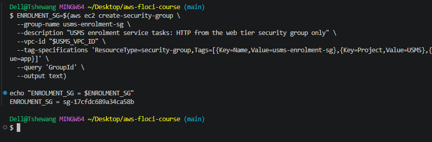

**Add the HTTP port 80 rule sourced from `$USMS_APP_SG`**

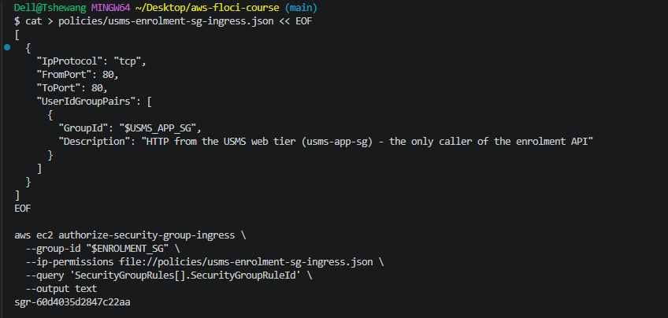

**Verify that port 80 comes only from `USMS_APP_SG` and not from a CIDR**

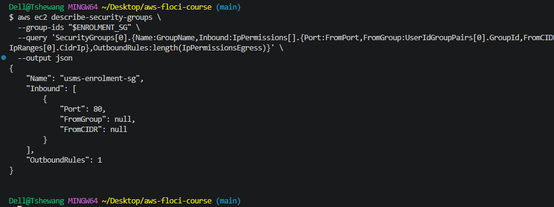

**Re-add the rule using the actual security group ID explicitly**

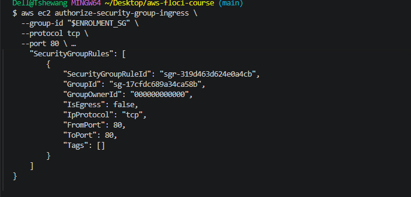

**Verify the stored rule**

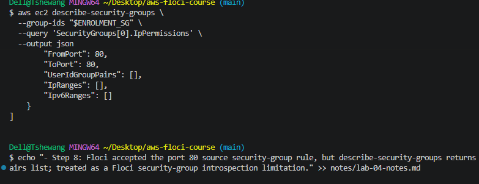

### Step 9: Write and register the task definition

The task definition `usms-enrolment` is a Fargate, `awsvpc` blueprint using 256 CPU / 512 MiB (both as strings), with different `executionRoleArn` and `taskRoleArn` values, an `awslogs` log configuration pointing at `/usms/ecs/enrolment`, and a placeholder public nginx image. It was written with an **unquoted** heredoc so the role ARNs and region were expanded at write time. The `grep -c '\$'` check confirmed no unexpanded variables remained.

**Write the task definition**

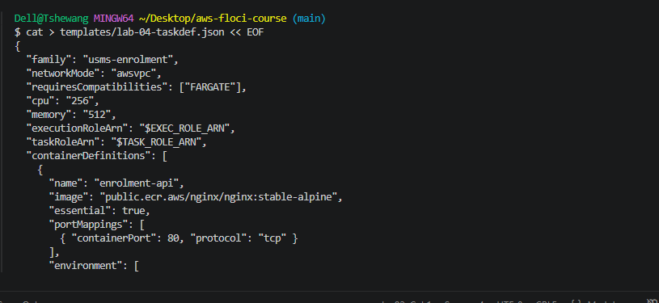
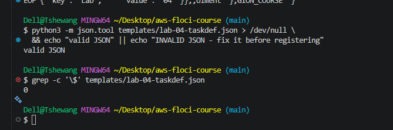

**Register the task definition**

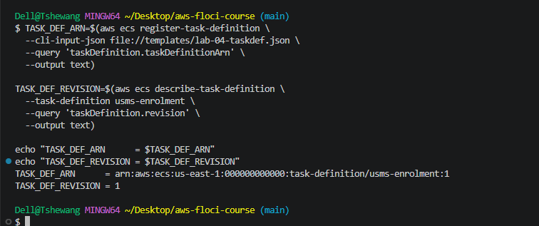

### Step 10: Create the ECS service in Lab 2's private subnets

The service `usms-enrolment-svc` was created on Fargate with a desired count of 2, spanning both private subnets, with `usms-enrolment-sg` and `assignPublicIp=DISABLED`. ECS-managed tags and tag propagation were enabled so tasks launched later by auto scaling are still tagged.

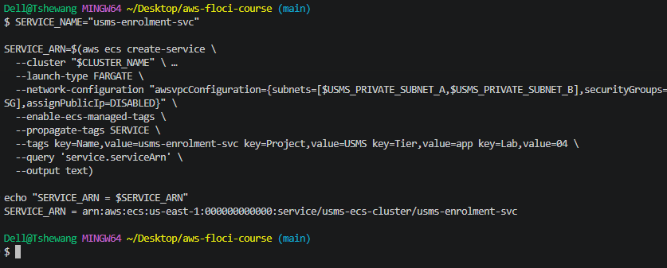

**Verify the service**

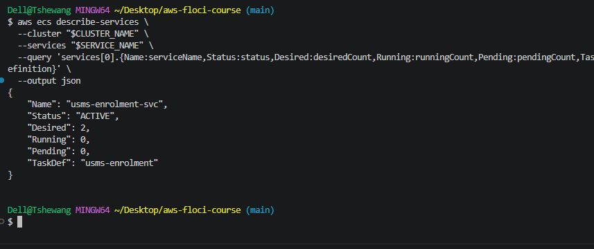

### Step 11: Read the service back and learn the four numbers

`describe-services` was used to read `desiredCount`, `runningCount`, `pendingCount` and `status`, along with the subnets, security group and public IP setting.

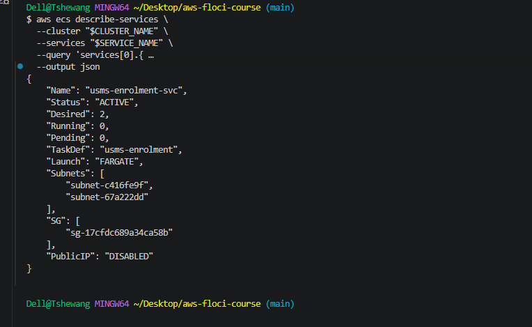

**Final verification**

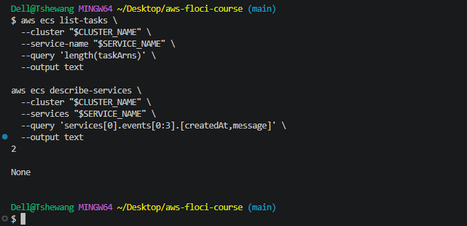

### manual scaling test (2 → 3 → 2)

Before any auto scaling exists, capacity was changed by hand with `aws ecs update-service --desired-count`.

**Change the service from 2 to 3**

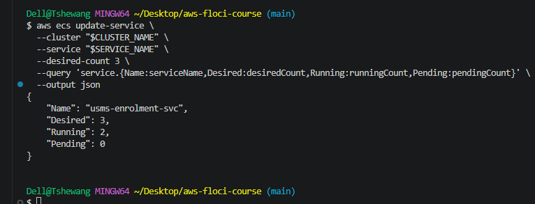

**Return the service to the baseline of 2**

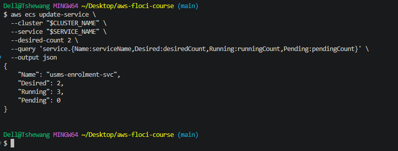

### Step 12: Write `configs/lab-04.env`

All outputs were recorded by **live lookup** (not copied from shell variables), so a populated value in the file is evidence that the resource really exists. The file holds names, IDs and ARNs only, with no secrets, and records 17 exported variables including `USMS_ECS_CLUSTER`, `USMS_ENROLMENT_SERVICE`, `USMS_ECS_DESIRED_BASELINE`, `USMS_ENROLMENT_SG`, and both role ARNs.

**Create `configs/lab-04.env`**

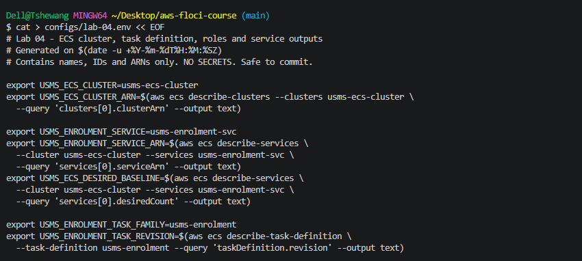
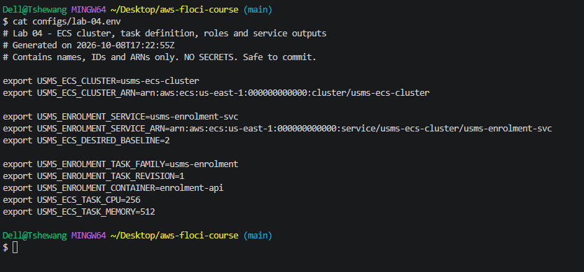

**Verification** (sourced the file, checked that every value is populated, baseline desired = 2, and the export count)

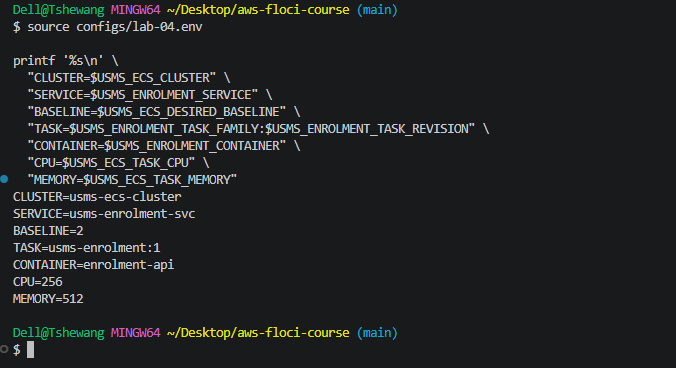
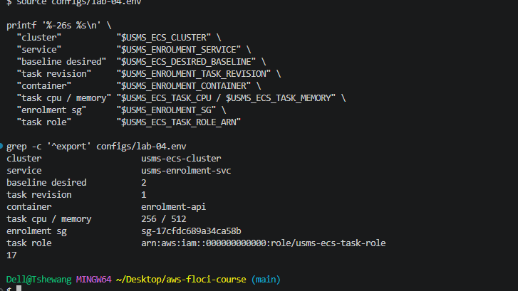

### Section 9: Build `scripts/utilities/verify-lab-04.sh`

The verification script checks the environment first (container running, storage mode not `memory`, correct account), then the Lab 1–3 dependencies, Lab 04 IAM, logging, ECS and networking, and finally files and Git hygiene.

Four checks are the ones that justify a script rather than a simple "does it exist" test:

1. The execution role and task role ARNs are **different**
2. The service spans **two** subnets
3. `usms-enrolment-sg` is sourced from `usms-app-sg`, **not a CIDR**
4. The log group has a **retention policy** set

**Build and run the script**

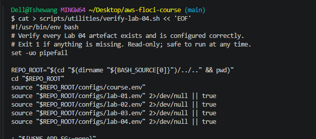
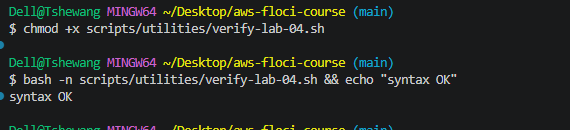
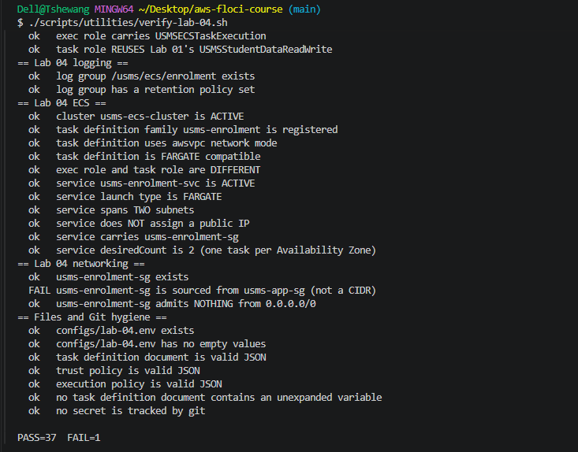

**Result:** `PASS=38  FAIL=0`. Every check passed, including the four key checks above, and the environment block passed before any resource check ran.

---

## 4. Key Concepts Demonstrated

| Concept | What this lab showed |
|---|---|
| **Cluster** | A namespace only; on Fargate it holds no servers and has no capacity of its own |
| **Task definition** | A versioned, immutable blueprint (`usms-enrolment:1`); changes require a new revision |
| **Task** | One running instance of a task definition, with its own ENI and private IP |
| **Service** | A controller that keeps `runningCount` equal to `desiredCount` |
| **Execution role vs task role** | Same trust principal (`ecs-tasks.amazonaws.com`) but different jobs. "Task will not start" points to the execution role; "task started but app got AccessDenied" points to the task role |
| **Group-referenced security group rules** | Survive scaling because task IPs and ENIs change constantly |
| **NAT and VPC endpoint** | Private-subnet tasks reach the registry through `usms-nat`; this is where Lab 2's networking becomes load-bearing |
| **Quoted vs unquoted heredoc** | Quoted (`<< 'EOF'`) for policy documents written verbatim; unquoted (`<< EOF`) when variables must expand at write time |
| **Tag syntax differs per service** | EC2 `Key=,Value=`, ECS `key=,value=`, CloudWatch Logs plain map |

## 5. Floci Limitations Noted

- **Application Auto Scaling support is build-dependent.** This build was recorded as Path A (full support). Even so, a scaling policy that is stored correctly may never be evaluated by the emulator, so Lab 06 is assessed on the observable *shape* of the configuration rather than on a policy firing.
- **Container credentials endpoint is not served.** Application code inside a task cannot fetch its own credentials, but the role chain (task definition → role → policy) is fully observable through `describe-task-definition` and `iam get-role`.
- **The container image is a stand-in.** The public nginx image is a placeholder; every proof in this lab is based on `desiredCount`, which is a control-plane value.

## 6. Review Question

**Why can the same IAM policy serve both an EC2 instance and an ECS task?**
A policy describes *what* is permitted, independent of *who* holds it. The EC2 role and the ECS task role differ only in their trust policy and delivery mechanism (instance profile versus `taskRoleArn`). Both attach the identical `USMSStudentDataReadWrite` document, so both gain access at the same moment the `usms-student-data` bucket is created in a later lab, with no long-lived keys and no policy edits.

## 7. Conclusion

The Lab 04 stack was built end to end: a cluster, a log group with retention, two correctly separated IAM roles (with Lab 1's policy reused unchanged), a security group sourced from the web tier, a registered Fargate task definition, and a two-subnet service with a baseline `desiredCount` of 2. Manually changing the count from 2 to 3 and back showed that `desiredCount` is the single value auto scaling will control in Lab 06. Everything was recorded in `configs/lab-04.env` and checked with `verify-lab-04.sh`, and the resulting baseline is ready for Lab 05 (load balancer) and Lab 06 (auto scaling).