# Lab 06 Report: Auto Scaling for the Enrolment Service


## 1. What this lab was about

Until now, my enrolment service (`usms-enrolment-svc`) always ran exactly 2 tasks. In this lab I made it scale up and down by itself. When the system gets busy, it adds more tasks. When it is quiet, it goes back to a smaller number. I set the limits to a minimum of 2 and a maximum of 10 tasks.

I built three ways to trigger scaling:
1. **CPU policy:** keeps CPU usage around 50%.
2. **Request-count policy:** keeps requests per task around 1000 per minute.
3. **Step policy:** adds 1 task when my work queue reaches 100, and 3 tasks when the breach is bigger.

I also tried to create scheduled actions (more tasks in the morning, fewer in the evening), but this version of Floci does not support them. More on that later.

---

## 2. Architecture diagram

The idea is simple: something is measured, an alarm notices, a policy decides, and ECS changes the number of tasks.

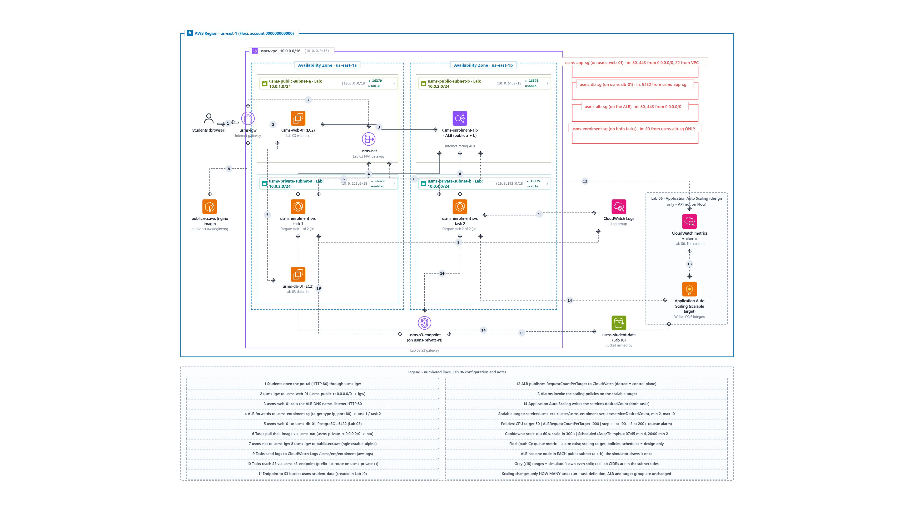

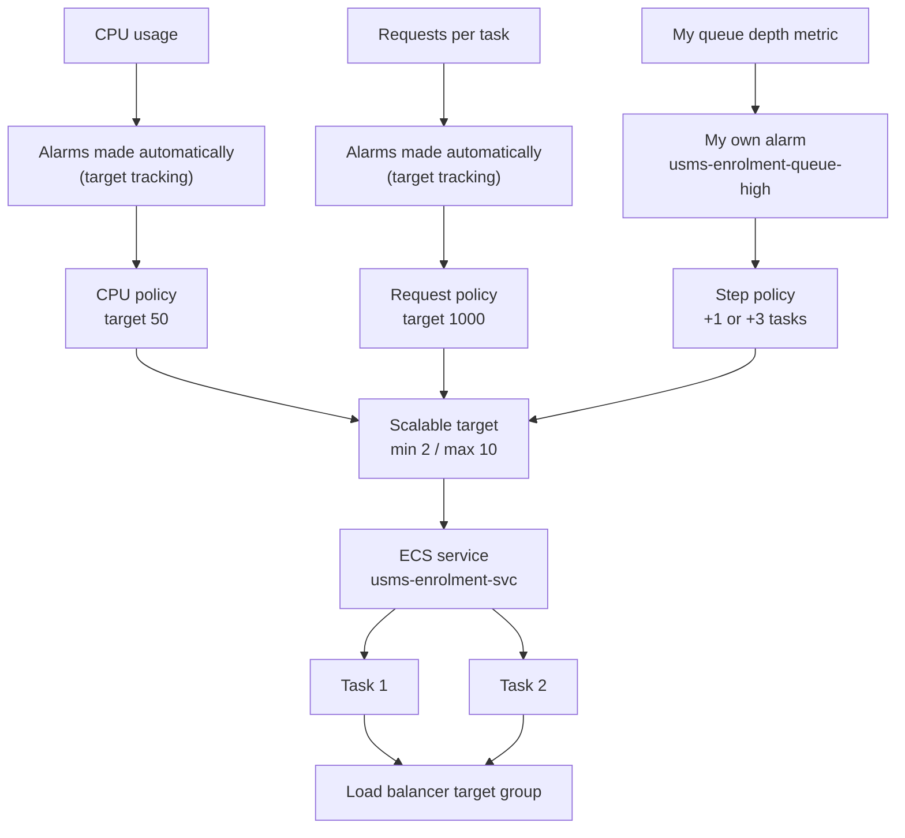

In plain text:

```text
metric -> alarm -> scaling policy -> scalable target (min 2, max 10) -> ECS service -> tasks -> load balancer
```

**Important:** Labs 02, 04 and 05 (network, ECS service, load balancer) were already built. In this lab I only added the scaling layer on top, and I checked at the end that nothing underneath had changed.

**Names I used:**

| Item | Value |
|---|---|
| Resource ID | `service/usms-ecs-cluster/usms-enrolment-svc` |
| Dimension | `ecs:service:DesiredCount` |
| Role | `AWSServiceRoleForEcsApplicationAutoscaling` |
| CPU policy | `usms-enrolment-cpu-target-tracking` |
| Request policy | `usms-enrolment-requests-target-tracking` |
| Step policy | `usms-enrolment-queue-step-out` |
| My alarm | `usms-enrolment-queue-high` |

---

## 3. What I did, step by step

### Step 1: Start the environment
I started Floci and loaded the env files from the earlier labs. All 14 values showed up.

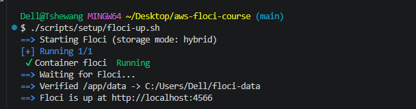

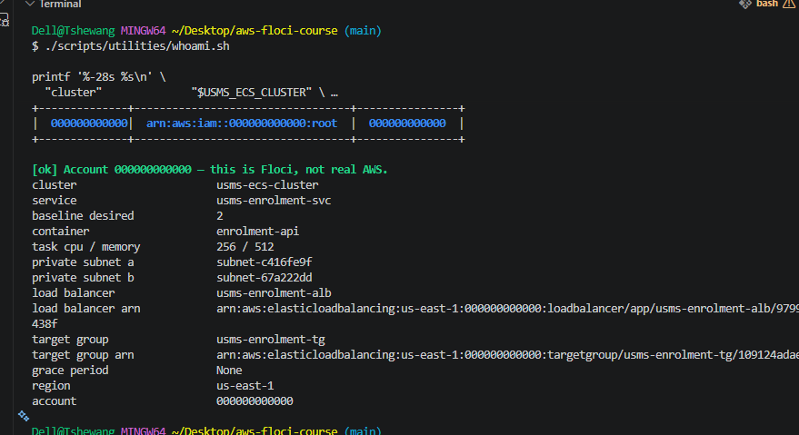

### Step 2: Check the earlier labs still work
I ran the verify scripts for Labs 02 to 05 first, so I knew any problem later was from this lab.

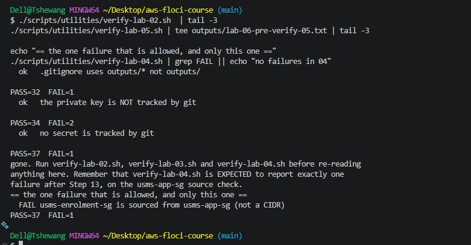

### Step 3: Check what Floci supports
The probe said everything was supported. That turned out to be wrong for scheduled actions (see Step 11). So a probe saying "supported" does not mean it really works.

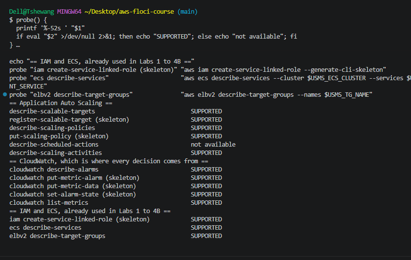

### Step 4: The service-linked role
Creating the role failed with "already taken", which just means it already existed. The error showed the real name on my build, `AWSServiceRoleForEcsApplicationAutoscaling`, which is different from the name in the lab. I checked it with `get-role` and it was correct. The lab's name gave `NoSuchEntity`.

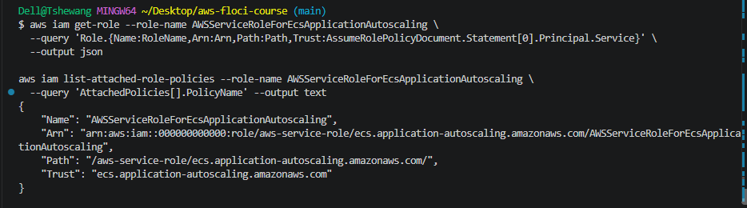


### Step 5: Register the scalable target
I got the resource ID from the service ARN instead of typing it, then registered it with min 2 and max 10. The service stayed at 2 tasks, which is right because 2 is already inside the limits.

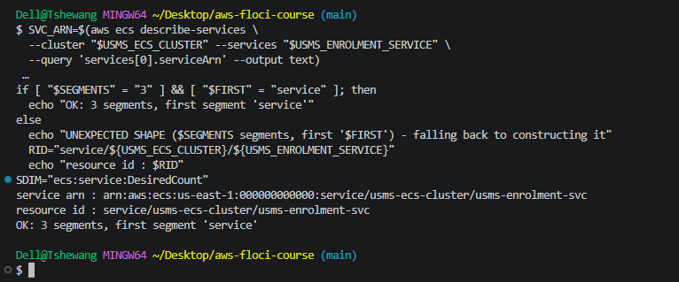
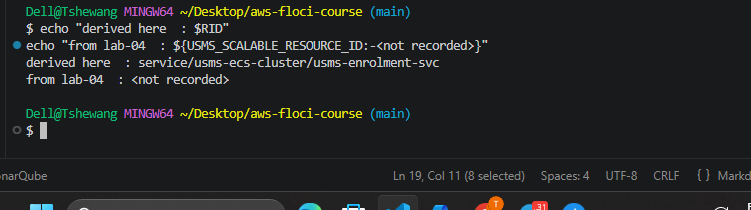


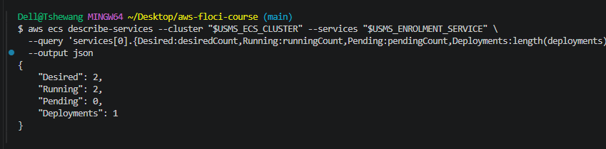

### Step 6: Change the limits
There is no "update" command for a scalable target. You register it again at the same address. When I changed only the maximum to 12, the minimum stayed at 2. Then I put it back to 2 and 10 and confirmed there was only one target.

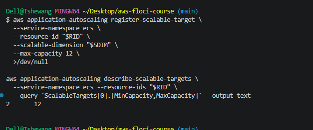

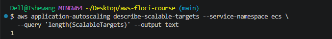

**My own test:** I set the minimum to 5 while 2 tasks were running. On real AWS the service would jump to 5 tasks. On my Floci build it stayed at 2 for the whole 30 seconds, so Floci saves the limit but does not enforce it. I put everything back to 2 afterwards.


### Step 7: CPU policy
I wrote the policy file (target 50, scale-out cooldown 60, scale-in cooldown 300) and created it. Floci also created two alarms for it automatically.


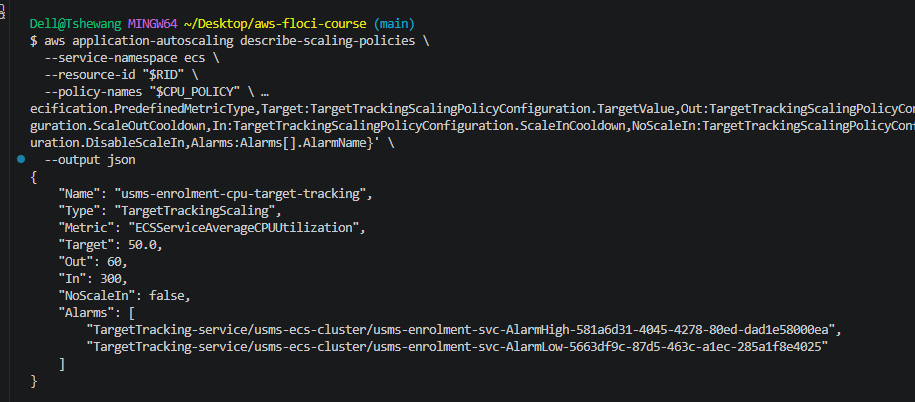

### Step 8: The two alarms I did not create
These alarms are owned by the policy, so I should not edit or delete them. The high alarm needs 3 checks in a row and the low alarm needs 15, so the system scales up quickly but scales down slowly. Both alarms point to my CPU policy. Two small differences from real AWS: the metric name was shown differently, and the low alarm had the same threshold (50) as the high alarm.

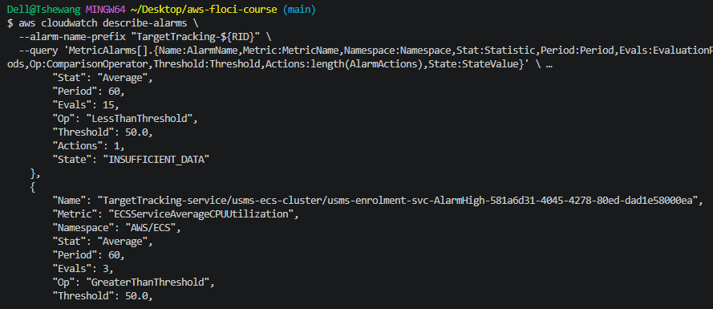
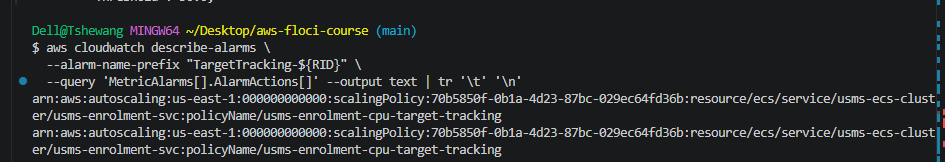
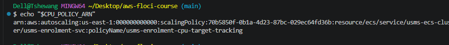


### Step 9: Request-count policy
I built the "resource label" from the load balancer and target group ARNs and checked it had six parts. Then I created the policy with a target of 1000. Now there were 2 policies and 4 automatic alarms.


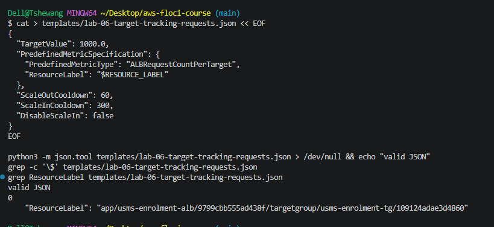
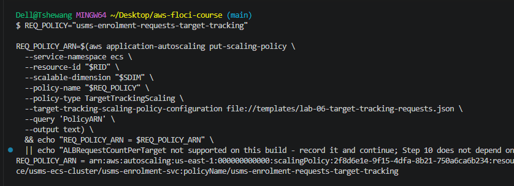
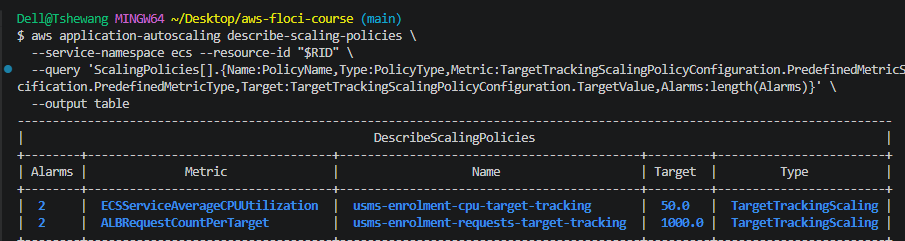
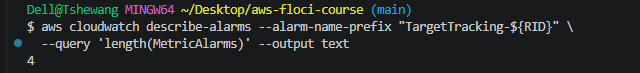

### Step 10: Step policy and my own alarm
I published a custom metric for queue depth, wrote the step rules, created the policy, and then created my own alarm that triggers it. The policy has to be created first, because the alarm needs its ARN. On Floci the policy did not list my alarm, but the alarm itself pointed to the policy, which is what matters.

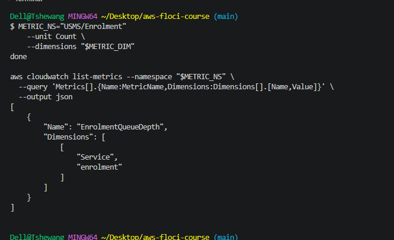
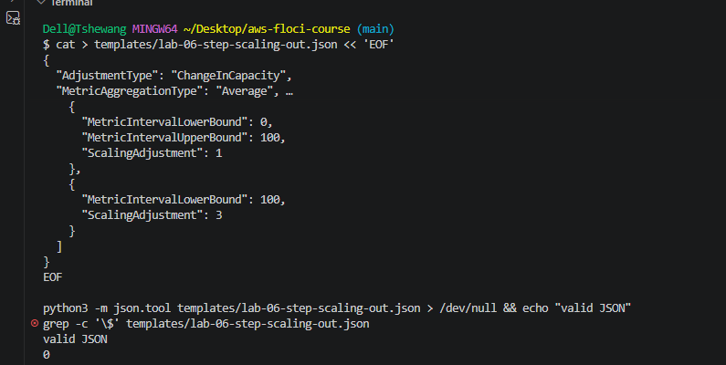
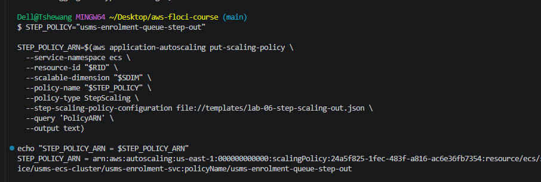

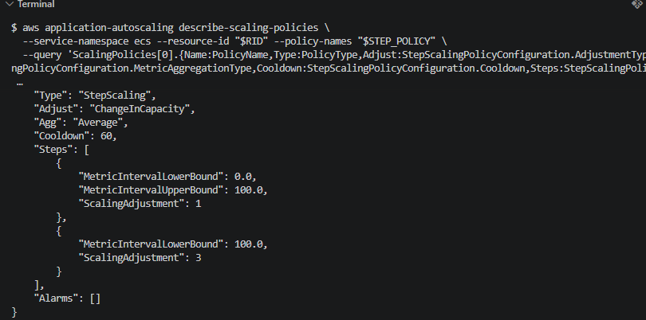

### Step 11: Scheduled actions (did not work)
`put-scheduled-action` failed with `UnsupportedOperation`. I tried with the Asia/Thimphu time zone and then with a UTC version, and both failed, so it was not my command. Later I found `describe-scheduled-actions` is also unsupported. So I could not create these, and I skipped the one-off `at()` exercise.


### Step 12: Make the alarm fire and see tasks change
This was the main proof. I noted the state before (2 tasks, 0 scaling activities). Then I pushed the queue metric to 260, which is 160 over the threshold, so the step policy should add 3 tasks.

The alarm went into ALARM by itself. The task count went from 2 to 5, then 8, then 10. The scaling activity log said the alarm `usms-enrolment-queue-high` triggered the policy `usms-enrolment-queue-step-out`, which is exactly the evidence the lab wanted.

It kept going to 10 because Floci ignored the 60 second cooldown and re-fired every 10 seconds. Real AWS would add tasks only once per cooldown.

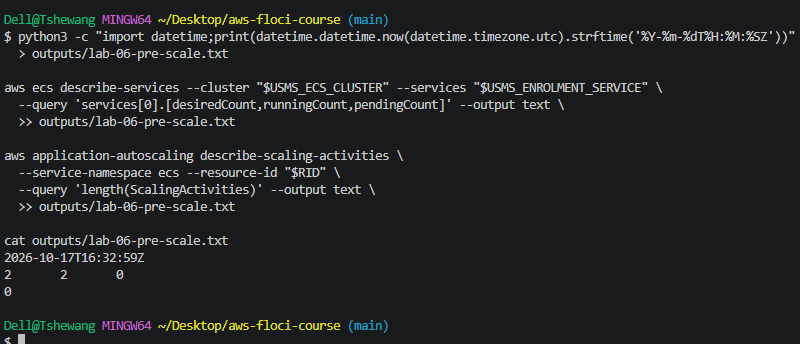
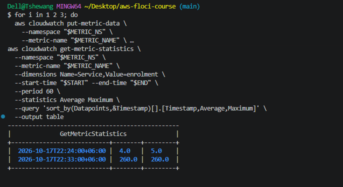
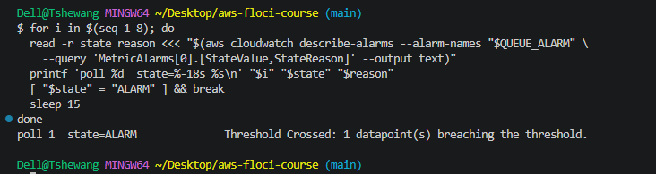
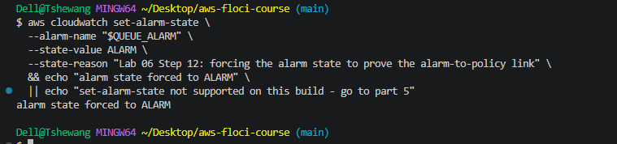
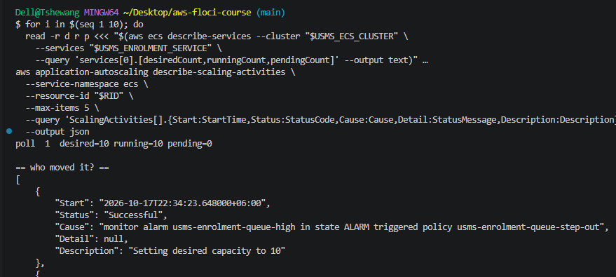
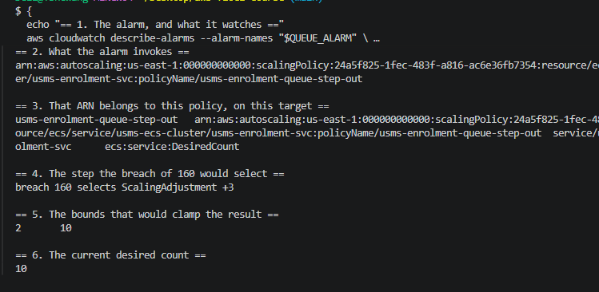

To clean up, I did it in the right order: lower the metric first, set the alarm back to OK, and only then set the count back to 2. If I had lowered the count first, the policy would have pushed it up again.

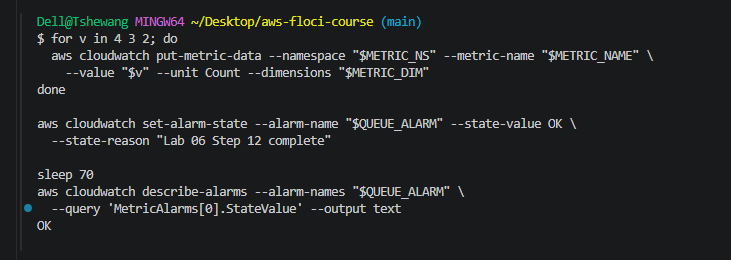
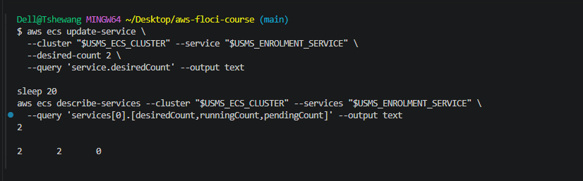


### Step 13: Suspend and resume
I suspended scale-in only, checked that the policies and alarms were untouched, then resumed. At the end all three switches were `False` and the count of `true` was 0. This matters because a suspended target gives no warning at all.

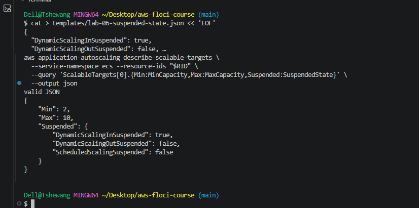

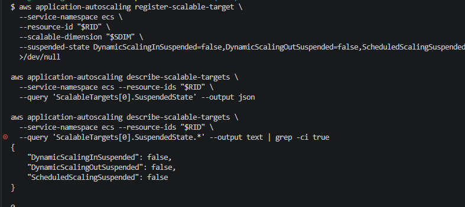
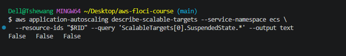

### Step 14: Does it survive a restart?
I saved the configuration, restarted Floci, rebuilt every name from the API (not from my shell variables), and compared. Everything matched. The first comparison said "failed" on every line even though the text looked the same. The reason was Windows line endings (CRLF) versus Linux ones (LF). After removing the carriage returns, the result was PERSISTENCE PROVEN.

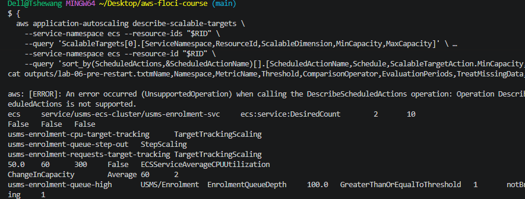
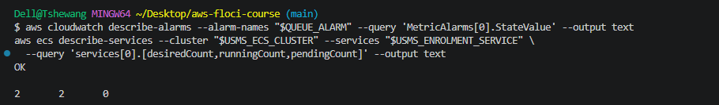
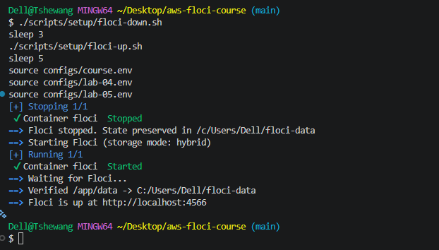

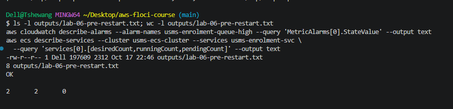

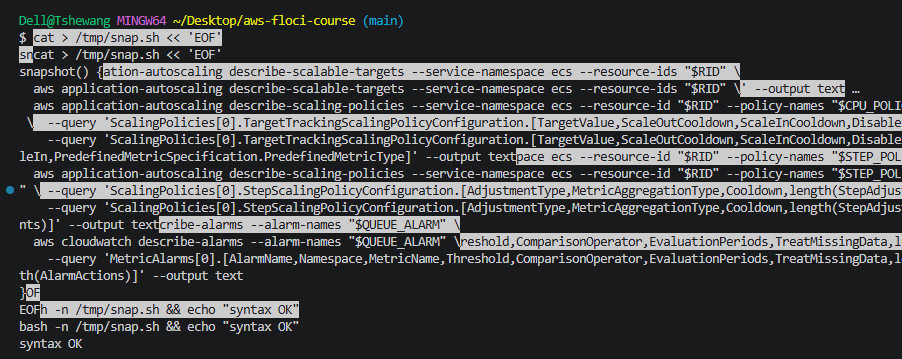
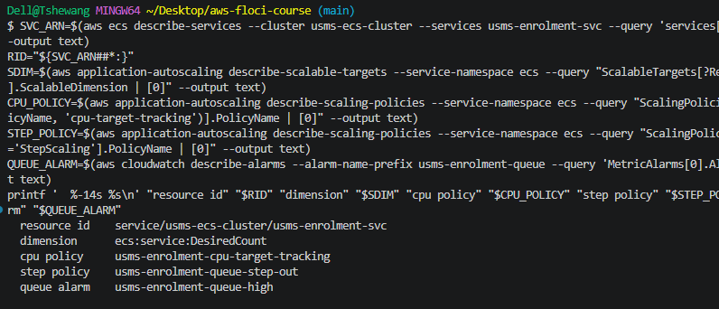
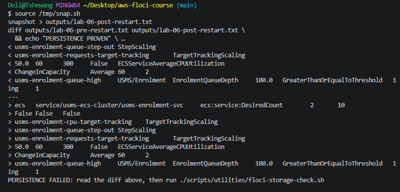

### Step 15: Follow the whole path
I traced the path from metric to alarm to policy to target to service to load balancer. Only the first three parts belong to this lab. The rest came from Labs 04 and 05 and were unchanged: same task definition (`:2`), 1 load balancer, 1 deployment, and both targets healthy.

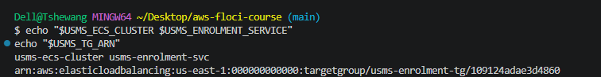

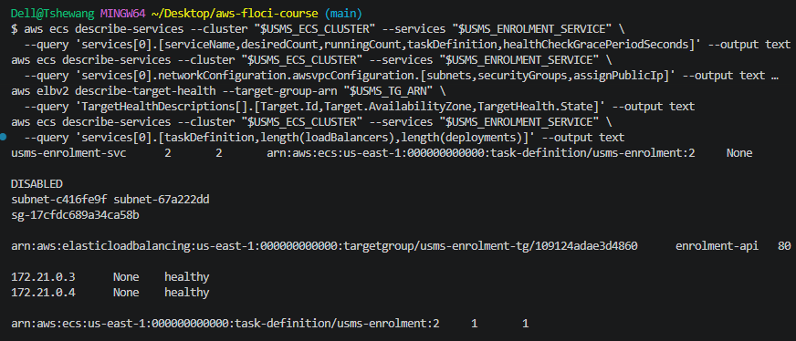

### Step 16: Save results in `configs/lab-06.env`
I saved 22 values. One value (the resource ID) came out empty because of how my shell handled a backslash, so I fixed it with `sed`. I also used the real role name instead of the one in the lab.


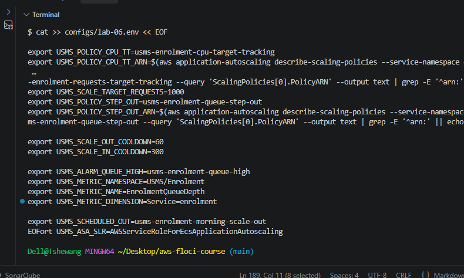
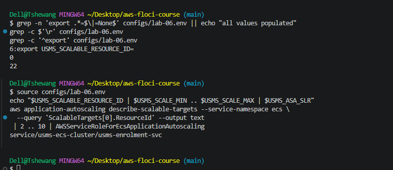


### Step 17: Commit
The two cleanup scripts the lab wanted me to fix don't exist in my repo, so I skipped that part. I added only the Lab 06 files by name and committed them. The `outputs/` folder is ignored by git, which is what I wanted.

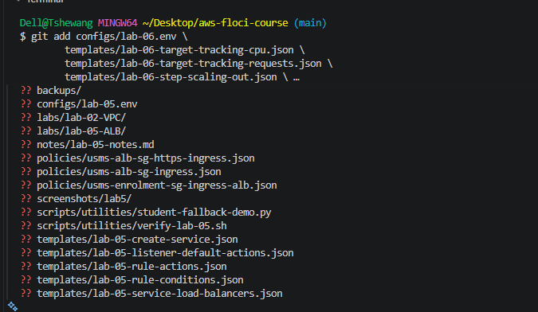
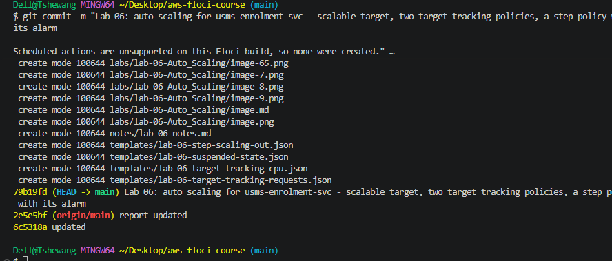
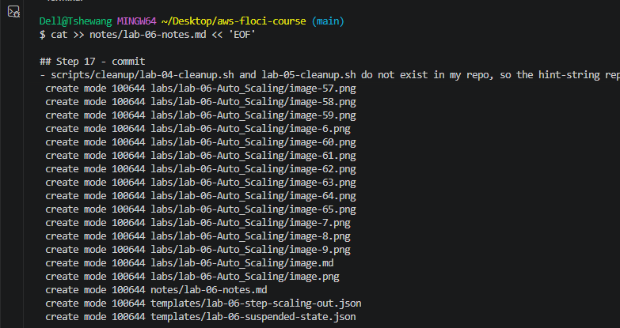

### Verification
I wrote the verify script in smaller pieces because long pastes kept breaking. Final result: **PASS=35, FAIL=0**.

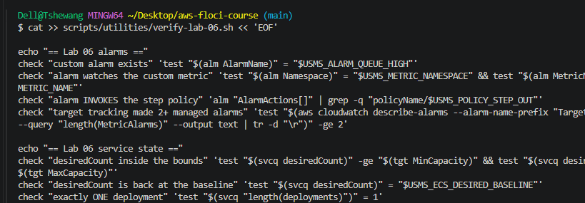


---

## 4. Results

| What I checked | Result |
|---|---|
| Scalable target | 1 target, min 2, max 10 |
| Scaling policies | 3 |
| Automatic alarms | 4 |
| My alarm linked to the step policy | Yes |
| Alarm changed the task count | Yes, 2 → 5 → 8 → 10 |
| Log shows the alarm and policy as the cause | Yes |
| Service after the lab | 2 tasks, 1 deployment, 1 load balancer |
| Scheduled actions | Not possible on this Floci build |
| Survived restart | Yes |
| Verify script | 35 passed, 0 failed |

## 5. Where Floci was different from real AWS

- The scalable target's Role field shows a role name that does not exist.
- Raising the minimum does not change the running task count.
- Automatic alarms have the same high and low threshold, so there is no buffer zone.
- Scheduled actions are not supported (both create and read).
- The step cooldown was ignored, so scaling kept repeating.
- Some fields are empty (scaling activity message, availability zone).

## 6. Things I want to be honest about

- I did **not** create or test scheduled actions, because Floci doesn't support them. I skipped the `at()` exercise too. My understanding: an `at()` action stays behind after it runs, so it should be deleted with `delete-scheduled-action`, and deleting it does not undo a minimum it already raised.
- The service's health-check grace period is `None`. Lab 05 never applied it. I did not fix it here, because this lab should not change the service.
- The "before restart" file was rebuilt by hand after a paste error. The comparison only passed after I removed the carriage returns, so this is weaker evidence than two files made by the CLI.
- My verify script has 35 checks, not the lab's 42. I replaced the scheduled-action checks with a simple check that the names are in the env file, and removed a few others.
- I did not delete any resources, and cleanup was not part of what I did.

---

## 7. Reflection

### 1. What did you learn?
- Auto scaling is a chain: metric → alarm → policy → scalable target → service. Seeing the activity log name both the alarm and the policy made it clear.
- A scalable target is found by namespace, resource ID and dimension, not by an ARN. To change limits you register it again.
- Target tracking keeps a number near a goal and makes its own alarms. Step scaling gives different responses for different sizes of problem. Scheduled actions change the limits before a known busy time.
- Scaling out is fast and scaling in is slow on purpose, so the service doesn't shrink too early.
- A suspended target looks normal everywhere, so you have to check it directly.
- A command succeeding does not prove it works. I only trusted it when I saw the number actually change.

### 2. What challenges did you encounter?
- The service-linked role had a different name than the lab said.
- Scheduled actions were unsupported, which blocked Step 11 and some later checks.
- The service scaled all the way to 10 because Floci ignored the cooldown, so I had to clean up in the right order.
- Long pasted commands kept getting scrambled in Git Bash. I fixed this by splitting them into small pieces.
- Windows line endings made my restart comparison fail even though the content was the same.
- A backslash in an awk command left one env value empty until I noticed and repaired it.
- Some things from earlier labs were missing (cleanup scripts, the grace period), so I had to note them instead of pretending they were fine.

### 3. How would you apply this in a real-world environment?
- For a university enrolment system, I would use a request-count policy as the main control, a step policy for queue backlogs, and scheduled actions to raise the minimum before enrolment opens or results are published.
- I would load-test first to find out how many requests one task can really handle, instead of guessing 1000.
- I would set the grace period and cooldowns to match how long a task really takes to start.
- I would add monitoring for the minimum and maximum values, the suspended state, alarms stuck without data, and the count staying at the maximum.
- I would keep the scaling setup in code (CloudFormation or Terraform), as I did with the JSON files in Git, so it can be rebuilt.
- I would watch costs, because a minimum someone forgot to lower means paying for idle tasks all day.
- I would use Floci for practice, then test the real behaviour in a real AWS test account before production.

### 4. What additional concepts would you like to explore?
- Scheduled scaling in detail: cron vs `at()`, time zones and daylight saving.
- How to pick the best scaling metric for different workloads.
- Load testing to find good target values.
- Predictive scaling and other ways to plan for known peaks.
- Infrastructure as code for the whole scaling setup.
- Dashboards and CloudTrail to watch the scaling system itself.
- Cost saving with Fargate Spot together with a safe baseline of normal tasks.

---

## 8. Conclusion

I now have a working auto scaling setup for the enrolment service: one scalable target, two target tracking policies, a step policy with my own alarm, and suspend and resume controls. I proved the loop works because an alarm changed the task count from 2 to 10, and the log named both the alarm and the policy. The setup also survived a restart. Scheduled actions could not be built on this Floci build, and a few other Floci behaviours differ from real AWS. I have written those down so the report matches what I really saw.