Step 1 - Resume the environment and load six env files

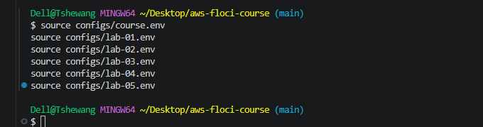

Step 2 - Confirm Labs 02, 03, 04 and 05 are still intact

Step 3 - Probe what this Floci build supports

Step 4 - Create the service-linked role that writes desiredCount

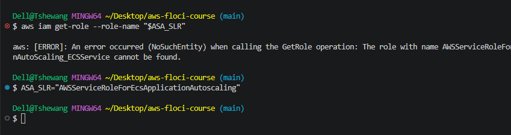

Step 5: register the scalable target.
Part 1: build the resource ID from the API

Part 2: register it
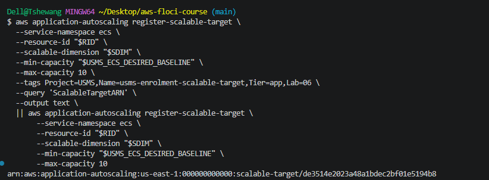

Verify
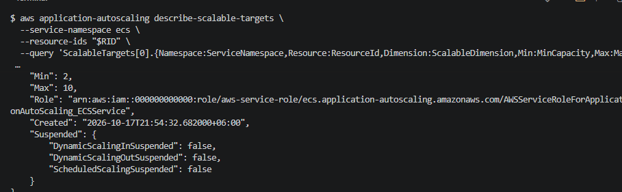

Part 3: check what registering did to the service

Step 6: change the bounds.

Part 1 raises the max to 12 passing only --max-capacity, and the min should stay at 2.

Part 2: put it back
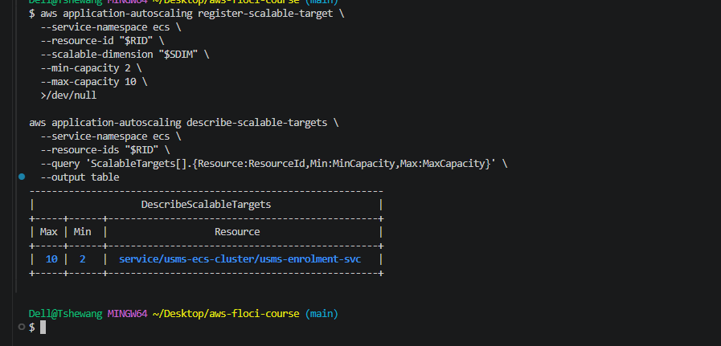

Then the duplicate check:

Your turn exercise (do it after Part 2 is confirmed)

First, answer in your head without running anything: if you re-register with --min-capacity 5 while the service runs 2 tasks, what happens? Then run it:
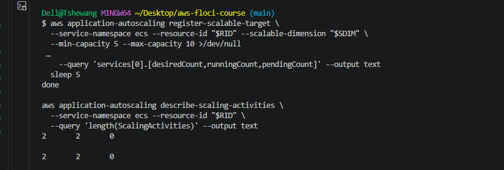
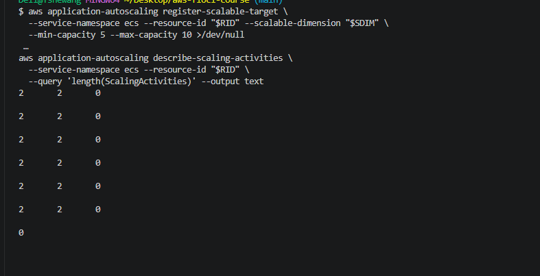

Then put it back to 2, and also fix the service count. Re-registering with min 2 will not lower desiredCount on its own, because the floor only pushes the count up.
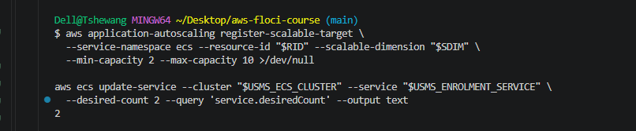

Step 7, the CPU target tracking policy. 
Part 1 writes the config file, and Part 2 creates the policy.
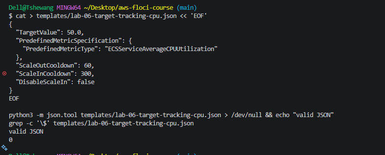

Part 2: create the policy
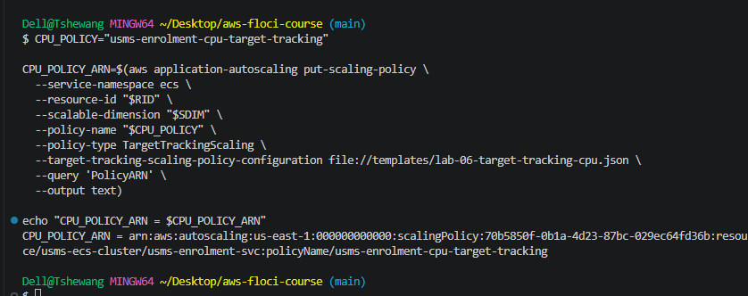

Then verify:

Step 8: read the two alarms you didn't create

Part 1, find them:

Then confirm both alarms invoke your Step 7 policy:

Every line should equal your $CPU_POLICY_ARN. You can check by comparing with:

Part 2, prove the naming is derivable:
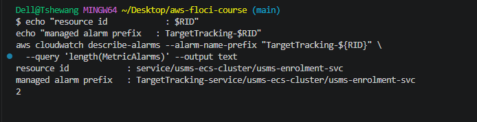

Step 9: the request-count policy. 
Part 1 gets the ResourceLabel:
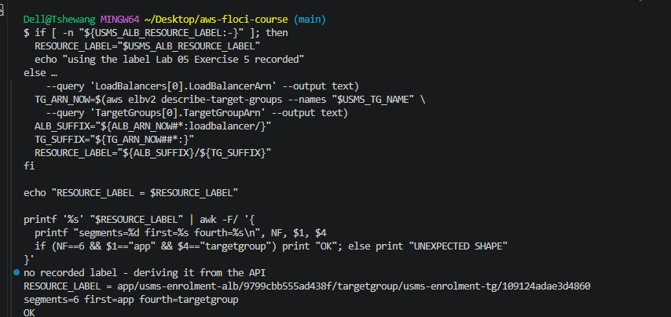

Part 2: write the policy configuration

Part 3: create the policy

Verify:

Step 10: the step scaling policy and the alarm that drives it
Part 1: publish the metric

Part 2: write the step configuration (quoted heredoc, because there are no variables)

Part 3: create the policy first, then the alarm that drives it

Check that the ARN is not empty before going on. Then create the alarm:
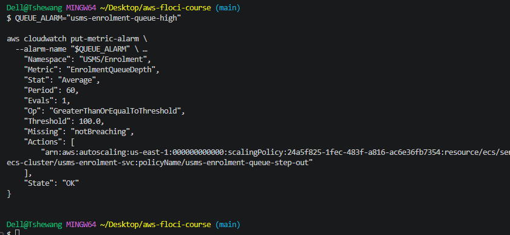

Then verify the policy side of the link:

Step 11: scheduled actions

Part 1 is the morning scale-out. Try the Asia/Thimphu time zone first:
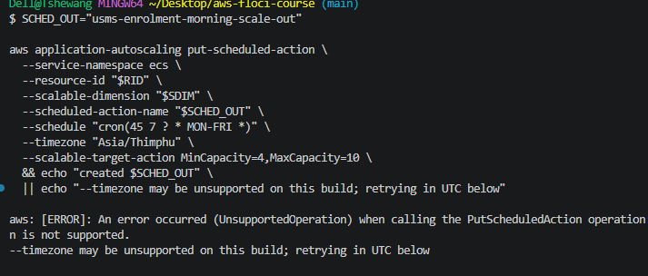
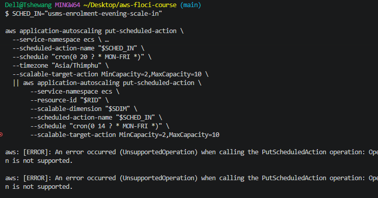

Step 12 doesn't depend on scheduled actions, so you can carry on with it. 
Part 1 records the state before:

Part 2: push the metric past the threshold

Then watch whether the alarm fires by itself:

Part 3 (only if the alarm stays OK/INSUFFICIENT_DATA)

Part 4: read back the number and the record

Part 5 (the fallback proof) so you have outputs/lab-06-scaling-proof.txt. It is the evidence file the lab asks you to keep:

Part 6, in the right order. The alarm is still ALARM and the metric is still 260, so if you only set the count, the policy would scale it straight back up. Push the metric down first, then reset the alarm, wait, and only then lower the count:

If it says OK, continue. If it flipped back to ALARM, the 260 datapoint is still in its window; wait another minute and re-check.

Then record the after-state:
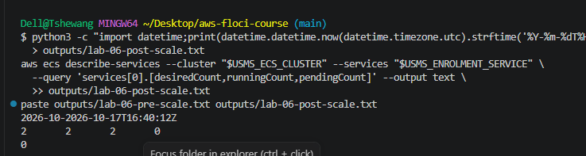

Step 13: suspend and resume scaling. 
Part 1 suspends scale-in only:

Part 2: confirm the policies and alarms are untouched
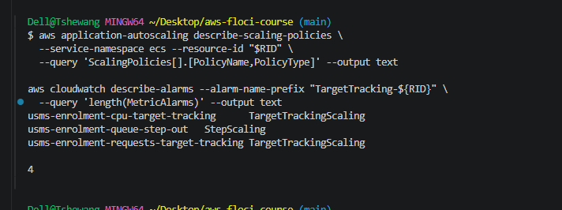

Part 3: resume, and prove it (required)

Then check the capitalisation the lab mentions:

Step 14: prove the configuration survives a restart

Part 1: record the truth before

check the alarm is OK and the count is 2, so the restart doesn't start with a scaling loop in flight:

Part 2: perturb (restart Floci)

Part 3: read back, re-deriving every identifier
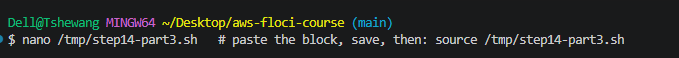

Check what you have, and that the restart was clean

Recreate the pre-restart file from the output you captured before the restart
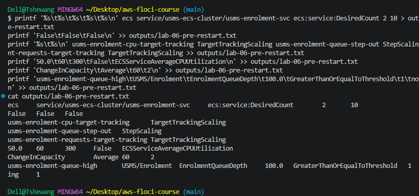

Build a snapshot function in two small pieces

Re-derive every identifier from the API, then diff

Step 15: trace the whole path, from metric to serving task

Blocks 1 to 3, the metric, the policies and the scalable target:
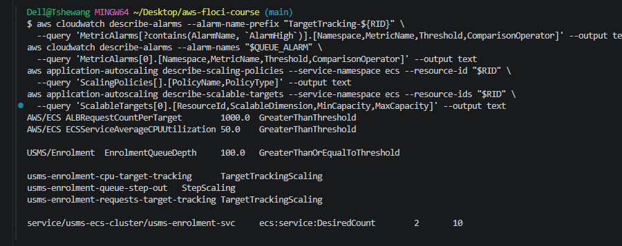

Blocks 4 to 7, the service, network, load balancer and what this lab changed:

Step 16: write configs/lab-06.env
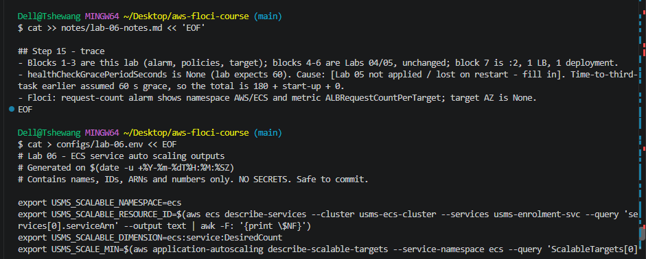

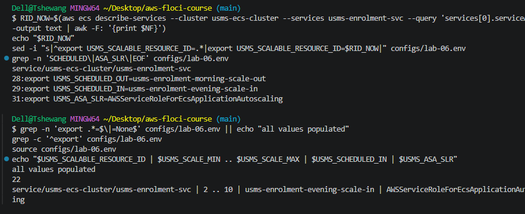

Step 17: commit, and repair two stale strings