# Lab 07 Report: Amazon EKS Cluster, Managed Node Group and USMS Microservices on Floci

## 1. Objective

The objective of this lab was to build a Kubernetes platform for the USMS application on Floci. The work covered:

1. Creating two IAM roles with separate trust policies, one for the EKS control plane and one for the worker nodes.
2. Creating an EKS cluster and a managed node group inside the VPC built in Lab 02.
3. Connecting `kubectl`, then deploying three microservices (gateway, enrolment, results) with ConfigMaps, a Secret, and ClusterIP Services.
4. Proving service discovery, rolling updates, rollback and common failure diagnosis.
5. Proving that state survived a Floci restart, recording identifiers in `configs/lab-07.env`, and committing the work.

---
## 2. Introduction

Amazon Elastic Kubernetes Service (Amazon EKS) is a managed Kubernetes service provided by Amazon Web Services (AWS) that simplifies the deployment, management, and scaling of containerized applications. It uses Kubernetes to automate container orchestration tasks such as scheduling pods, maintaining application replicas, service discovery, load balancing, and rolling updates. Amazon EKS separates the control plane, which manages the Kubernetes cluster, from the worker nodes, which run application workloads. It also integrates with AWS services such as IAM, Amazon VPC, and Amazon CloudWatch to support access control, networking, and monitoring. Amazon EKS is commonly used to deploy microservices, web applications, APIs, and other distributed systems that require scalability, reliability, and efficient resource management. In this practical, Floci was used to emulate AWS APIs, while a local k3s environment was used to deploy and manage the USMS gateway, enrolment, and results microservices, demonstrating key EKS and Kubernetes concepts in a controlled lab environment.

## 3. Use Case

The use case of this practical is to deploy and manage the University Student Management System (USMS) using Kubernetes concepts in a simulated AWS environment. The system consists of three microservices: the **Gateway Service, Enrolment Service, and Results Service**. The Gateway Service receives client requests and forwards them to the appropriate backend service. The Enrolment Service manages student enrolment-related requests, while the Results Service handles student result-related requests.

Kubernetes is used to deploy the microservices, manage their replicas, provide internal service discovery, and maintain application availability. ConfigMaps and Secrets are used to manage application configuration and sensitive values. The practical also demonstrates how to troubleshoot common deployment problems, such as invalid container images, insufficient resource requests, and containers that crash during execution.

Floci is used to simulate AWS API operations, while a local k3s environment runs the Kubernetes workloads. This setup helps demonstrate key concepts related to Amazon EKS, IAM roles, managed node group configuration, microservice deployment, scaling, and troubleshooting without requiring a fully provisioned Amazon EKS cluster.

The main use cases are:

1. **Deploy microservices:** Run the Gateway, Enrolment, and Results services in the `usms` namespace.
2. **Route requests:** Use the Gateway Service to forward requests to the appropriate backend services.
3. **Scale applications:** Run multiple replicas of the Enrolment and Results services to improve workload handling.
4. **Manage configuration:** Use ConfigMaps and Secrets to store application settings and sensitive values.
5. **Test fault recovery:** Verify pod replacement and deployment rollback when failures occur.
6. **Troubleshoot errors:** Identify and resolve image-pull failures, scheduling problems, and container crashes.
7. **Verify deployment:** Use AWS CLI commands, Floci API responses, and Kubernetes commands to inspect resources and confirm system behaviour.

Overall, this practical demonstrates how Kubernetes can support the deployment, management, and troubleshooting of a microservices-based student management system in a controlled lab environment.

## 4. Architecture

### 4.1 Diagram

.png>)

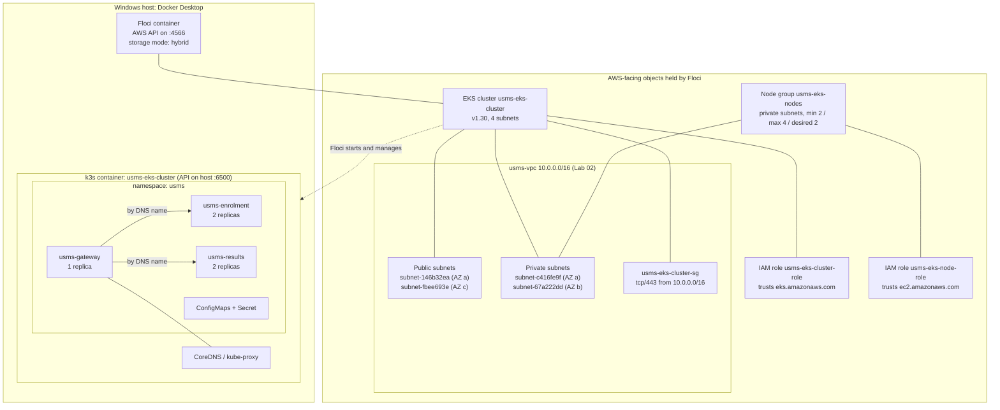

### 4.2 Plain-text version

```
                         Windows host (Docker Desktop)
 +------------------------------------------------------------------+
 |  Floci container (AWS API :4566, hybrid storage)                 |
 |    IAM : usms-eks-cluster-role  (trusts eks.amazonaws.com)       |
 |          usms-eks-node-role     (trusts ec2.amazonaws.com)       |
 |    EC2 : usms-eks-cluster-sg    (tcp/443 from 10.0.0.0/16)       |
 |    EKS : usms-eks-cluster (1.30) -> usms-eks-nodes (private)     |
 |                 |                                                |
 |                 | starts and manages                             |
 |                 v                                                |
 |  k3s container (API published on host :6500)                     |
 |    namespace usms                                                |
 |      usms-gateway (1) --DNS--> usms-enrolment (2)                |
 |                        \-DNS-> usms-results   (2)                |
 |      ConfigMaps (4) + Secret (1)                                 |
 +------------------------------------------------------------------+

 usms-vpc 10.0.0.0/16 : public a, public c | private a, private b
```

### 4.3 Control plane and data plane

The control plane (API server, etcd, scheduler, controllers) is run by the provider and billed per cluster. The data plane (nodes, kubelet, container runtime, pods) belongs to the customer. Because of this split, two IAM roles were needed: the cluster role, assumed by the control plane, and the node role, assumed by the nodes. The two roles trust different principals and are not interchangeable.

---

## 5. Procedure and Evidence

### Step 1: Start the environment and confirm prerequisites

Floci was started, the course environment files were sourced, and identity and storage mode were checked. `verify-lab-02.sh` and `verify-lab-04.sh` each reported one failure. The `public-b` variable was empty (see Section 4, Issue 1).

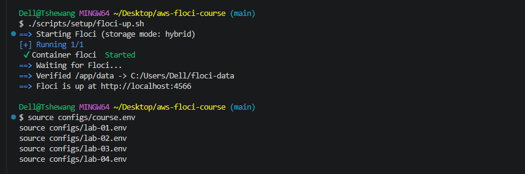


### Step 2: Probe which EKS support path the build offered

A read-only probe script was written and run. `aws eks list-clusters` answered and `kubectl` was installed, so the verdict was **Path A**. `k3d` was missing, which was acceptable on Path A.

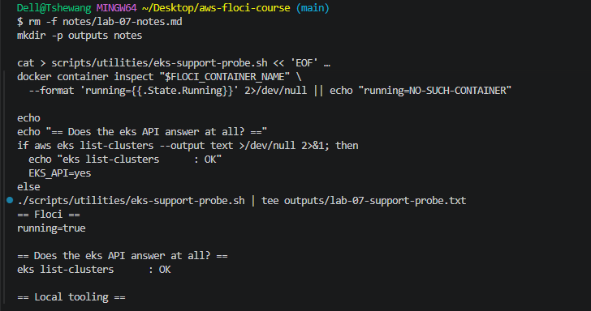
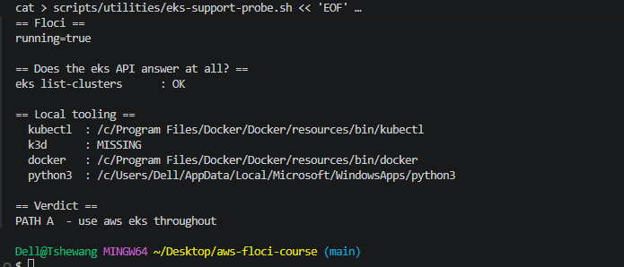


### Steps 3 and 4: Trust policies

Two trust policies were written. The cluster role trusted `eks.amazonaws.com`, and the node role trusted `ec2.amazonaws.com`. Both were validated as JSON and the principals were read back.

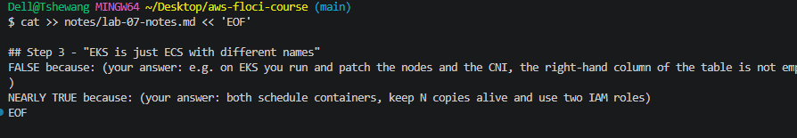

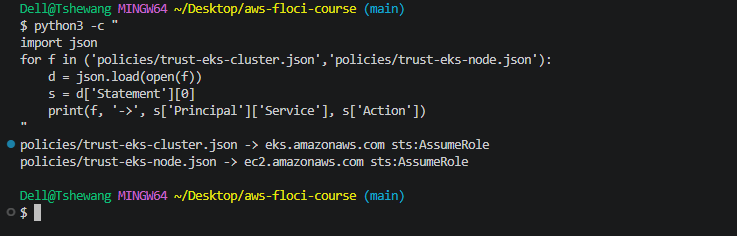
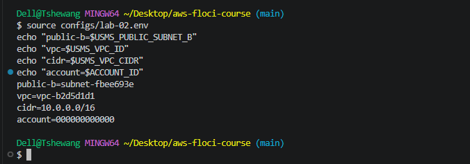

### Step 5: Permissions policies

Local stand-ins for the AWS managed policies were written. The cluster policy had three statements (network interfaces, load balancers, region deny). The node policy had five statements (EKS describe, VPC CNI, ECR pull, scoped log writes, region deny). Floci stored these policies but did not enforce them, so they were judged by reading.


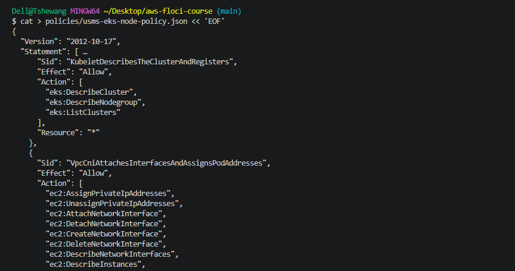
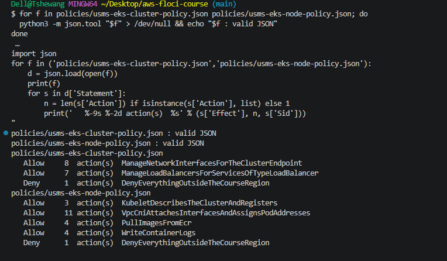

### Step 6: Cluster role and cluster security group

`usms-eks-cluster-role` was created and `USMSEKSClusterPolicy` was attached. A security group `usms-eks-cluster-sg` was created in `usms-vpc` and allowed TCP 443 from the VPC CIDR only, because it fronts an administrative API.


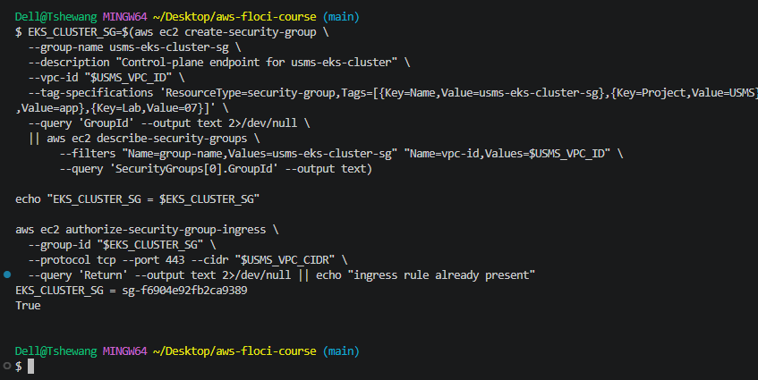
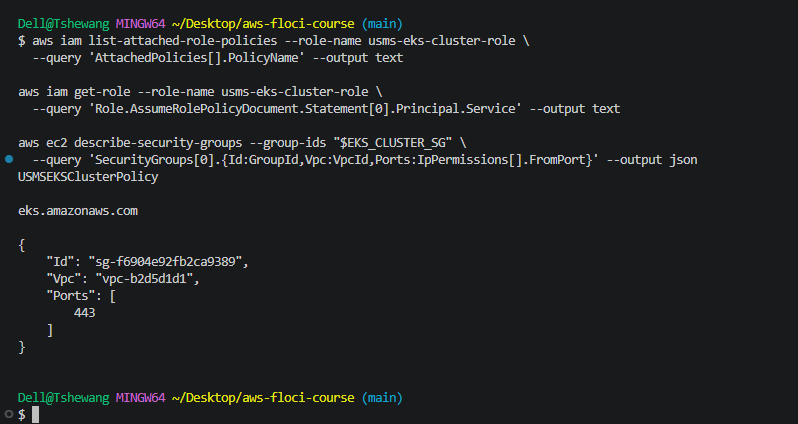

### Step 7: Node role and Lab 01 policy

`usms-eks-node-role` was created with `USMSEKSNodePolicy`, and Lab 01's `USMSStudentDataReadWrite` was attached unchanged. That policy then had three holders: `usms-ec2-app-role`, `usms-ecs-task-role` and `usms-eks-node-role`.


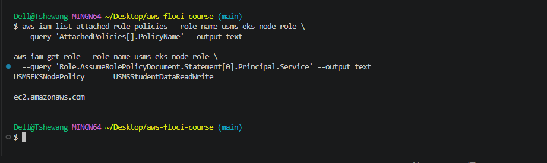

### Step 8: Create the cluster

The request body was generated with an unquoted heredoc so that real IDs were written into the file. Temporary credentials were obtained by assuming `usms-developer-role`, the cluster was created (status `CREATING`), and the normal identity was restored with `unset`. The `_lb_ports_` tag was set at creation, as Lab 08 requires.

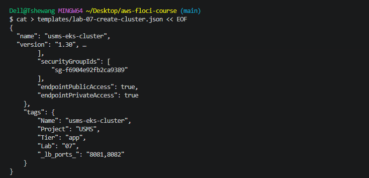
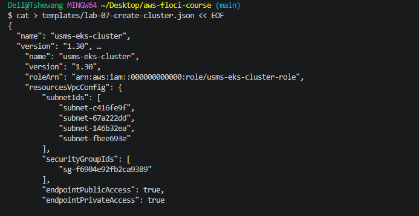


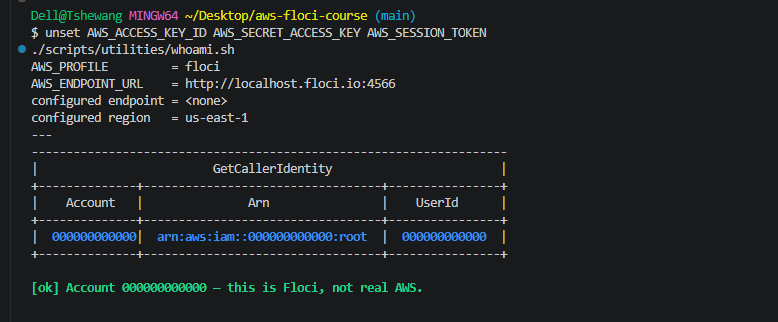

### Step 9: Wait for ACTIVE

The waiter completed and the cluster reached `ACTIVE`. `describe-cluster` showed four subnets, the correct VPC, the security group, the endpoint `https://localhost:6500`, and the tag `_lb_ports_=8081,8082`. The cluster also reported an OIDC issuer URL.

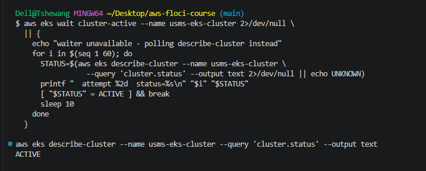
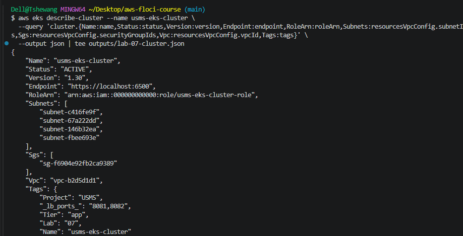

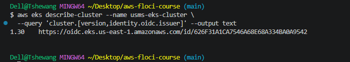

The OIDC issuer is the URL at which a cluster publishes the keys that verify its service-account tokens. IAM can trust it as an identity provider, which allows a pod to exchange its token for AWS credentials (IRSA).

### Step 10: Managed node group

The node group `usms-eks-nodes` was created in the two private subnets with min 2, max 4 and desired 2, the labels `workload=usms` and `tier=app`, and the node role. Floci returned `ACTIVE` immediately. The instance type `t3.small` was recorded but not provisioned.


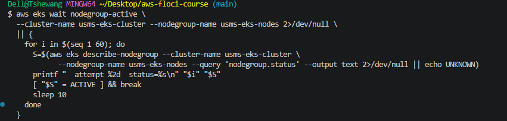


### Step 11: Connect kubectl

`aws eks update-kubeconfig` produced a kubeconfig, but the API server rejected the `aws eks get-token` credential. The workaround was to copy the cluster's own admin kubeconfig out of the k3s container, point it at `https://localhost:6500`, and store it in the git-ignored `outputs/` folder with `chmod 600` (see Issue 2). After this, `kubectl cluster-info` worked and one node was `Ready`.

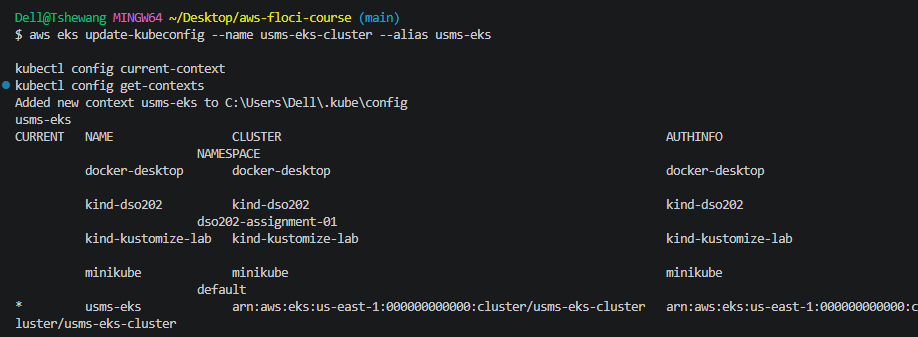


### Step 12: Namespace

The `usms` namespace was created and set as the context default. It was `Active` with the labels `project`, `tier` and `lab`.


### Step 13: usms-enrolment

A shared ConfigMap, then the enrolment ConfigMap, Deployment (2 replicas, `maxUnavailable: 0`, CPU request 50m, readiness and liveness probes) and ClusterIP Service were applied. The rollout succeeded, two endpoints appeared, and a test request returned JSON containing the pod name, node name and version.

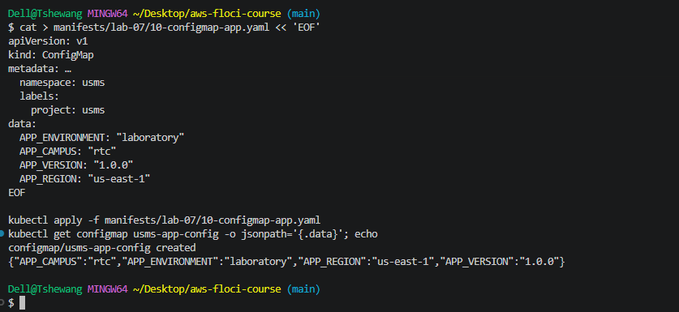
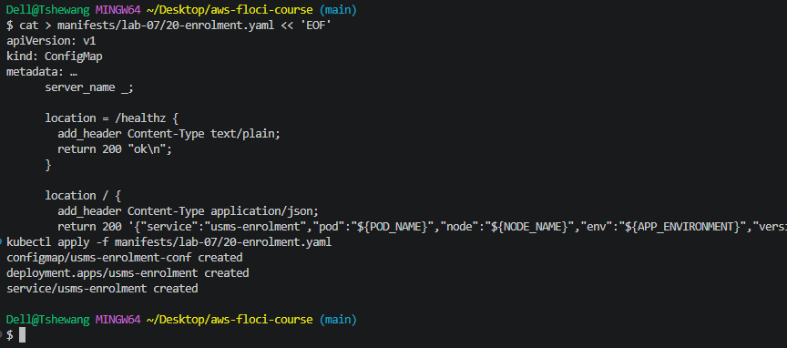
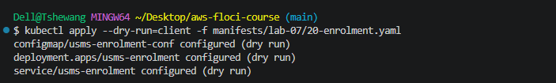
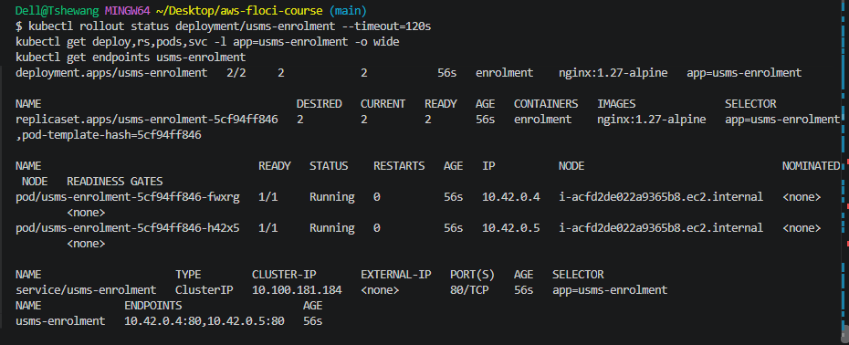


### Step 14: usms-results

The results service was deployed with the default rolling-update strategy (25%), no liveness probe, and `APP_CAMPUS` in its response. Both Deployments were 2/2, with `MAXUNAVAIL` of `0` for enrolment and `25%` for results.

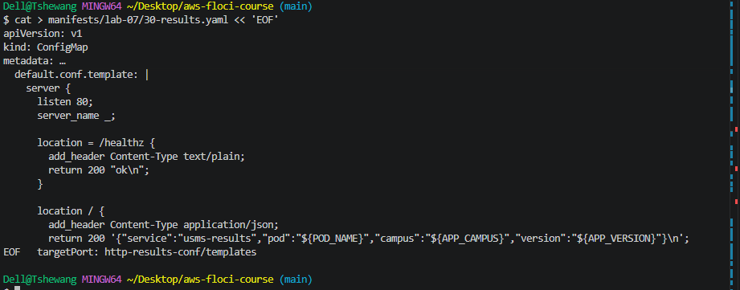
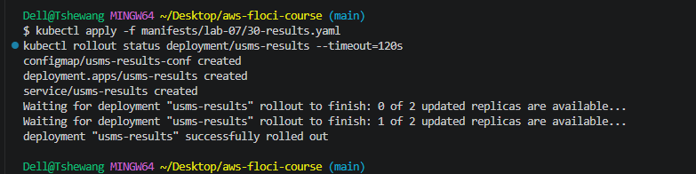
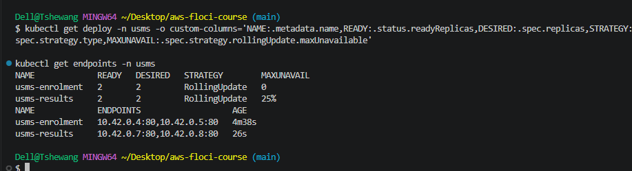

### Step 15: Gateway

The gateway was deployed after both backends existed, because nginx resolves `proxy_pass` hostnames only at start-up. Five pods were `Running` and the log showed no errors.

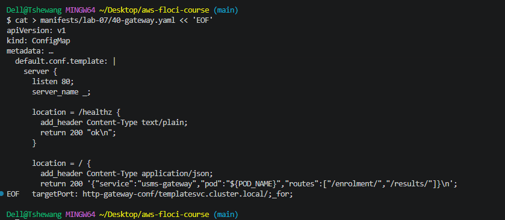


### Step 16: Service discovery

DNS lookups returned ClusterIPs (`10.100.181.184` and `10.100.168.192`) through CoreDNS, not pod addresses. Requests through the gateway reached both backends. Twelve requests were split 8 and 4 between two enrolment pods. One enrolment pod was then deleted, and a replacement appeared within seconds. The event log showed `SuccessfulCreate` from the **ReplicaSet**, so the ReplicaSet, not the Deployment, replaced it.


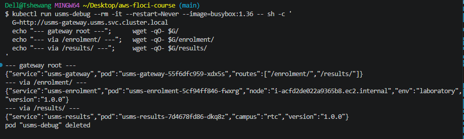
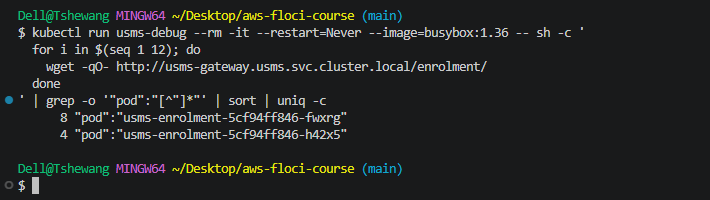
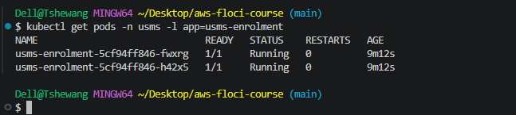


### Step 17: ConfigMaps and Secrets

A Secret was generated into the git-ignored `outputs/` folder rather than `manifests/`, so that even dummy credentials stayed out of Git history. Decoding the stored value showed that base64 is an encoding, not encryption. The Secret was consumed by the enrolment Deployment, which caused a new rollout, and the container then held four `APP_*` and two `ENROLMENT_*` variables.


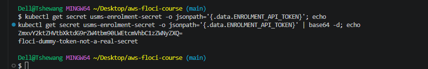
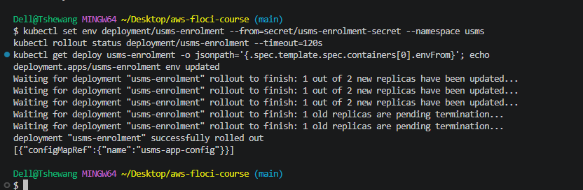
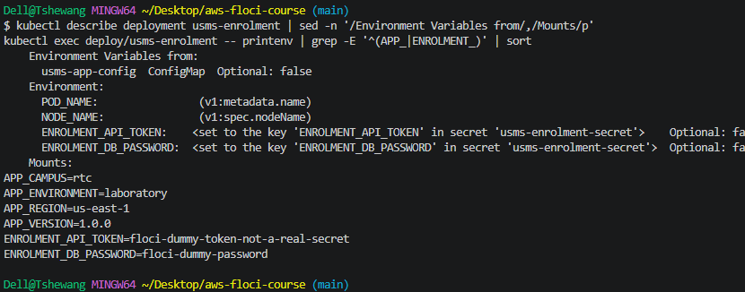

On this kubectl version, `kubectl set env --from=secret/...` expanded the Secret into individual `env` entries instead of adding a `secretRef`. The result was the same.

### Step 18: Rolling update and rollback

The ConfigMap was changed to `1.1.0`. The running pods still reported `1.0.0`, which showed that updating a ConfigMap does not restart pods. `rollout restart` created a new ReplicaSet and the response changed to `1.1.0`. `rollout undo` reverted the pod template, but the response still said `1.1.0`, because rollback does not revert the ConfigMap. The ConfigMap was then restored to `1.0.0`.

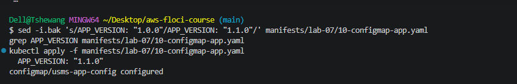
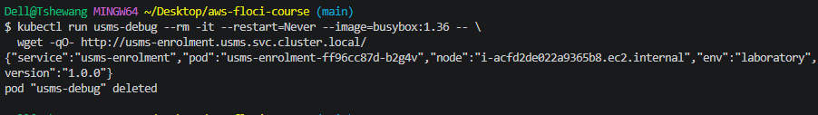
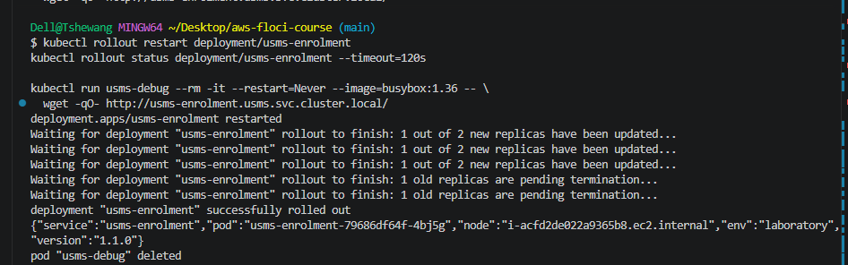


An image-tag change on `usms-results` to `nginx:1.27` stalled: the image could not be pulled within 120 seconds. The old pods kept serving, and `rollout undo` restored `nginx:1.27-alpine`. The history then showed two revisions.


### Step 19: Deliberate failures

Three failures were produced and diagnosed with `describe`, `logs` and events.

| Failure | Symptom | Cause |
| --- | --- | --- |
| Bad image tag | `ImagePullBackOff`; the two old pods kept serving | The tag did not exist |
| Oversized pod | `Pending`, `FailedScheduling` (`0/1 nodes`) | CPU and memory requests larger than the node |
| Crashing container | `Error`, exit code 1, log line `fatal: no database configured` | Container exited immediately |


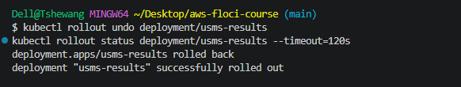
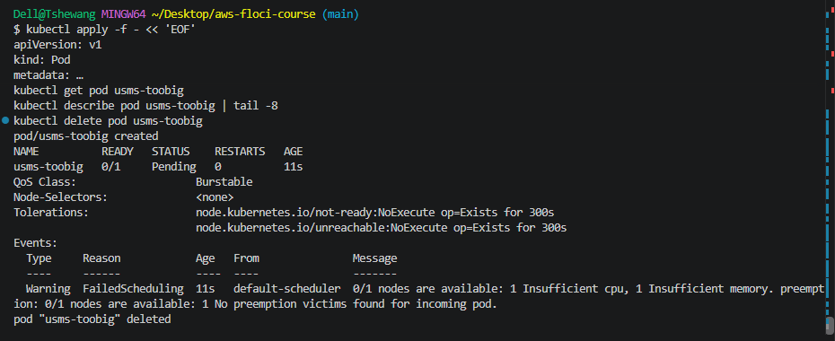

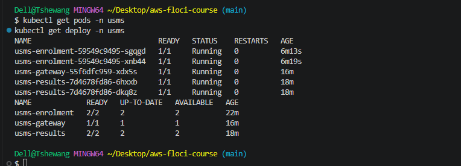

### Step 20: ECS and Kubernetes compared

ECS service `usms-enrolment-svc` had desired 2, running 2, one load balancer and task definition `usms-enrolment:2`. The Kubernetes side had three Deployments and three ClusterIP Services.

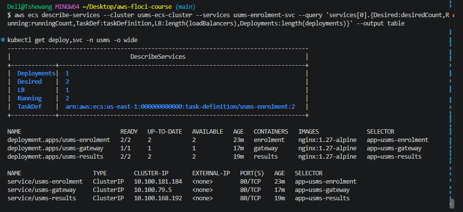

| Question | ECS | Kubernetes |
| --- | --- | --- |
| What holds the container spec? | Task definition revision | Pod template in the Deployment |
| What keeps N copies alive? | ECS service scheduler | ReplicaSet |
| What gives it a stable name? | Service and load balancer DNS | Service ClusterIP and DNS name |
| How does another service find it? | Load balancer or service discovery | `<service>.<namespace>.svc.cluster.local` |
| What does a rolling update create? | A new ECS deployment | A new ReplicaSet |
| Where does rollback state live? | Earlier task definition revisions | Old ReplicaSets kept at 0 replicas |
| Which IAM role does the app use? | Task role | Node role (pod-level via IRSA on real AWS) |
| What changes to move to another cloud? | Almost everything | Manifests move; IAM, VPC, node groups and load-balancer annotations do not |

### Step 21: IRSA

The cluster exposed an OIDC issuer, and IAM accepted the provider registration (`list-open-id-connect-providers` returned the same ARN). The ServiceAccount `usms-enrolment-sa` was created. IRSA could not be completed end to end: no web-identity role was written, no pod-identity webhook was present in the k3s cluster, and STS could not fetch a discovery document from a non-public issuer. IRSA was therefore treated as conceptual on this build.


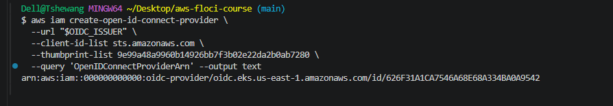
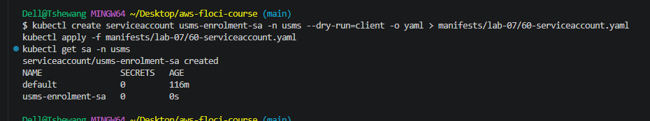


### Step 22: Persistence across a Floci restart

State was recorded, Floci was stopped and started, and everything was re-derived from the API. The cluster and node group were found through `list-clusters` and `list-nodegroups`. The namespace, all Deployments and all ConfigMaps survived. The Floci log showed `Restoring k3s container` and `Adopted surviving k3s container ... on port 6500`. However, the cluster status stayed `CREATING` for more than five minutes (see Issue 5).


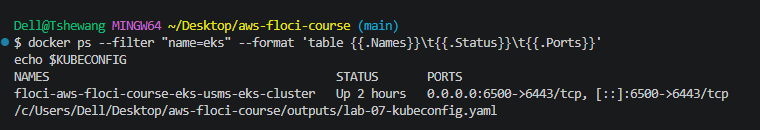
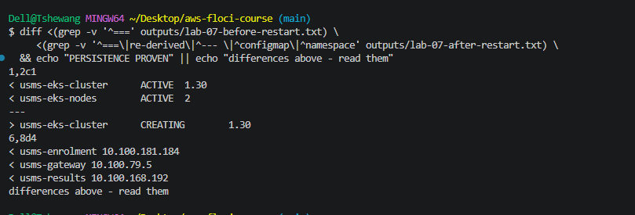

### Step 23: Environment file

`configs/lab-07.env` was written with 21 exports and no empty values. It was rewritten in three smaller parts after a paste corrupted the first version. `USMS_EKS_CLUSTER_STATUS` was recorded as `CREATING`, matching what was observed.


### Step 24 and Section 8: Commit and verification

The work was committed (16 files), and `git ls-files | grep -c '^outputs/'` returned `0`, so no kubeconfig or Secret was tracked. `verify-lab-07.sh` was then run. With `KUBECONFIG` set, the result was **PASS=29, FAIL=1**. The single failure was `cluster usms-eks-cluster is ACTIVE`.

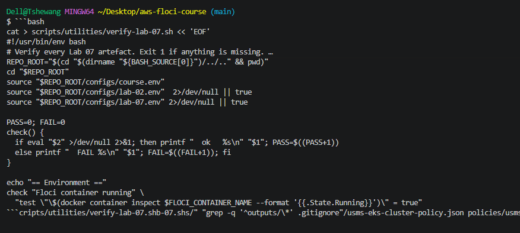
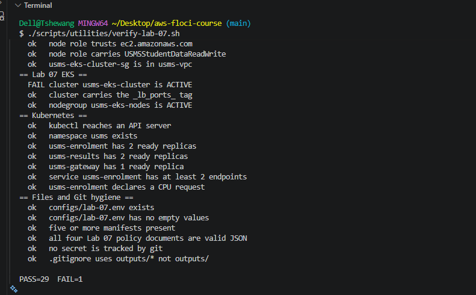

---

## 6. Issues Encountered and Resolutions

| # | Issue | Cause | Resolution |
| --- | --- | --- | --- |
| 1 | `USMS_PUBLIC_SUBNET_B` was empty, and one Lab 02 check failed | The second public subnet had been created as `usms-public-subnet-c` in us-east-1c, so the env file never recorded it | Confirmed it was routed to an internet gateway, then set `USMS_PUBLIC_SUBNET_B=subnet-fbee693e`. A duplicate `public-a` subnet was noticed and left alone |
| 2 | `kubectl` returned "must be logged in" | The k3s API server did not accept `aws eks get-token` credentials | Copied `k3s.yaml` from the k3s container, set the server to `https://localhost:6500`, stored it in git-ignored `outputs/` with `chmod 600` |
| 3 | Only one node registered | Floci runs one k3s container, so `t3.small` and the 2-node group exist only in the AWS API | Continued; pods scheduled on the single node. Failure 2 showed `0/1 nodes` instead of `0/3` |
| 4 | `usms-results` image roll to `nginx:1.27` timed out | The image could not be pulled in time | Old pods kept serving; `rollout undo` recovered. This matched Failure 1 |
| 5 | Cluster stayed `CREATING` after restart | Floci re-adopted the k3s container but never promoted the cluster status. Nodegroup stayed `ACTIVE` and Kubernetes was healthy | Did not recreate the cluster. Recorded the status honestly in the env file and notes |
| 6 | Long heredoc pastes were garbled in Git Bash, including the verify script | Terminal paste handling spliced lines together | Wrote long files in smaller parts and checked with `bash -n`, `cat` and `python3 -m json.tool` |
| 7 | Seven Kubernetes checks failed in the first verify run | A new terminal had lost `KUBECONFIG` | Exported `KUBECONFIG` and reran, giving PASS=29 |


---

## 7. Reflection

**What I learned.** The main lesson was how EKS divides responsibility. The control plane has its own identity (the cluster role), and the nodes have another (the node role). Writing the trust policies by hand showed me why a node role that trusts `eks.amazonaws.com` is the most common mistake. I also learned that a healthy cluster with no nodes runs nothing, and that Kubernetes objects form a chain: a Deployment owns ReplicaSets, and a ReplicaSet owns pods. Deleting a pod proved this, because the ReplicaSet replaced it, not the Deployment and not me.

**What surprised me.** Updating a ConfigMap did not change the running pods, and rolling back a Deployment did not roll back the ConfigMap. It is easy to assume that a rollback returns everything to the previous state, and that is not true when configuration lives in a separate object. Decoding a Secret with one `base64 -d` command also changed how I think about Secrets. They keep a value out of the image, but they are not encryption.

**What did not work, and what I did about it.** Several things differed from the lab text. `aws eks update-kubeconfig` did not work, so I took the cluster's own kubeconfig. Only one node registered. IRSA could not complete. The cluster status stayed `CREATING` after a restart. In each case I checked the evidence before acting. For example, the Floci log showed that the k3s container had been adopted, so I did not recreate the cluster, which would have wasted the work from Steps 8 to 22. I recorded the deviations in my notes rather than changing the expected output to match.

**Security observations.** The node role gave every pod on a node the same S3 permissions, which is coarse. IRSA is the finer alternative, and understanding why it matters was the purpose of Step 21. I kept the kubeconfig and Secret in the git-ignored `outputs/` folder and confirmed with `git ls-files` that none were tracked. Floci stored the IAM policies without enforcing them, so I could only judge them by reading, which is a limit of the emulator.

**ECS and Kubernetes.** Both keep N copies alive, roll updates, and use two IAM identities. Kubernetes exposed far more of the machinery (DNS, ReplicaSets, probes, nodes), which gave more control but more to learn and operate. For USMS at its present size, ECS with Fargate would be simpler to run, because the data plane is nearly empty. Kubernetes would be a better choice if the team wanted portable manifests or a richer ecosystem.

**What I would do differently.** I would keep one terminal session open for the whole lab and export `KUBECONFIG` at the start. I would write long files in small parts from the beginning, to avoid corrupted pastes. I would also copy the env file only after confirming every value was true, so that Lab 08 would not read a wrong cluster status.

**Open item.** At the last check the cluster status still read `CREATING`, so `verify-lab-07.sh` reported one failure. Lab 08 reads `USMS_EKS_CLUSTER_STATUS`, so this should be rechecked, and the env file updated if the status settles to `ACTIVE`.

---

## 8. Conclusion

The EKS cluster, node group, IAM roles, security group, namespace and three microservices were created and verified on Floci. Service discovery, rolling updates, rollback and three failure modes were demonstrated, and Kubernetes state survived a Floci restart. The deviations (single node, kubeconfig workaround, incomplete IRSA, and the `CREATING` status after restart) were documented rather than hidden. The final verification result was PASS=29 and FAIL=1.