# Lab 12: CI/CD Image Build, ECR Registry and ECS Deploy Stage

## 1. Aim / Objective

The objective of this practical was to extend an existing CI/CD pipeline so that it could build a container image, store it in Amazon ECR, and deploy it to an Amazon ECS service. The specific goals were:

- To create an ECR repository, push an image to it by hand, and prove the push by pulling the image back by digest.
- To register an ECS task definition revision derived from an existing one, and deploy it to the service.
- To extend the IAM policies `USMSCodeBuildBase` and `USMSCodePipelineBase` to version 2 with least-privilege permissions.
- To enable Docker builds in CodeBuild and extend the buildspec to produce `imagedefinitions.json`.
- To add a Deploy stage to AWS CodePipeline, run a rollback drill, and design a blue/green deployment on paper.

## 2. Introduction

This practical used four connected AWS services. Amazon ECR is a managed container registry that stores, versions and secures container images. Amazon ECS runs those containers as tasks and services, handling placement, rolling deployments and health. AWS CodeBuild compiles and packages code in a managed build container, and AWS CodePipeline orchestrates source, build and deploy stages into one automated workflow. Together they let a team move a code change into a running application without manual steps, with every stage permissioned through IAM roles. This automation is central to cloud computing because it makes releases repeatable, auditable and fast. Typical applications include web and API back ends, microservices, and any workload released frequently.

## 3. Use Case

- Releasing a containerised web application (here, the USMS enrolment portal served by nginx) automatically whenever the source version changes.
- Storing versioned, scannable container images in a private registry using Amazon ECR.
- Running and updating long-lived services with rolling deployments on Amazon ECS.
- Controlling what an automated pipeline may do, using scoped IAM policies and `iam:PassRole` conditions.
- Reducing release risk with rollback procedures and blue/green deployments using CodeDeploy.

## 4. System Architecture / Design

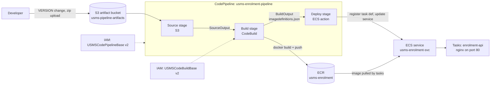
.png>)

**Data flow:** the developer changes `VERSION` and uploads the source zip to S3. CodePipeline's Source stage picks it up and passes `SourceOutput` to CodeBuild. CodeBuild builds the image, pushes it to ECR, and writes `imagedefinitions.json` into `BuildOutput`. The Deploy stage reads that file, registers a new task definition revision, and updates the ECS service. The dotted lines show the IAM policies that bound what each component was allowed to do.

## 5. Implementation Procedure

1. **Started Floci and checked state.** Ran the storage check and read Lab 11's readiness file.
2. **Sourced all earlier lab environments.** Confirmed that no required variable was missing.
3. **Probed deployment support.** Docker, ECR and ECS all answered, so the lab ran on Path A. CodeDeploy was treated as conceptual.
4. **Published ECR ports 5100 to 5104.** Backed up `docker-compose.yml`, uncommented one line, recreated the container, and confirmed no resources were lost.
5. **Created the ECR repository** `usms-enrolment` and read its URI from the API.
6. **Authenticated Docker** to the registry through standard input.
7. **Wrote the Dockerfile and `.dockerignore`** so the image shipped only the built `dist/` output.
8. **Built, tagged and pushed** image r6.
9. **Proved the image was in the registry** with `describe-images`, then deleted local copies and pulled it back by digest.
10. **Registered task definition revision 3** by describing revision 2, removing read-only fields, and changing only the image.
11. **Deployed revision 3 by hand** with `update-service`, using a polling watcher script.
12. **Created `USMSCodeBuildBase` v2**, adding ECR push permissions and `ecr:GetAuthorizationToken` on `*`.
13. **Enabled `privilegedMode`** on the CodeBuild project and added `IMAGE_REPO_URI`.
14. **Extended the buildspec** to build and push the image and write `imagedefinitions.json`. Added an eighth smoke test, ran it locally, and uploaded the source.
15. **Created `USMSCodePipelineBase` v2** with six statements, including `PassRole` for the two ECS roles to `ecs-tasks.amazonaws.com`.
16. **Added the Deploy stage** by reading the pipeline, appending the stage with a guarded script, and calling `update-pipeline` with the full three-stage document.
17. **Ran the pipeline end to end** with release r7, and recorded the before and after task definitions as evidence.
18. **Ran the rollback drill.** Registered r8 (an image that was never pushed), observed the failure mode, rolled back to revision 4, and restored `VERSION` to r7.
19. **Wrote blue/green documents** (`appspec.yaml` and a deployment group definition) and validated them without executing them.
20. **Recorded outputs** in `configs/lab-12.env`.
21. **Committed** the work to Git after reviewing `git status`.

## 6. Results and Evidence

### 6.1 CLI / SDK Output

**Environment and probe (Steps 1 to 3)**

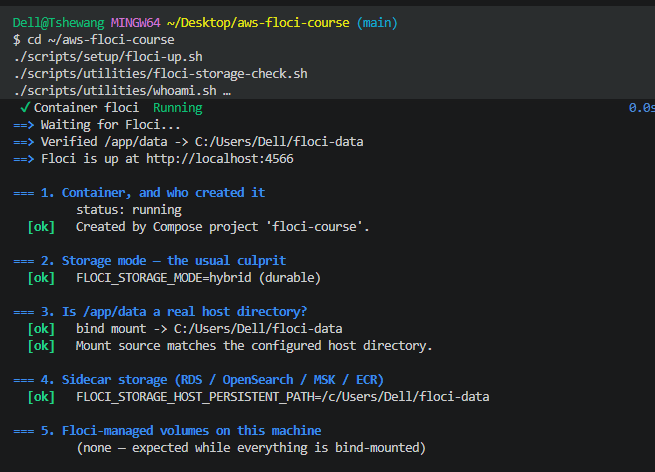
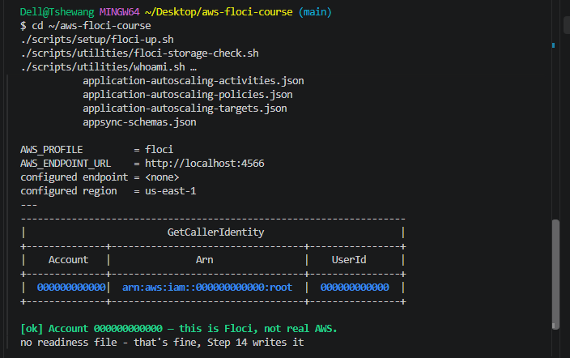
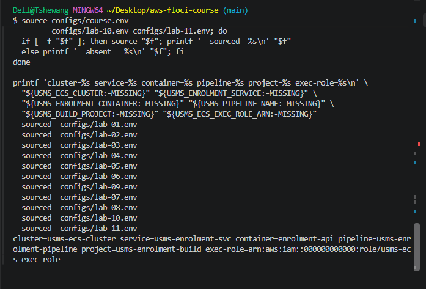
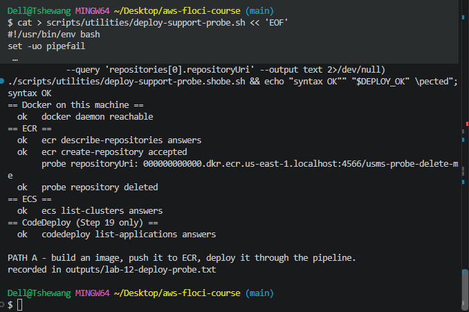

**ECR repository and Docker login (Steps 4 to 6)**

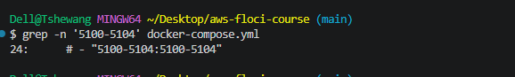
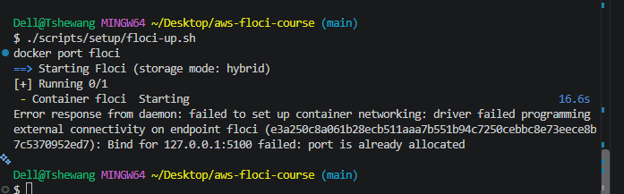
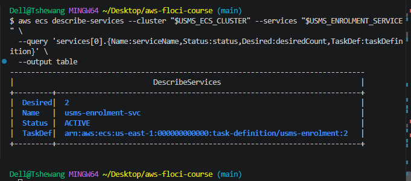
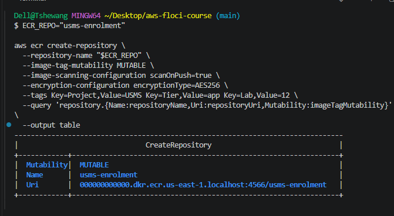
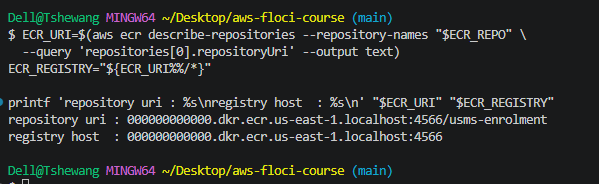
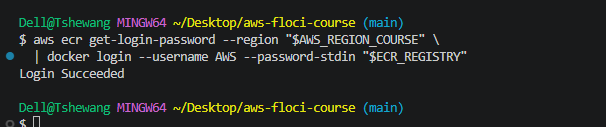

**Image build, push and proof (Steps 7 to 9)**

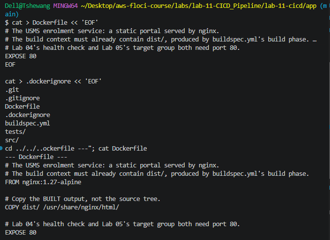
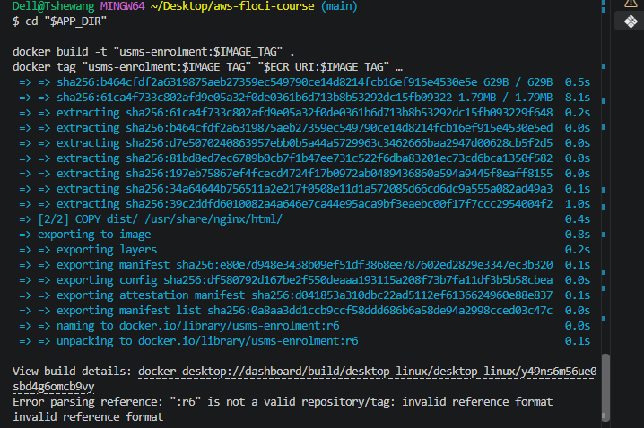
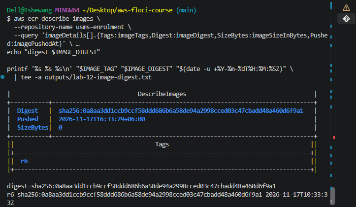
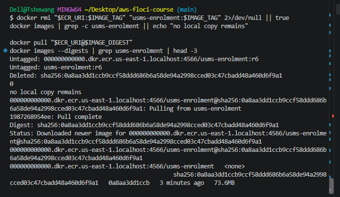

**Task definition and manual deploy (Steps 10 and 11)**

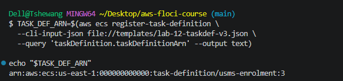
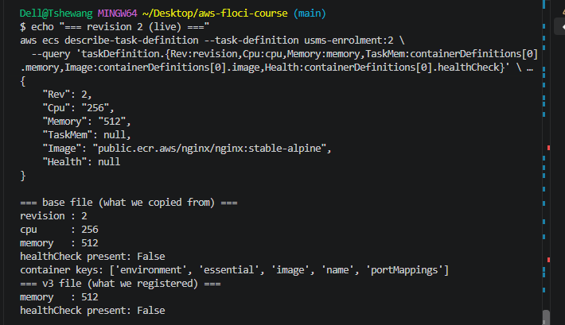
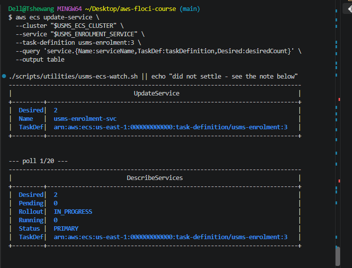
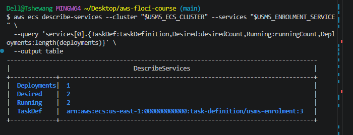

**IAM policy version 2 and CodeBuild (Steps 12 and 13)**

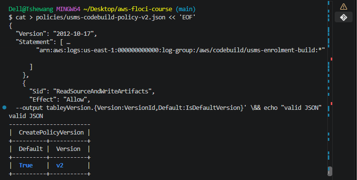
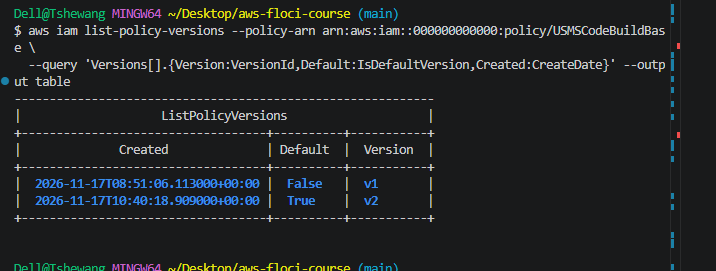
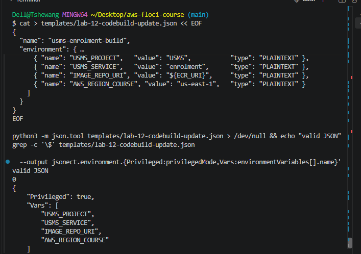
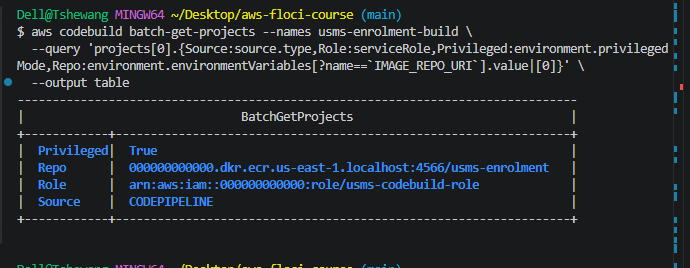

**Buildspec and pipeline (Steps 14 to 16)**

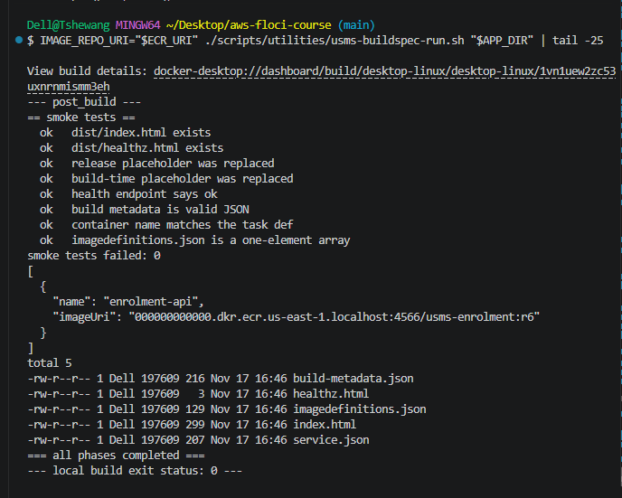
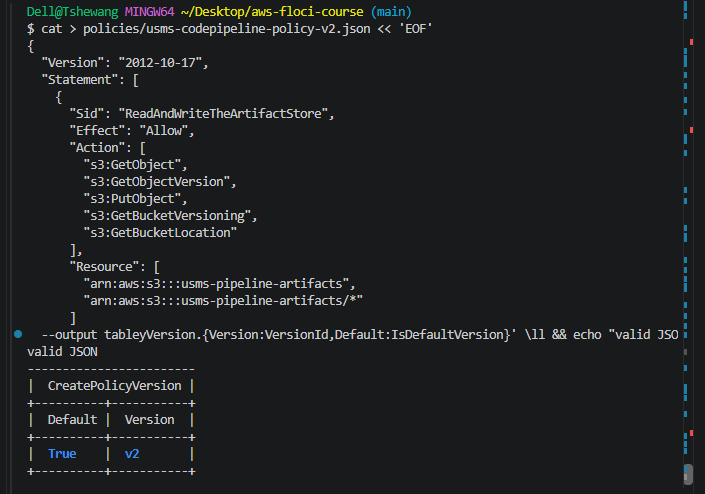
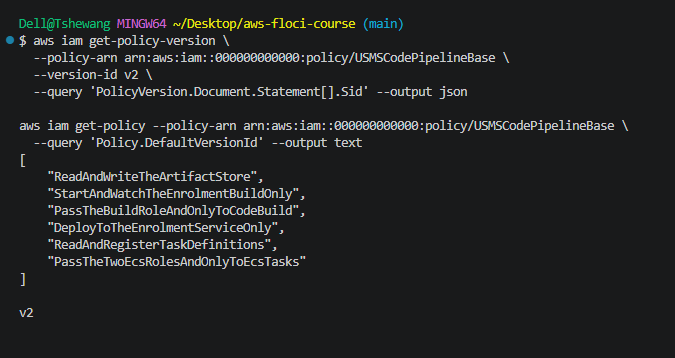
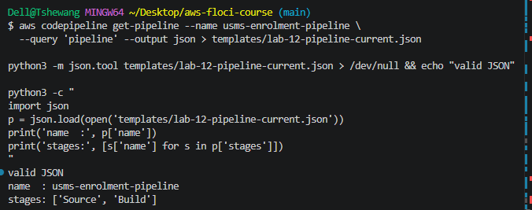
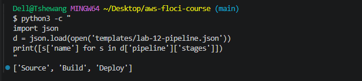
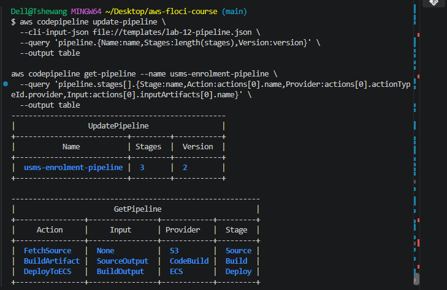

**End-to-end run and rollback (Steps 17 and 18)**

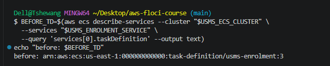
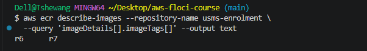
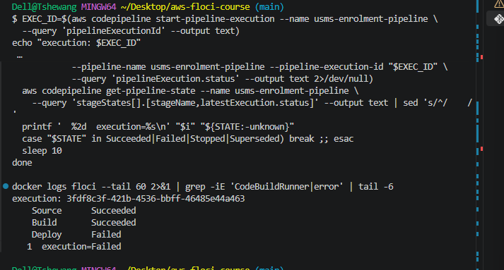
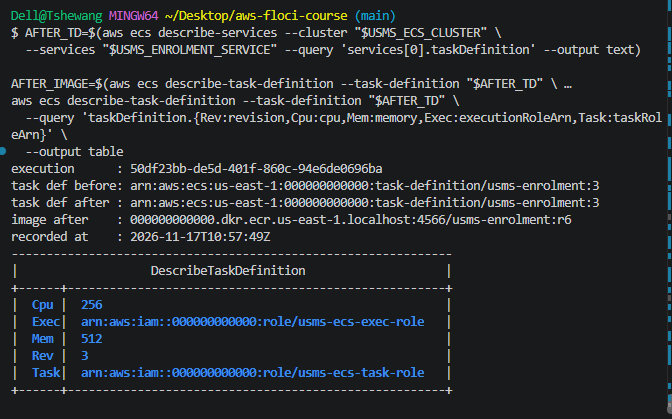
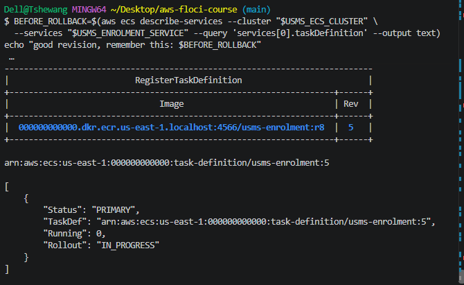
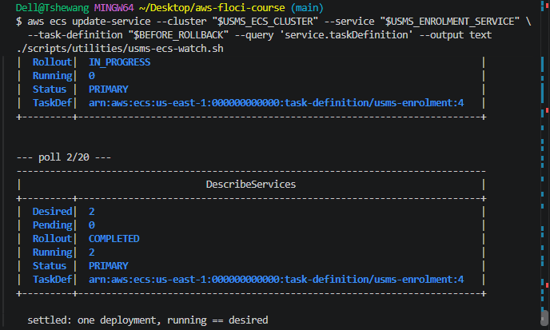

**Conceptual documents and outputs (Steps 19 and 20)**

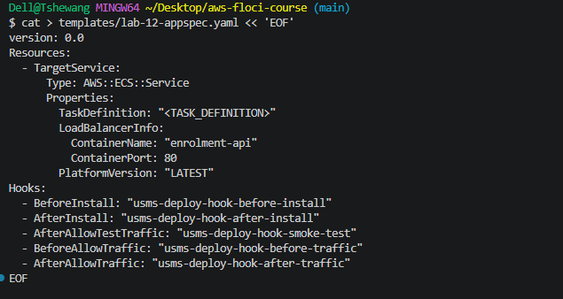
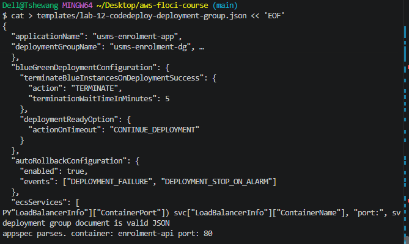
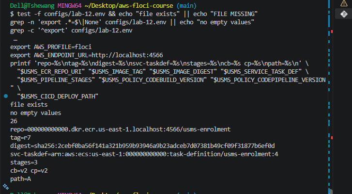

**Final verification**

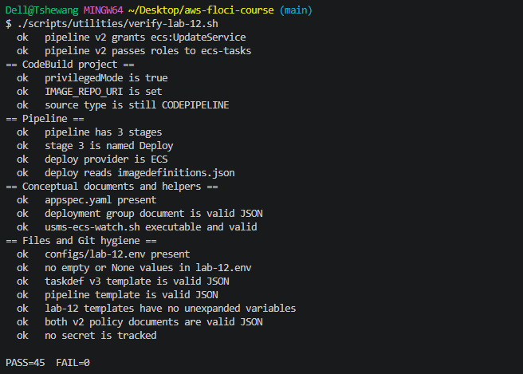

### 6.2 AWS Management Console Verification

This practical ran against Floci, a local emulator that exposes AWS APIs but has no AWS Management Console, so console screenshots were not possible. Verification was done by reading each resource back through the AWS CLI instead. Each read-back below confirmed the matching console view that real AWS would show.

| Resource | What the read-back confirmed | Evidence |
|---|---|---|
| ECR repository and images | Repository `usms-enrolment` held tags r6 and r7 with digests (the console's Images tab) | `../../screenshots/lab12/image-8.png`, `../../screenshots/lab12/image-16.png`, `../../screenshots/lab12/image-52.png` |
| ECS service | The service moved to `usms-enrolment:3`, then to the later revisions (the console's Deployments tab) | `../../screenshots/lab12/image-26.png`, `../../screenshots/lab12/image-55.png` |
| ECS task definition | Revision 3 matched revision 2 except for the image (the console's Task definitions page) | `../../screenshots/lab12/image-22.png` |
| IAM policies | `USMSCodeBuildBase` and `USMSCodePipelineBase` both had v2 as the default version | `../../screenshots/lab12/image-30.png`, `../../screenshots/lab12/image-44.png` |
| CodeBuild project | `privilegedMode` was true and the source was still CODEPIPELINE | `../../screenshots/lab12/image-34.png` |
| CodePipeline | The pipeline had three stages: Source, Build and Deploy | `../../screenshots/lab12/image-48.png` |

## 7. Analysis and Discussion

**What was achieved.** I built a full path from a source change to a registered, deployed task definition. I pushed and verified a container image, created two IAM policy versions, enabled Docker builds in CodeBuild, and added a Deploy stage to the pipeline. I also completed a rollback drill and designed a blue/green deployment. The final verification script reported **PASS=45 FAIL=0**.

**Did the results match the expected outcome?** Mostly. Path A was confirmed and the image, task definition, IAM and pipeline checks all behaved as the lab described. There were two differences. In this environment the pipeline's Deploy stage did not carry out the deployment on its own, so revision 4 was registered by hand. Also, the circuit breaker was stored but not enforced, as the lab had warned.

**Errors encountered and how they were resolved.**

| Issue | Cause | Resolution |
|---|---|---|
| First verification run: PASS=44 FAIL=1 (`memory is still 1024`) | Lab 04 had registered the task definition with 512 MB, not 1024. All revisions (2 to 5) carried 512 | Read the real value with `describe-task-definition` and ruled out a Git Bash carriage-return problem (the `cpu` check used the same pattern and passed). Changed the check to expect 512 |
| Revision 5 named a never-pushed image (r8) | It was created on purpose in the rollback drill | Rolled the service back to revision 4 and deregistered revision 5 |
| Shell variables were lost between steps | Variables such as `ECR_URI` only live in one terminal | Re-ran the variable block before each dependent step |

**Observations.**

- A tag can move but a digest cannot, so pulling by digest was the real proof of what was stored.
- Deriving a task definition from an existing one preserved CPU, memory, roles and logging. Writing one from memory would have risked dropping fields.
- `update-pipeline` replaces the whole document, so a partial document would have deleted the Source and Build stages silently.
- After the rollback drill, the service pointed at a missing image and nothing raised an alert. This showed that a deployment mechanism needs a health signal to be able to roll back.

## 8. Reflection

**1. What did you learn about this AWS service?**  
I learned how ECR, ECS, CodeBuild and CodePipeline fit together, and how the artifact chain carries data between stages: `SourceOutput` to `BuildOutput`, with `imagedefinitions.json` as the contract between Build and Deploy. I also learned that IAM needs a separate `PassRole` permission for each service that receives a role, and that `ecr:GetAuthorizationToken` can only be granted on `*`.

**2. What challenges did you encounter?**  
Keeping shell variables alive across steps was a recurring problem. The pipeline's Deploy stage also did not complete a deployment on the emulator, which meant doing part of the work by hand. The memory mismatch showed that the lab text assumed a value my environment did not have, and I had to investigate rather than accept the expected output.

**3. How would you apply this service in a real-world cloud environment?**  
I would use the same pattern for any containerised application: a private ECR repository with immutable tags, a pipeline that builds on every change, and an ECS service that deploys by task definition revision. I would pin deployments to image digests, use IAM policies scoped to single resources, and add health checks and alarms so that rollbacks trigger automatically.

**4. What additional concepts or features would you like to explore?**  
I would like to try blue/green deployments with CodeDeploy on real AWS, the deployment circuit breaker under a genuine failure, ECR image scanning and lifecycle policies, and defining the whole pipeline as code with CloudFormation, which the next lab covers.

## 9. Conclusion

The practical achieved its objectives. I built and verified a container image in ECR, deployed it to an ECS service, extended two IAM policies to version 2, enabled Docker builds in CodeBuild, added a Deploy stage to the pipeline, rehearsed a rollback, and specified a blue/green design. Final verification passed all 45 checks. Two parts were limited by the emulator: the pipeline's own deployment and the circuit breaker. Both are described honestly in the discussion above.

The key concepts were the difference between tags and digests, deriving task definitions instead of rewriting them, the replace-only behaviour of `update-pipeline`, and the importance of a health signal for rollback. The skills developed were CLI-driven deployment, IAM policy versioning, buildspec authoring, and checking real values against expected ones. These services matter because they turn a code change into a running, auditable release, and they are the foundation of reliable delivery in modern cloud environments.